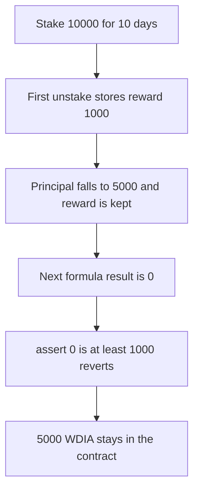

# DIA — a partial unstake makes the next unstake revert, and 5000 stays locked

> **Vulnerability classes:** vuln/dos/frozen-funds · vuln/logic/wrong-condition

> **Reproduction:** a self-contained Foundry PoC that compiles and runs offline
> with only `forge-std` — no fork and no RPC. Trace: [output.txt](output.txt).
> PoC: [test/57919-rewards-claiming-may-fail-due-to-potentially-decreasing-para_exp.sol](test/57919-rewards-claiming-may-fail-due-to-potentially-decreasing-para_exp.sol).

<!-- non-defihacklabs -->
<!-- source-auditvault: https://github.com/Auditware/AuditVault/blob/main/findings/57919-rewards-claiming-may-fail-due-to-potentially-decreasing-para.md -->
<!-- date: 2025-06 -->

---

## Key info

| | |
|---|---|
| **Impact** | **HIGH** — the second unstake reverts and **5,000 WDIA** of principal stays locked |
| **Protocol** | DIA `DIAWhitelistedStaking` |
| **Vulnerable code** | `assert(reward >= currentStore.reward)` |
| **Bug class** | Reward is recomputed from a smaller principal and compared to the old stored value |
| **Finding** | MixBytes — DIA Lumina Staking, June 2025 · id 57919 |
| **Report** | [Lumina Staking](https://github.com/mixbytes/audits_public/blob/master/DIA/Lumina%20Staking/README.md#2-rewards-claiming-may-fail-due-to-potentially-decreasing-parameters-used-in-calculation) |
| **Source** | [AuditVault finding](https://github.com/Auditware/AuditVault/blob/main/findings/57919-rewards-claiming-may-fail-due-to-potentially-decreasing-para.md) |
| **Status** | Triggered by a partial principal unstake, not by an admin rate change. |
| **Compiler** | solc 0.8.27, cancun, via IR |

---

## TL;DR

`getRewardForStakingStore` is `(rewardRatePerDay * passedDays * principal) / 10000`. `updateReward` asserts that this value is at least the reward already stored.

A stake of **10,000** that has already run **10 days** at **100** bps per day has a stored reward of **1,000**. `unstakePrincipal` of **5,000** pays that reward, cuts the principal in half, and does not clear `reward`. The next `unstakePrincipal` calls `updateReward`, the new calculation is **0**, and `assert(0 >= 1000)` reverts.

**5,000 WDIA** remains in the staking contract. The user was paid the first half plus the 1,000 reward and cannot take the rest.

The 10 days are two stored timestamps, `1` and `1 + 10 days`. `run()` does not warp.

## The vulnerable code

```solidity
function getRewardForStakingStore(uint256 stakingStoreIndex) public view returns (uint256) {
    // passedDays from the stored start and the stored request time
    return (rewardRatePerDay * passedDays * currentStore.principal) / 10000;
}

function updateReward(uint256 stakingStoreIndex) public {
    uint256 reward = getRewardForStakingStore(stakingStoreIndex);
    // @> VULN: a smaller principal makes this reward fall below currentStore.reward
    assert(reward >= currentStore.reward);
    currentStore.reward = reward;
}
```

Both lines are the ones the report quotes.

## Root cause

The stored reward was computed on the old principal. Partial unstake reduces `principal` and leaves `reward` in place. The next claim runs the same formula on the new principal, gets a smaller number, and the assert treats that as a failure instead of as a new accrual.

## Preconditions

- Rate is 100, meaning 1% per day in basis points.
- The stake's stored interval is 10 full days, so the first reward is 1,000.
- The user unstakes 5,000 of a 10,000 principal, then tries to unstake the rest.

## Attack walkthrough

1. Put 11,000 WDIA on the staking contract and record a 10,000 stake.
2. First `unstakePrincipal(5000)` stores reward 1,000, pays 6,000, and leaves principal at 5,000.
3. `reward` is still 1,000. The start time is now this block, so a fresh calculation is 0.
4. Second `unstakePrincipal(5000)` reverts inside the assert.
5. The contract still holds 5,000 WDIA.

Control: the unstake pays from `getRewardForStakingStore` and does not assert against the old stored reward. The second call pays the remaining 5,000 and the contract balance is 0.

## Diagrams



## Impact

The staker cannot withdraw the remaining **5,000 WDIA**. The same assert blocks a later reward claim. The trigger here is the user's own partial unstake, which the report lists as one of the two ways the inputs of the formula decrease.

## Remediation

Do not assert the new accrual against the previously stored reward. Pay `getRewardForStakingStore` minus what was already paid, and clear or replace the stored reward when the principal changes.

## Sources

- [AuditVault finding 57919](https://github.com/Auditware/AuditVault/blob/main/findings/57919-rewards-claiming-may-fail-due-to-potentially-decreasing-para.md)
- [MixBytes DIA Lumina Staking, June 2025](https://github.com/mixbytes/audits_public/blob/master/DIA/Lumina%20Staking/README.md#2-rewards-claiming-may-fail-due-to-potentially-decreasing-parameters-used-in-calculation)
- [DIAWhitelistedStaking.sol at 50b70919](https://github.com/diadata-org/lumina-staking/blob/50b709199461ae48e3186d5a04cd22eff39ebcf5/contracts/DIAWhitelistedStaking.sol)

### Taxonomy

- `vuln/dos/frozen-funds` · `vuln/logic/wrong-condition`
