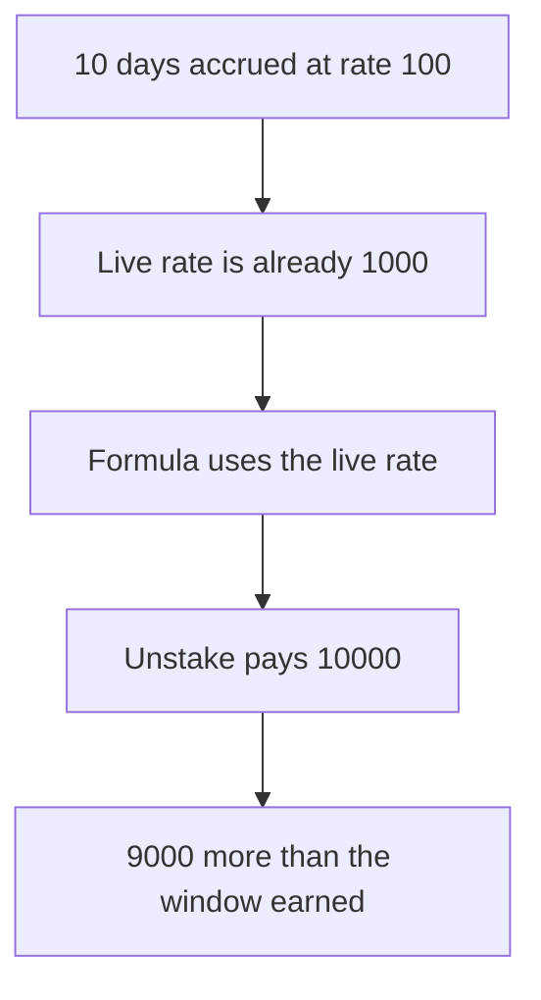

# DIA — unstake pays the live rate for days that accrued at the old rate

> **Vulnerability classes:** vuln/logic/reward-calculation

> **Reproduction:** a self-contained Foundry PoC that compiles and runs offline
> with only `forge-std` — no fork and no RPC. Trace: [output.txt](output.txt).
> PoC: [test/57921-incorrect-reward-calculation-when-reward-rate-changes-mixbyt_exp.sol](test/57921-incorrect-reward-calculation-when-reward-rate-changes-mixbyt_exp.sol).

<!-- non-defihacklabs -->
<!-- source-auditvault: https://github.com/Auditware/AuditVault/blob/main/findings/57921-incorrect-reward-calculation-when-reward-rate-changes-mixbyt.md -->
<!-- date: 2025-06 -->

---

## Key info

| | |
|---|---|
| **Impact** | **HIGH** — a 10-day window that earned **1,000** is paid **10,000 WDIA** |
| **Protocol** | DIA `DIAWhitelistedStaking` |
| **Vulnerable code** | `(rewardRatePerDay * passedDays * principal) / 10000` |
| **Bug class** | The current rate is applied to the whole stored window |
| **Finding** | MixBytes — DIA Lumina Staking, June 2025 · id 57921 |
| **Report** | [Lumina Staking](https://github.com/mixbytes/audits_public/blob/master/DIA/Lumina%20Staking/README.md#4-incorrect-reward-calculation-when-reward-rate-changes) |
| **Source** | [AuditVault finding](https://github.com/Auditware/AuditVault/blob/main/findings/57921-incorrect-reward-calculation-when-reward-rate-changes-mixbyt.md) |
| **Compiler** | solc 0.8.27, cancun, via IR |

---

## TL;DR

`getRewardForStakingStore` multiplies `passedDays` by whatever `rewardRatePerDay` is **now**. It does not remember the rate that was in force between `stakingStartTime` and the unstake request.

This stake's stored window is 10 days. That window accrued at **100** bps, which is **1,000 WDIA** on a 10,000 principal. The live rate is already **1,000**. The quote is `(1000 * 10 * 10000 ether) / 10000 = 10000 ether`. Unstake pays the whole **10,000** and empties a pool that was funded for the larger number. The overpayment is **9,000 WDIA**.

The 10 days are stored timestamps. `run()` does not warp. The rate change is prior state: the live rate is already the new one when the user unstakes.

## The vulnerable code

```solidity
uint256 passedDays = passedSeconds / (24 * 60 * 60);
// @> VULN: (rewardRatePerDay * passedDays * principal) / 10000 uses the live rate
return (rewardRatePerDay * passedDays * currentStore.principal) / 10000;
```

Two identical stakes unstaked on either side of a rate change receive different amounts. The report's fix is an accumulator updated before the rate changes.

## Root cause

The formula has one rate and one window. After `updateRewardRatePerDay` the old rate is gone, so every day in the window is repriced.

## Preconditions

- Principal is 10,000 and the stored window is 10 days.
- The rate during that window was 100. The live rate is 1,000.
- The reward pool holds 10,000 WDIA.

## Attack walkthrough

1. Open the 10-day stake.
2. Quote at the live rate. The quote is 10,000.
3. Unstake. The pool pays 10,000.
4. The same window at rate 100 is 1,000. The difference is 9,000 taken from the pool.

Control: the quote multiplies by the stored old rate. Unstake pays 1,000 and 9,000 stays in the contract.

## Diagrams



## Impact

The staker receives **10,000 WDIA** for a window that earned **1,000**. The extra **9,000** is reward inventory that belonged to the rate actually in force. A later decrease of the rate underpays the same window by the same mechanism.

## Remediation

Keep an accumulator of reward per unit of stake and update it before `rewardRatePerDay` changes. Pay `principal * (globalIndex - userIndex)`.

## Sources

- [AuditVault finding 57921](https://github.com/Auditware/AuditVault/blob/main/findings/57921-incorrect-reward-calculation-when-reward-rate-changes-mixbyt.md)
- [MixBytes DIA Lumina Staking, June 2025](https://github.com/mixbytes/audits_public/blob/master/DIA/Lumina%20Staking/README.md#4-incorrect-reward-calculation-when-reward-rate-changes)
- [DIAWhitelistedStaking.sol at 50b70919](https://github.com/diadata-org/lumina-staking/blob/50b709199461ae48e3186d5a04cd22eff39ebcf5/contracts/DIAWhitelistedStaking.sol)

### Taxonomy

- `vuln/logic/reward-calculation` · `vuln/logic/incorrect-calculation`
