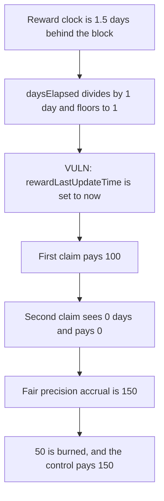

# DIA Lumina: a claim floors the partial day and moves the clock

> **Vulnerability classes:** vuln/logic/reward-calculation · vuln/arithmetic/precision-loss · vuln/logic/state-update

<!-- non-defihacklabs -->
<!-- source-auditvault: https://github.com/Auditware/AuditVault/blob/main/findings/57923-reward-accumulation-manipulation-through-frequent-claims-mix.md -->
<!-- date: 2025-06 -->

## Key info

| | |
|---|---|
| **Protocol** | DIA Lumina staking |
| **Finding** | MixBytes, AuditVault 57923 |
| **Vulnerable code** | `Staking._updateRewardAccumulator` |
| **Harm** | A stake open for 1.5 days is paid 100. The fair accrual is 150. The second claim in the same block pays 0. The burned amount is 50 |
| **Chain** | local synthetic |

## TL;DR

`daysElapsed` is `(block.timestamp - rewardLastUpdateTime) / 1 days`. A gap of 1 day and 12 hours floors to 1, so the accumulator adds one daily rate of 100. The function then sets `rewardLastUpdateTime = block.timestamp`, which deletes the 12 hours. A second claim sees a gap of 0 and pays 0. The recommended precision formula, `timeElapsed = gap * 1e18 / 1 days`, pays 150 for the same gap. The control pays that 150.

## The vulnerable code

```solidity
uint256 daysElapsed = (block.timestamp - rewardLastUpdateTime) / SECONDS_IN_A_DAY;
daysElapsedStored = daysElapsed;
rewardAccumulator += RATE * daysElapsed;
// @> VULN: the clock jumps to now even when the division dropped a partial day
this.commitClock(block.timestamp);
```

`commitClock` writes `rewardLastUpdateTime = nextClock` with `nextClock` equal to `block.timestamp`.

The fix advances the clock by `SECONDS_IN_A_DAY * daysElapsed` only, or scales the elapsed time by `1e18` before dividing.

## Root cause

Integer division drops every fraction of a day, and the clock is still moved to the current timestamp. The dropped fraction is not waiting in the gap for the next claim. Calling claim often, including twice at the same timestamp after a fractional day, keeps the floored total and never restores the remainder.

## Preconditions

The daily rate is 100 ether per 10000 of principal, and the stake's principal is 10000. The reward clock is `block.timestamp` minus 1 day and 12 hours. That gap is computed inside `run()`. `run()` does not warp. The staking contract holds 150 ether so the fair amount is funded. The Foundry test warps once before `run()`, to the same effect as the playground's fixed block timestamp.

## Attack walkthrough

1. The stake is opened with snapshot 0 and a clock 1.5 days behind the block.
2. The first claim floors the gap to 1 day, adds 100 to the accumulator, and sets the clock to now.
3. The staker is paid `100 * 10000 / 10000 = 100`.
4. `fairReward` uses the unfloored gap and returns 150.
5. The second claim divides a zero gap, adds nothing, and pays 0.
6. The staker's balance is 100. `burned` is 50.

The control multiplies the 1.5 day gap by the rate with 1e18 precision and transfers 150.

## Diagrams



## Impact

The staker receives 100 for 1.5 days of a 100-per-day rate. The other 50 never accrues, because the clock no longer covers it. Repeating the claim does not recover it. Every stake that shares this accumulator loses the same floored remainder.

## How to reproduce

```bash
cd 57923-reward-accumulation-manipulation-through-frequent-claims-mix_exp
forge test -vv
```

`run()` does not warp. The control test pays 150.

## Sources

- AuditVault finding: https://github.com/Auditware/AuditVault/blob/main/findings/57923-reward-accumulation-manipulation-through-frequent-claims-mix.md
- MixBytes report: https://github.com/mixbytes/audits_public/blob/master/DIA/Lumina%20Staking/README.md
- Reviewed tree: https://github.com/diadata-org/lumina-staking/blob/50b709199461ae48e3186d5a04cd22eff39ebcf5/contracts/DIAWhitelistedStaking.sol
