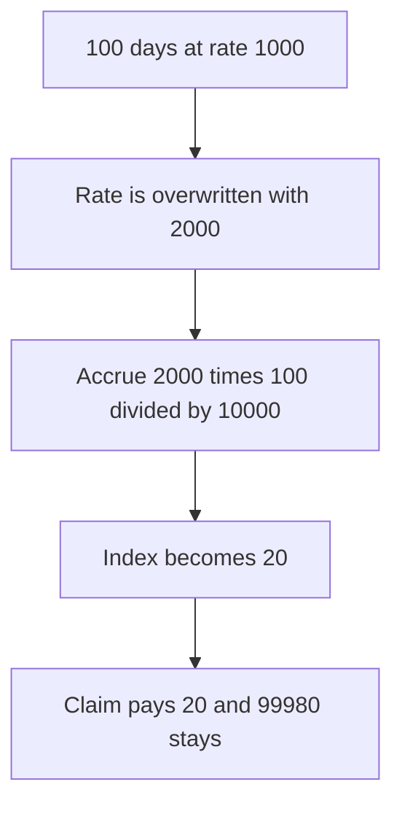

# DIA — updateRewardRatePerDay accrues 20 where the old rate accrued 100000

> **Vulnerability classes:** vuln/logic/reward-calculation · vuln/arithmetic/precision-loss

> **Reproduction:** a self-contained Foundry PoC that compiles and runs offline
> with only `forge-std` — no fork and no RPC. Trace: [output.txt](output.txt).
> PoC: [test/57924-incorrect-calculation-of-accrued-rewards-in-updaterewardrate_exp.sol](test/57924-incorrect-calculation-of-accrued-rewards-in-updaterewardrate_exp.sol).

<!-- non-defihacklabs -->
<!-- source-auditvault: https://github.com/Auditware/AuditVault/blob/main/findings/57924-incorrect-calculation-of-accrued-rewards-in-updaterewardrate.md -->
<!-- date: 2025-06 -->

---

## Key info

| | |
|---|---|
| **Impact** | **HIGH** — a 10,000 principal is paid **20 WDIA** instead of **100,000** |
| **Protocol** | DIA `DIARewardsDistribution` |
| **Vulnerable code** | `rewardsAccrued = (rewardRatePerDay * daysElapsed) / 10000` |
| **Bug class** | Accrual uses the new rate and divides by 10,000 too early |
| **Finding** | MixBytes — DIA Lumina Staking, June 2025 · id 57924 |
| **Report** | [Lumina Staking](https://github.com/mixbytes/audits_public/blob/master/DIA/Lumina%20Staking/README.md#7-incorrect-calculation-of-accrued-rewards-in-updaterewardrateperday) |
| **Source** | [AuditVault finding](https://github.com/Auditware/AuditVault/blob/main/findings/57924-incorrect-calculation-of-accrued-rewards-in-updaterewardrate.md) |
| **Compiler** | solc 0.8.27, cancun, via IR |

---

## TL;DR

`updateRewardRatePerDay` stores the new rate, then accrues the elapsed days with that new rate, and divides by 10,000. The claim divides by 10,000 again.

Here **100 days** already elapsed at rate **1,000**. The fair accumulator delta is `1000 * 100 = 100000`. The function sets the rate to **2,000** first, then adds `(2000 * 100) / 10000 = 20`. A 10,000 principal is paid `20 * 10000 ether / 10000 = 20 ether`. **99,980 WDIA** stays in the distributor.

`rewardLastUpdateTime` is set 100 days before this block in the constructor. `run()` does not warp. The replay block is timestamp 8,640,001.

## The vulnerable code

```solidity
rewardRatePerDay = newRewardRate;
uint256 daysElapsed = (block.timestamp - rewardLastUpdateTime) / SECONDS_IN_A_DAY;
// @> VULN: rewardsAccrued = (rewardRatePerDay * daysElapsed) / 10000 uses the new rate and divides twice
uint256 rewardsAccrued = (rewardRatePerDay * daysElapsed) / 10000;
rewardAccumulator += rewardsAccrued;
```

The claim then does `stakerReward = (stakerDelta * principal) / 10000`, which is the second division the report describes.

## Root cause

Two mistakes stack. The elapsed period is priced at the rate that was not in force, and the per-day index is scaled down by 10,000 before a second 10,000 scale is applied at claim time. For any realistic rate the first division collapses the index.

## Preconditions

- 100 days separate `rewardLastUpdateTime` from this block.
- The rate in force was 1,000. The update sets 2,000.
- The staker's index is 0 and the principal is 10,000 ether.
- The distributor holds 100,000 WDIA.

## Attack walkthrough

1. Call `updateRewardRatePerDay(2000)`.
2. The accumulator becomes 20.
3. Claim. The user receives 20 WDIA.
4. The distributor still holds 99,980.

Control: accrue `oldRewardRate * daysElapsed` with no extra division, then set the new rate. The claim pays 100,000 and the distributor balance is 0.

## Diagrams



## Impact

The staker is underpaid by **99,980 WDIA** on a single 10,000 principal. Every stake whose index was last updated before this call shares the same collapsed delta. The reward tokens remain in the distributor instead of being paid.

## Remediation

Accrue with `oldRewardRate * daysElapsed` before writing `rewardRatePerDay`, and do not divide the accumulator by 10,000. Leave that scale to the claim, which already divides by 10,000.

## Sources

- [AuditVault finding 57924](https://github.com/Auditware/AuditVault/blob/main/findings/57924-incorrect-calculation-of-accrued-rewards-in-updaterewardrate.md)
- [MixBytes DIA Lumina Staking, June 2025](https://github.com/mixbytes/audits_public/blob/master/DIA/Lumina%20Staking/README.md#7-incorrect-calculation-of-accrued-rewards-in-updaterewardrateperday)
- [DIARewardsDistribution.sol at dfd0bb6](https://github.com/diadata-org/lumina-staking/blob/dfd0bb6dc60735ed6983ee2aa4b10c7fac875ff6/contracts/DIARewardsDistribution.sol)

### Taxonomy

- `vuln/logic/reward-calculation` · `vuln/arithmetic/precision-loss`
