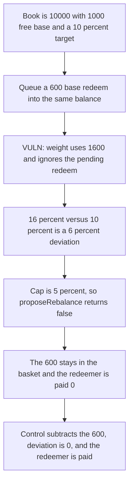

# Cove: the target-weight check ignores a pending redeem

> **Vulnerability classes:** vuln/logic/missing-check · vuln/logic/wrong-condition · vuln/dos/frozen-funds

<!-- non-defihacklabs -->
<!-- source-auditvault: https://github.com/Auditware/AuditVault/blob/main/findings/57954-h-02-the-target-weight-check-does-not-account-for-redeem-req.md -->
<!-- date: 2024-12 -->

## Key info

| | |
|---|---|
| **Protocol** | Cove basket manager |
| **Finding** | Pashov H-02, AuditVault 57954 |
| **Vulnerable code** | `BasketManager._isTargetWeightMet` |
| **Harm** | A 600 base redeem makes the quoted weight 16 percent against a 10 percent target. The 6 percent gap is over the 5 percent cap, the rebalance returns false, and the 600 stays in the basket |
| **Chain** | local synthetic |

## TL;DR

`_isTargetWeightMet` prices each asset from `basketBalances` and compares that weight with the proposed target. Pending redeems are still inside the balance. A book of 10000 with 1000 of free base and a 600 redeem quotes base at 1600, which is 16 percent. The target is 10 percent. The deviation is 600 basis points and the cap is 500, so `proposeRebalance` returns false and does not pay the redeemer. Quoting `baseBalance - pendingRedeem` is 10 percent, deviation 0, and the same call pays the 600.

## The vulnerable code

```solidity
uint256 assetValueInUSD = baseBalance;
// @> VULN: assetValueInUSD still includes pendingRedeem, so the weight check ignores it
afterTradeWeight = (assetValueInUSD * WEIGHT_PRECISION) / totalValue;
if (deviation > MAX_WEIGHT_DEVIATION) return false;
```

The fix quotes `baseBalance - pendingRedeem` before the division.

## Root cause

Assets already owed to redeemers are not free inventory. The weight check treats them as if the basket still chooses to hold them. A redeem larger than the 5 percent band makes an otherwise on-target book look off-target, and the rebalance that would settle the redeem refuses to run.

## Preconditions

Total value is 10000 ether. Free base starts at 1000 ether, target weight 1000 of 10000 (10 percent), max deviation 500 (5 percent). The redeem is 600 ether, minted into the basket during `run()`. The quote is 1:1 with the token amount. `run()` does not warp.

## Attack walkthrough

1. `queueRedeem` adds 600 to `baseBalance` and to `pendingRedeem`. The basket's token balance becomes 1600.
2. `proposeRebalance` sets `afterTradeWeight` to `1600 * 10000 / 10000 = 1600`.
3. Deviation against 1000 is 600, which is greater than 500, so the function returns false.
4. No transfer runs. The redeemer balance stays 0. The basket still holds 1600.
5. The 600 that arrived in this call is the locked redeem. The other 1000 was already inventory.

The control subtracts 600 before the quote. Weight is 1000, deviation is 0, and the redeemer receives 600. The basket is left holding the original 1000.

## Diagrams



## Impact

The redeemer does not receive 600. Those assets sit in the basket until a rebalance can pass the weight check, and this check cannot pass while the redeem itself is what pushes the weight through the 5 percent band. The control pays the 600.

## How to reproduce

```bash
cd 57954-h-02-the-target-weight-check-does-not-account-for-redeem-req_exp
forge test -vv
```

`run()` does not warp. The control test pays 600 and leaves 1000 in the basket.

## Sources

- AuditVault finding: https://github.com/Auditware/AuditVault/blob/main/findings/57954-h-02-the-target-weight-check-does-not-account-for-redeem-req.md
- Pashov report: https://github.com/pashov/audits/blob/master/team/md/Cove-security-review_2024-12-30.md
- Protocol: Cove, reviewed December 2024
