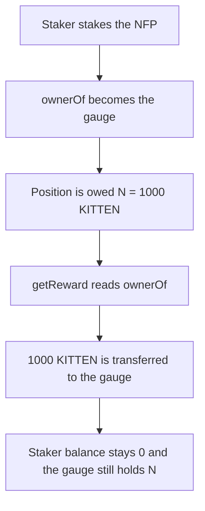

# KittenSwap — CLGauge pays KITTEN to itself

> **Vulnerability classes:** vuln/logic/reward-calculation · vuln/logic/incorrect-state-transition

> **Reproduction:** a self-contained Foundry PoC that compiles and runs offline
> with only `forge-std` — no fork and no RPC. Trace: [output.txt](output.txt).
> PoC: [test/58011-c-02-clgauge-sends-kitten-rewards-to-itself-instead-of-to-st_exp.sol](test/58011-c-02-clgauge-sends-kitten-rewards-to-itself-instead-of-to-st_exp.sol).

<!-- non-defihacklabs -->
<!-- source-auditvault: https://github.com/Auditware/AuditVault/blob/main/findings/58011-c-02-clgauge-sends-kitten-rewards-to-itself-instead-of-to-st.md -->
<!-- date: 2025-05 -->

---

## Key info

| | |
|---|---|
| **Impact** | **HIGH** — the staker is paid **0 KITTEN** and the gauge keeps **N = 1,000 KITTEN** |
| **Protocol** | KittenSwap `CLGauge` |
| **Vulnerable code** | `_getReward` pays `nfp.ownerOf(nfpTokenId)` |
| **Bug class** | Staking moves the NFT, so the reward recipient is the gauge |
| **Finding** | Pashov Audit Group — KittenSwap, 7 May 2025 · C-02 · id 58011 |
| **Report** | [KittenSwap-security-review_2025-05-07.md](https://github.com/pashov/audits/blob/master/team/md/KittenSwap-security-review_2025-05-07.md) |
| **Source** | [AuditVault finding](https://github.com/Auditware/AuditVault/blob/main/findings/58011-c-02-clgauge-sends-kitten-rewards-to-itself-instead-of-to-st.md) |
| **Status** | Reproduced here as a local synthetic of the audited payee. |
| **Compiler** | solc 0.8.27, cancun, via IR |

---

## TL;DR

Staking a concentrated-liquidity position transfers the NFT to `CLGauge`. `_getReward` then sends the KITTEN reward to `nfp.ownerOf(tokenId)`, which is the gauge.

With **N = 1,000 KITTEN** accounted to the staked position:

1. The staker stakes the NFT. `ownerOf` becomes the gauge.
2. The staker calls `getReward`.
3. The staker's balance stays **0**.
4. The gauge still holds **1,000 KITTEN**. `rewards[tokenId]` is deleted, so the amount is not claimed again.

The fixed claim pays the address saved at stake time. That staker receives **1,000 KITTEN** and the gauge is left with **0**.

## The vulnerable code

```solidity
function _getReward(uint256 nfpTokenId) internal {
    (, , , , , int24 _tickLower, int24 _tickUpper, , , , , ) = nfp
        .positions(nfpTokenId);

    _updateRewardForNfp(nfpTokenId, _tickLower, _tickUpper);

    uint256 reward = rewards[nfpTokenId];
    // @> VULN: after stake, ownerOf is this gauge, so the staker is not paid
    address owner = nfp.ownerOf(nfpTokenId);

    if (reward > 0) {
        delete rewards[nfpTokenId];
        _safeApprove(address(kitten), address(this), reward);
        _safeTransferFrom(address(kitten), address(this), owner, reward);
        emit ClaimRewards(owner, reward);
    }
}
```

`stake` sets `stakerOf[tokenId] = msg.sender` and then `transferFrom`s the NFT to the gauge. `_getReward` never reads `stakerOf`.

## Root cause

The NFT cannot stay with the staker, because the gauge has to hold it while the position is staked. The reward recipient is derived from that custody. After `stake`, `ownerOf` is the gauge, so the transfer of KITTEN is from the gauge to the gauge. The staker who called `getReward` receives nothing, and deleting `rewards[tokenId]` consumes the accounting.

## Preconditions

- The staker has staked the NFP, so the gauge is `ownerOf`.
- `rewards[tokenId]` is **N = 1,000 KITTEN**, and the gauge's token balance is the same **1,000**.
- Anyone who can call `getReward` hits the same payee. The caller here is the staker.

## Attack walkthrough

1. Mint NFP id 1 to the staker and stake it. `ownerOf` is the gauge. `stakerOf` is the staker.
2. Mint **1,000 KITTEN** to the gauge and set `rewards[1] = 1000 ether`.
3. The staker calls `getReward(1)`.
4. `owner = nfp.ownerOf(1)`, which is the gauge. `lastPaidTo` is the gauge.
5. `_safeTransferFrom` moves **1,000 KITTEN** from the gauge to the gauge.
6. The staker's balance is **0**. The gauge's balance is still **1,000**.

Control: `getReward` pays `stakerOf[tokenId]` with `kitten.transfer`, and does not read `ownerOf`. After the same stake, the staker's balance is **1,000 KITTEN** and the gauge's balance is **0**. The NFT is still held by the gauge.

## Diagrams



## Impact

The staker loses the whole reward. **1,000 KITTEN** stays in the gauge, and the per-position reward is cleared, so the staker cannot claim it later. Every staked position is paid this way. The fixed path pays that same **1,000 KITTEN** to the staker.

## Remediation

Pass the staker into `_getReward` (the address recorded at `stake`) and transfer KITTEN to that address. Do not use `nfp.ownerOf` after the gauge has taken custody of the NFT.

## Sources

- [AuditVault finding 58011](https://github.com/Auditware/AuditVault/blob/main/findings/58011-c-02-clgauge-sends-kitten-rewards-to-itself-instead-of-to-st.md)
- [Pashov KittenSwap review, 7 May 2025](https://github.com/pashov/audits/blob/master/team/md/KittenSwap-security-review_2025-05-07.md)

### Taxonomy

- `severity/high`
- `vuln/logic/reward-calculation` · `vuln/logic/incorrect-state-transition`
