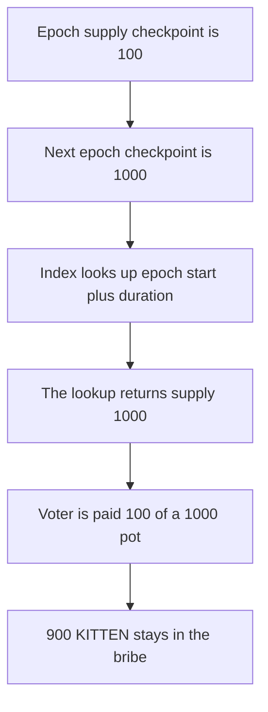

# KittenSwap — epoch rewards use the next epoch's supply, so the voter is paid 100 of 1000

> **Vulnerability classes:** vuln/logic/reward-calculation

> **Reproduction:** a self-contained Foundry PoC that compiles and runs offline
> with only `forge-std` — no fork and no RPC. Trace: [output.txt](output.txt).
> PoC: [test/58012-h-01-incorrect-next-epoch-supply-usage-affects-reward-calcul_exp.sol](test/58012-h-01-incorrect-next-epoch-supply-usage-affects-reward-calcul_exp.sol).

<!-- non-defihacklabs -->
<!-- source-auditvault: https://github.com/Auditware/AuditVault/blob/main/findings/58012-h-01-incorrect-next-epoch-supply-usage-affects-reward-calcul.md -->
<!-- date: 2025-05 -->

---

## Key info

| | |
|---|---|
| **Impact** | **HIGH** — the voter is paid **100** of a fair **1,000**; **900 KITTEN** stays in the bribe |
| **Protocol** | KittenSwap `ExternalBribe` |
| **Vulnerable code** | `getPriorSupplyIndex(_nextEpochStart + DURATION)` |
| **Bug class** | The index timestamp is the next epoch, not the one being paid |
| **Finding** | Pashov Audit Group — KittenSwap, 7 May 2025 · H-01 · id 58012 |
| **Report** | [KittenSwap-security-review_2025-05-07](https://github.com/pashov/audits/blob/master/team/md/KittenSwap-security-review_2025-05-07.md) |
| **Source** | [AuditVault finding](https://github.com/Auditware/AuditVault/blob/main/findings/58012-h-01-incorrect-next-epoch-supply-usage-affects-reward-calcul.md) |
| **Status** | The forked Velodrome line, reproduced with two supply checkpoints. |
| **Compiler** | solc 0.8.27, cancun, via IR |

---

## TL;DR

The bribe loads the supply used for a finished epoch with `getPriorSupplyIndex(_nextEpochStart + DURATION)`. That timestamp is the first second of the next epoch. A checkpoint written on that boundary is included.

Supply during the epoch was **100**, and this voter held all of it, against a pot of **1,000 KITTEN**. The boundary checkpoint says **1,000**. The voter is paid `100 * 1000 / 1000 = 100`. The fair pay, using `DURATION - 1`, is **1,000**. **900 KITTEN** stays in the bribe.

Finding 58152 quotes this same assignment. It is not reproduced separately.

## The vulnerable code

```solidity
function _supplyAt(uint256 _nextEpochStart) internal view returns (uint256) {
    Prev memory _prev;
    // @> VULN: _nextEpochStart + DURATION is the next epoch, not the one being paid
    _prev._prevSupply = supplyCheckpoints[getPriorSupplyIndex(_nextEpochStart + DURATION)].supply;
    return _prev._prevSupply;
}
```

The report's fix is `_nextEpochStart + DURATION - 1`.

## Root cause

`getPriorSupplyIndex` returns the latest checkpoint whose timestamp is less than or equal to the argument. Passing the exact start of the next epoch makes a checkpoint written at that instant eligible. That checkpoint already includes deposits from the new epoch. The reward for the epoch that just ended is diluted by supply that was not present while it was earned.

## Preconditions

- Checkpoint 0 at the epoch start, supply 100.
- Checkpoint 1 exactly one duration later, supply 1,000.
- The voter's balance for the epoch is 100. The pot is 1,000 KITTEN.

## Attack walkthrough

1. Write the two supply checkpoints.
2. Mint 1,000 KITTEN to the bribe.
3. `getPriorSupplyIndex(epochStart + duration)` returns index 1.
4. `getReward` pays `100 * 1000 / 1000 = 100`.
5. The bribe still holds 900. The fair amount is 1,000.

Control: the index argument is `epochStart + duration - 1`. That stops on checkpoint 0. The voter receives 1,000 and the bribe is empty.

## Diagrams



## Impact

The voter who held the whole epoch supply is underpaid by **900 KITTEN**. The same index is used for every claim that crosses an epoch boundary where supply changed.

## Remediation

Pass `_nextEpochStart + DURATION - 1` to `getPriorSupplyIndex`.

## Sources

- [AuditVault finding 58012](https://github.com/Auditware/AuditVault/blob/main/findings/58012-h-01-incorrect-next-epoch-supply-usage-affects-reward-calcul.md)
- [Pashov KittenSwap review, 7 May 2025](https://github.com/pashov/audits/blob/master/team/md/KittenSwap-security-review_2025-05-07.md)
- The line is the unfixed Velodrome `ExternalBribe` bug cited in that review, section 5.1.1 of the Spearbit Velodrome review.

### Taxonomy

- `vuln/logic/reward-calculation` · `vuln/logic/incorrect-calculation`
