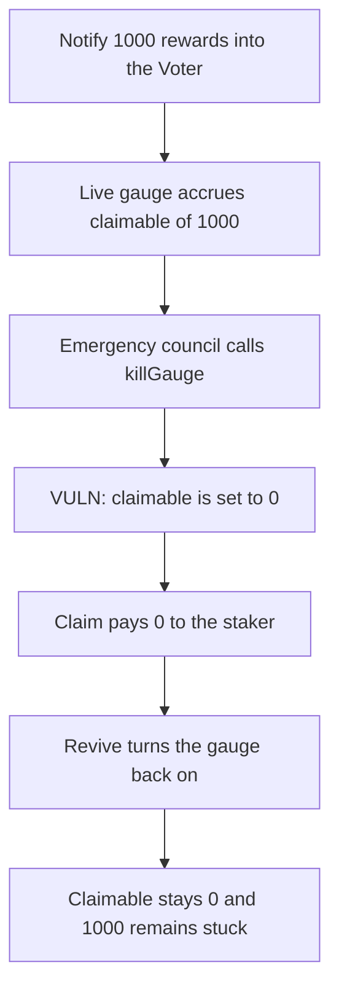

# KittenSwap Voter — deactivating a gauge deletes claimable rewards

> **Vulnerability classes:** vuln/logic/reward-calculation · vuln/logic/state-update · vuln/dos/frozen-funds

<!-- non-defihacklabs -->
<!-- source-auditvault: https://github.com/Auditware/AuditVault/blob/main/findings/58013-h-02-loss-of-claimable-rewards-upon-gauge-deactivation-pasho.md -->
<!-- date: 2025-05 -->

## Key info

| | |
|---|---|
| **Protocol** | KittenSwap |
| **Finding** | Pashov Audit Group H-02, AuditVault 58013 |
| **Vulnerable code** | `Voter.killGauge` |
| **Harm** | 1,000 rewards that were claimable become unclaimable; the claim pays 0 and the tokens stay in the Voter |
| **Chain** | local synthetic |

## TL;DR

A gauge with the full voting weight is notified 1,000 KITTEN. `updateFor` writes that 1,000 into `claimable`. `killGauge` then sets `claimable` to 0 and marks the gauge dead. The staker's claim returns 0. `reviveGauge` turns the gauge back on and does not restore the deleted amount. The 1,000 remains in the Voter with no claim path.

The control pays that claimable balance to the staker as part of deactivation. The staker receives 1,000 and the Voter balance goes to 0.

## The vulnerable code

```solidity
function killGauge(address _gauge) external {
    require(msg.sender == emergencyCouncil, "not emergency council");
    require(isAlive[_gauge], "gauge already dead");
    isAlive[_gauge] = false;
    // @> VULN: accrued claimable rewards are deleted.
    claimable[_gauge] = 0;
}
```

Accrual while the gauge is alive is the usual index share:

```solidity
uint _delta = _index - _supplyIndex;
if (_delta > 0) {
    uint _share = (uint(_supplied) * _delta) / 1e18;
    if (isAlive[_gauge]) {
        claimable[_gauge] += _share;
    }
}
```

`reviveGauge` only sets `isAlive` back to true. The warden's fix is to keep `claimable` recoverable, or to pay it out when the gauge is killed.

## Root cause

`claimable` is the only record of rewards already earned and not yet sent to the gauge. Zeroing it on deactivation throws that record away. The tokens were already transferred into the Voter by `notifyRewardAmount`, and nothing else is allowed to withdraw them. Revival does not replay the deleted accrual.

## Preconditions

The emergency council calls `killGauge` on a gauge that has a non-zero `claimable`. Here the gauge holds the entire `totalWeight`, so one notification of 1,000 accrues 1,000 before the kill. No epoch boundary and no time warp are required. The staker is not the caller of the kill.

## Attack walkthrough

1. The council notifies 1,000 KITTEN. `index` increases by `amount * 1e18 / totalWeight`.
2. `updateFor` sees a live gauge and sets `claimable` to 1,000.
3. `killGauge` passes the council check, sets `isAlive` false, and stores `claimable = 0`.
4. `claim` reads 0 and transfers nothing. The staker's balance stays 0.
5. `reviveGauge` sets `isAlive` true. `claimable` is still 0.
6. The Voter's token balance is still 1,000.

The control runs the same accrual, then on `killGauge` transfers the 1,000 to the staker before clearing the accounting. The staker's balance is 1,000 and the Voter's balance is 0.

## Diagrams



## Impact

Stakers of a deactivated gauge lose every reward that had accrued and not yet been claimed. In this distribution that is the full 1,000. Reviving the gauge does not give it back. The tokens sit in the Voter with `claimable` at 0, so a later claim still pays 0.

## Sources

- AuditVault finding: https://github.com/Auditware/AuditVault/blob/main/findings/58013-h-02-loss-of-claimable-rewards-upon-gauge-deactivation-pasho.md
- Report: https://github.com/pashov/audits/blob/master/team/md/KittenSwap-security-review_2025-05-07.md
- Reviewed tree: https://github.com/Kittenswap/contracts/commit/b191141c1efa9eda997c75460dab383db878e2b1 (`Voter.killGauge`)
