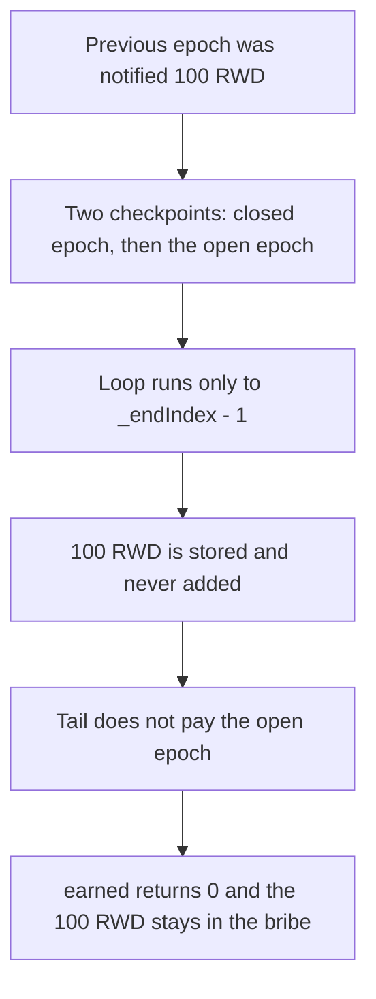

# KittenSwap — `earned()` skips the checkpoint before the last

> **Vulnerability classes:** vuln/logic/reward-calculation · vuln/logic/incorrect-state-transition

> **Reproduction:** a self-contained Foundry PoC that compiles and runs offline
> with only `forge-std` — no fork and no RPC. Trace: [output.txt](output.txt).
> PoC: [test/58014-h-03-externalbribeearned-skips-rewards-before-the-last-token_exp.sol](test/58014-h-03-externalbribeearned-skips-rewards-before-the-last-token_exp.sol).

<!-- non-defihacklabs -->
<!-- source-auditvault: https://github.com/Auditware/AuditVault/blob/main/findings/58014-h-03-externalbribeearned-skips-rewards-before-the-last-token.md -->
<!-- date: 2025-05 -->

---

## Key info

| | |
|---|---|
| **Impact** | **HIGH** — the voter should receive **100 RWD** and `earned()` returns **0** |
| **Protocol** | KittenSwap `ExternalBribe` |
| **Vulnerable code** | `for (i = _startIndex; i <= _endIndex - 1; i++)` |
| **Bug class** | The reward for the checkpoint before the last one is computed and then dropped |
| **Finding** | Pashov Audit Group — KittenSwap, 7 May 2025 · H-03 · id 58014 |
| **Report** | [KittenSwap-security-review_2025-05-07.md](https://github.com/pashov/audits/blob/master/team/md/KittenSwap-security-review_2025-05-07.md) |
| **Source** | [AuditVault finding](https://github.com/Auditware/AuditVault/blob/main/findings/58014-h-03-externalbribeearned-skips-rewards-before-the-last-token.md) |
| **Status** | Reproduced here as a local synthetic of the audited loop. |
| **Compiler** | solc 0.8.27, cancun, via IR |

---

## TL;DR

`ExternalBribe.earned` walks balance checkpoints only up to `_endIndex - 1`. Each iteration stores that checkpoint's reward and adds the reward stored by the **previous** iteration. The reward for the last checkpoint visited by the loop is therefore never added. The code after the loop pays only the final checkpoint, and only once that checkpoint's epoch has ended.

The report's test, at the end of the second epoch, logs `earned = 0` after a **100 RWD** notification on the first epoch. That is this state:

1. Checkpoint 0 is the deposit at the start of the previous epoch, balance **100** votes. That epoch was notified **100 RWD**, and the voter is the whole supply.
2. Checkpoint 1 is the withdraw-and-redeposit at the start of the current epoch. That epoch has not ended, so the tail pays nothing.
3. `earned()` returns **0**. The voter should receive **100 RWD**.
4. `getReward` pays **0**. The **100 RWD** stays in the bribe.

The fixed loop is `i <= _endIndex`. At the same checkpoints it returns **100 RWD**, and the claim pays the voter **100 RWD**.

The replay uses one timestamp, 30 days. `run()` does not warp. The two checkpoints are placed in the previous week and the current week of that timestamp, which is the report's second reading. The same skip also holds at the playground header timestamp used by the second Forge test.

## The vulnerable code

The report's `console.log` lines are debug prints and are not part of the calculation. The loop and the tail are the audited body:

```solidity
if (_endIndex > 0) {
    // @> VULN: stops at _endIndex - 1, so the reward parked for that checkpoint is never added
    for (uint256 i = _startIndex; i <= _endIndex - 1; i++) {
        _prev._prevTs = checkpoints[tokenId][i].timestamp;
        _prev._prevBal = checkpoints[tokenId][i].balanceOf;
        uint256 _nextEpochStart = _bribeStart(_prev._prevTs);
        if (_nextEpochStart > prevRewards.timestamp) {
            rewardAmt += prevRewards.balance;
        }

        prevRewards.timestamp = _nextEpochStart;
        _prev._prevSupply = supplyCheckpoints[
            getPriorSupplyIndex(_nextEpochStart + DURATION)
        ].supply;
        prevRewards.balance =
            (_prev._prevBal *
                tokenRewardsPerEpoch[token][_nextEpochStart]) /
            _prev._prevSupply;
    }
}
```

With two checkpoints, `_endIndex` is 1 and the loop body runs only for `i = 0`.

## Root cause

The addition is delayed by one checkpoint. Iteration `i` adds the reward that iteration `i - 1` stored, then stores checkpoint `i`'s reward for the next pass. Stopping at `_endIndex - 1` means checkpoint `_endIndex - 1` is stored and never added, and checkpoint `_endIndex` is handled only by the tail. The tail pays that last checkpoint only when `block.timestamp > epochEnd`. At the end of the second epoch the last checkpoint's epoch is the one that has just opened, so the tail pays nothing, and the closed epoch's **100 RWD** has already been dropped.

## Preconditions

- The token id has at least two balance checkpoints. Here the first is the previous epoch and the second is the current epoch, which is what the report's withdraw and redeposit produce.
- The previous epoch was notified **100 RWD**, and the voter's balance equals the supply, so the fair share is the whole **100 RWD**.
- The current epoch has not ended, so the tail's `block.timestamp > _lastEpochEnd` check is false.
- `lastEarn` is still 0, so the scan starts at checkpoint 0.

## Attack walkthrough

1. From the single timestamp, take the current week and the week before it.
2. Write checkpoint 0 at the previous week, balance **100** votes. Write checkpoint 1 at this week, balance **100** votes. Write supply **100** at this week.
3. Book **100 RWD** on the previous week and mint **100 RWD** into the bribe.
4. `earned()` enters the loop once. The addition adds the still-zero `prevRewards.balance`. The multiplication then stores `100 * 100 RWD / 100 = 100 RWD` and the loop ends.
5. The tail sees the current epoch and adds nothing. `earned()` is **0**.
6. `getReward` transfers **0**. The bribe still holds **100 RWD**. The voter's balance is **0**.

Control: the same writes with `i <= _endIndex`. The second iteration adds the parked **100 RWD**. `earned()` is **100 RWD**, the claim pays the voter **100 RWD**, and the bribe ends at **0**.

## Diagrams



## Impact

The voter is owed **100 RWD** for an epoch that has already closed and receives **0**. The tokens remain in the bribe. The report's log is the same shape: **100e18** at the end of the first epoch, then **0** at the end of the second. The fixed loop pays the **100 RWD**.

## Remediation

Include `_endIndex` in the checkpoint loop, as the report's diff does (`i <= _endIndex`), so the reward stored for the checkpoint before the last one is added on the next iteration. Keep the tail from paying an epoch that has not ended.

## Sources

- [AuditVault finding 58014](https://github.com/Auditware/AuditVault/blob/main/findings/58014-h-03-externalbribeearned-skips-rewards-before-the-last-token.md)
- [Pashov KittenSwap review, 7 May 2025](https://github.com/pashov/audits/blob/master/team/md/KittenSwap-security-review_2025-05-07.md)
- Report gist of the epoch test: [said017/b96daba163bf2e1eb101589bc541ce06](https://gist.github.com/said017/b96daba163bf2e1eb101589bc541ce06)

### Taxonomy

- `severity/high`
- `vuln/logic/reward-calculation` · `vuln/logic/incorrect-state-transition`
