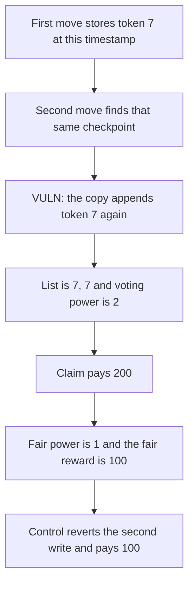

# KittenSwap: a same-block delegate duplicates a token id and its vote

> **Vulnerability classes:** vuln/governance/proposal-manipulation · vuln/logic/state-update · vuln/logic/reward-calculation

<!-- non-defihacklabs -->
<!-- source-auditvault: https://github.com/Auditware/AuditVault/blob/main/findings/58015-h-04-duplicate-tokenid-in-delegate-list-may-inflate-votes-pa.md -->
<!-- date: 2025-05 -->

## Key info

| | |
|---|---|
| **Protocol** | KittenSwap VotingEscrow |
| **Finding** | Pashov H-04, AuditVault 58015 |
| **Vulnerable code** | `VotingEscrow.moveToken` copy into the current checkpoint |
| **Harm** | Token 7 is stored twice. Voting power is 2 instead of 1. The reward taken is 200. The fair reward is 100. The control rejects the second write and pays 100 |
| **Chain** | local synthetic |

## TL;DR

`_findWhatCheckpointToWrite` returns the latest checkpoint when its timestamp equals `block.timestamp`. A second delegate in the same block therefore appends onto the list it should be replacing. The copy loop writes each existing token id again. After delegating token 7 and then moving again, the list is `[7, 7]`. `votes()` is the list length, so power is 2. At 100 per vote the claim pays 200. The control reverts when the checkpoint timestamp is already this block, leaves the length at 1, and pays 100.

## The vulnerable code

```solidity
} else {
    // @> VULN: the same-block checkpoint appends an existing tokenId again
    this.appendDuplicate(dst, bound);
}
```

`appendDuplicate` writes `tokenAt[dst][bound] = tokenAt[dst][0]` and increases the length.

`_findWhatCheckpointToWrite` returns `n - 1` when `checkpointTs[account] == block.timestamp`. The fix rejects that second write instead of appending.

## Root cause

The checkpoint chosen for a same-timestamp update is the one that already holds the token ids, and the code assumes that destination list is empty. It is not. Appending the old ids onto it duplicates every id. Vote weight is the length of that list, so one locked token counts twice, and a reward paid per vote pays twice.

## Preconditions

Token id 7 is delegated to the voter, which opens one checkpoint at the current timestamp with length 1. A second `moveToken` for the same id runs in the same block, before anything else changes `block.timestamp`. The reward rate is 100 ether per list entry. The escrow is minted 200. `run()` does not warp.

## Attack walkthrough

1. The first move sees no checkpoint, stores token 7 once, and stamps the checkpoint with `block.timestamp`.
2. The second move finds that timestamp and does not open a new list.
3. The loop reads index 0 (token 7) and writes it at index 1. Length becomes 2.
4. `votes()` returns 2. Both stored ids are 7.
5. `claim` pays `2 * 100 = 200`.

The control's second `moveToken` reverts with `duplicate checkpoint`. Length stays 1. `claim` pays 100.

## Diagrams



## Impact

The voter is paid 200 for one token id. The extra 100 is the duplicate vote. Any later reward or gauge weight that reads this list length counts the same lock twice. The control does not pay the extra 100.

## How to reproduce

```bash
cd 58015-h-04-duplicate-tokenid-in-delegate-list-may-inflate-votes-pa_exp
forge test -vv
```

`run()` does not warp. The control test rejects the duplicate and pays 100.

## Sources

- AuditVault finding: https://github.com/Auditware/AuditVault/blob/main/findings/58015-h-04-duplicate-tokenid-in-delegate-list-may-inflate-votes-pa.md
- Pashov report: https://github.com/pashov/audits/blob/master/team/md/KittenSwap-security-review_2025-05-07.md
- Earlier report of the same delegate-checkpoint bug: Velodrome, Spearbit
