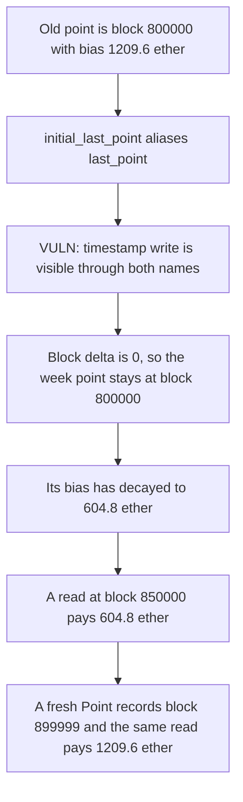

# KittenSwap: a shared point struct freezes the historical block

> **Vulnerability classes:** vuln/logic/state-update · vuln/logic/incorrect-state-transition · vuln/governance/proposal-manipulation

<!-- non-defihacklabs -->
<!-- source-auditvault: https://github.com/Auditware/AuditVault/blob/main/findings/58016-h-05-incorrect-last-pointblk-calculation-due-to-shared-memor.md -->
<!-- date: 2025-05 -->

## Key info

| | |
|---|---|
| **Protocol** | KittenSwap VotingEscrow |
| **Finding** | Pashov H-05, AuditVault 58016 |
| **Vulnerable code** | `VotingEscrow._checkpoint` block extrapolation |
| **Harm** | The week point's block stays 800000. A vote read at block 850000 pays 604.8 ether. A fresh copy of the point records block 899999 and the same read pays 1209.6 ether. The reward is short 604.8 ether |
| **Chain** | local synthetic |

## TL;DR

`Point memory initial_last_point = last_point` does not copy a memory struct. It aliases it. The loop then sets `last_point.ts = t_i`, which also changes `initial_last_point.ts`. The next line adds `block_slope * (t_i - initial_last_point.ts) / MULTIPLIER` to the block, and that difference is 0, so `blk` stays 800000. The point one week later should be block 899999. A lookup at block 850000 therefore treats the decayed point as already reached and pays its bias, 604.8 ether, instead of the previous point's 1209.6 ether. Copying the four fields into a new `Point` advances the block and the lookup pays 1209.6 ether.

## The vulnerable code

```solidity
Point memory initial_last_point = last_point;
last_point.ts = t_i;
// @> VULN: initial_last_point aliases last_point, so (t_i - initial_last_point.ts) is 0
last_point.blk =
    initial_last_point.blk +
    (block_slope * (t_i - initial_last_point.ts)) / MULTIPLIER;
```

The fix builds a new `Point` from `bias`, `slope`, `ts`, and `blk` instead of assigning the memory struct.

## Root cause

In the compiler, a memory-to-memory struct assignment is a reference. `initial_last_point` and `last_point` are the same value. Any write through one is visible through the other, including the timestamp the block slope is measured from. The slope itself is non-zero: this block is 1000000 and the old point is block 800000, over two weeks. The product is still zero because the time input was overwritten.

## Preconditions

The replay block is number 1000000 at timestamp 1700697600, which is a week boundary. The previous point is two weeks earlier, block 800000, slope `1e15`, bias two weeks of that slope (1209.6 ether). The checkpoint steps one week and stores that point. The claim reads votes at block 850000. `run()` does not warp. The Foundry test rolls and warps once before `run()`, matching this single replay block.

## Attack walkthrough

1. The old point is stored at epoch 0: block 800000, bias 1209.6 ether.
2. `initial_last_point` aliases `last_point`.
3. `last_point.ts` becomes the week boundary. `initial_last_point.ts` moves with it.
4. The block update adds zero. `historicalBlk` is 800000.
5. Epoch 1 is stored with the decayed bias, 604.8 ether, and block 800000.
6. Block 850000 is `>=` both stored blocks, so the lookup returns epoch 1 and pays 604.8 ether.

The control copies the fields first. Epoch 1's block is 899999, which is still above 850000, so the lookup returns epoch 0 and the bias is 1209.6 ether.

## Diagrams



## Impact

The voter is paid 604.8 ether. The vote weight a correct block extrapolation would still attach to block 850000 is 1209.6 ether. The reward is short 604.8 ether, one week of slope. Any historical balance that binary-searches these blocks picks the wrong epoch.

## How to reproduce

```bash
cd 58016-h-05-incorrect-last-pointblk-calculation-due-to-shared-memor_exp
forge test -vv
```

`run()` does not warp. The control test records block 899999 and returns the full bias.

## Sources

- AuditVault finding: https://github.com/Auditware/AuditVault/blob/main/findings/58016-h-05-incorrect-last-pointblk-calculation-due-to-shared-memor.md
- Pashov report: https://github.com/pashov/audits/blob/master/team/md/KittenSwap-security-review_2025-05-07.md
- Same function is also filed as AuditVault 58156. This reproduction is 58016 only.
