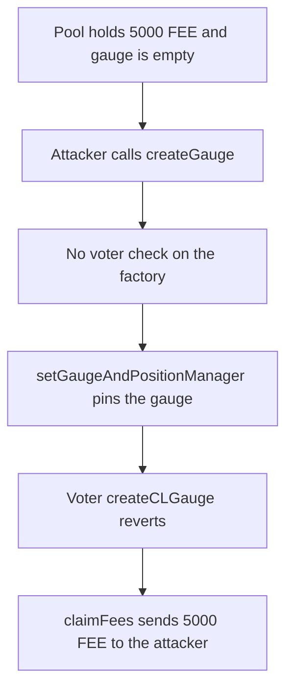

# KittenSwap — anyone can pin a CL gauge and collect the pool's fees

> **Vulnerability classes:** vuln/access-control/missing-auth · vuln/logic/missing-check · vuln/logic/reward-calculation

> **Reproduction:** a self-contained Foundry PoC that compiles and runs offline
> with only `forge-std` — no fork and no RPC. Trace: [output.txt](output.txt).
> PoC: [test/58017-h-06-lack-of-access-control-in-clgauge-creation-allows-unaut_exp.sol](test/58017-h-06-lack-of-access-control-in-clgauge-creation-allows-unaut_exp.sol).

<!-- non-defihacklabs -->
<!-- source-auditvault: https://github.com/Auditware/AuditVault/blob/main/findings/58017-h-06-lack-of-access-control-in-clgauge-creation-allows-unaut.md -->
<!-- date: 2025-05 -->

---

## Key info

| | |
|---|---|
| **Impact** | **HIGH** — an attacker pins the pool's only gauge and receives **5,000 FEE** that had accrued on the pool |
| **Protocol** | KittenSwap concentrated-liquidity gauges |
| **Vulnerable code** | `CLGaugeFactory.createGauge` — no `msg.sender == voter` before `setGaugeAndPositionManager` |
| **Bug class** | Missing access control on a one-shot gauge registration |
| **Finding** | Pashov Audit Group — KittenSwap security review, 7 May 2025 · H-06 · id 58017 |
| **Report** | [KittenSwap-security-review_2025-05-07.md](https://github.com/pashov/audits/blob/master/team/md/KittenSwap-security-review_2025-05-07.md) |
| **Source** | [AuditVault finding](https://github.com/Auditware/AuditVault/blob/main/findings/58017-h-06-lack-of-access-control-in-clgauge-creation-allows-unaut.md) |
| **Status** | Audit finding. Reproduced here as a local synthetic. |
| **Compiler** | solc 0.8.27, cancun, via IR |

---

## TL;DR

1. A CL pool holds **5,000 FEE** of accrued swap fees and its `gauge` slot is still empty.
2. `createGauge` does not check that the caller is the voter. The attacker calls it and supplies their own address as the internal bribe.
3. The pool's `setGaugeAndPositionManager` accepts the first gauge and never another. The factory marks `isGauge`.
4. The real `Voter.createCLGauge` reverts, because the slot is taken.
5. `claimFees` on the attacker gauge forwards the **5,000 FEE** to the attacker.

## The vulnerable code

The factory deploys a gauge and immediately pins it on the pool. The audit's fix is a voter check that this function does not have.

```solidity
function createGauge(
    address _pool,
    address _internal_bribe,
    address _kitten,
    bool _isPool
) external returns (address) {
    CLGauge newGauge = new CLGauge();
    newGauge.initialize(_pool, _internal_bribe, _kitten, voter, voter, nfp, _isPool);
    CLPool(_pool).setGaugeAndPositionManager(address(newGauge), nfp); // @> VULN: anyone pins the pool's one-shot gauge
    // FIX: require(msg.sender == voter, "Only voter can create gauge");
    isGauge[address(newGauge)] = true;
    return address(newGauge);
}
```

The pool side, quoted by the finding, rejects every caller after the first:

```solidity
function setGaugeAndPositionManager(address _gauge, address _nft) external {
    require(msg.sender == factory, "only gauge factory");
    require(gauge == address(0), "gauge set"); // @audit Can only be called once
    gauge = _gauge;
    nft = _nft;
}
```

Official gauges forward the pool's accrued fees to the `internal_bribe` stored at initialization. The attacker chooses that address.

## Root cause

Gauge creation is a one-shot registration on the pool, but the factory function that performs it is permissionless. The voter is not the only caller who can consume the slot, and the bribe address is caller-supplied, so the gauge that wins the slot also decides where fees go.

## Preconditions

- The pool's `gauge` is still `address(0)`.
- The pool holds a non-zero fee balance.
- The attacker can call `CLGaugeFactory.createGauge` directly.

## Attack walkthrough

1. The pool is funded with **5,000 FEE** and has no gauge.
2. The attacker calls `createGauge(pool, attacker, kitten, true)`.
3. The factory deploys a `CLGauge`, initializes it with the attacker as `internalBribe`, and calls `setGaugeAndPositionManager`. `isGauge[gauge]` becomes true.
4. `Voter.createCLGauge` hits `require(gauge == address(0))` and reverts.
5. `claimFees` calls `pool.collectTo(internalBribe)`. The pool transfers **5,000 FEE** to the attacker.
6. Attacker balance is **5,000 FEE**. Pool balance is 0. `pool.gauge()` is the attacker gauge.

Control: `CLGaugeFactoryFixed` reverts the attacker's `createGauge` with `Only voter can create gauge`. The slot stays empty and the 5,000 FEE stays on the pool. The voter then creates the gauge and the same 5,000 FEE is paid to the protocol bribe, not the attacker.

## Diagrams



## Impact

The attacker-created gauge is the pool's real gauge: the factory lists it, the pool stores it, and fee collection pays it. In this run that payment is exactly **5,000 FEE**. The legitimate voter can no longer install a gauge on the same pool.

## Remediation

Require `msg.sender == voter` at the start of `createGauge`, before the gauge is deployed and before `setGaugeAndPositionManager`.

## Sources

- [AuditVault finding 58017](https://github.com/Auditware/AuditVault/blob/main/findings/58017-h-06-lack-of-access-control-in-clgauge-creation-allows-unaut.md)
- [Pashov KittenSwap review, 7 May 2025](https://github.com/pashov/audits/blob/master/team/md/KittenSwap-security-review_2025-05-07.md)

### Taxonomy

- `severity/high` · `sector/governance` · `sector/nft`
- `vuln/access-control/missing-auth` · `vuln/logic/missing-check` · `vuln/logic/reward-calculation`
