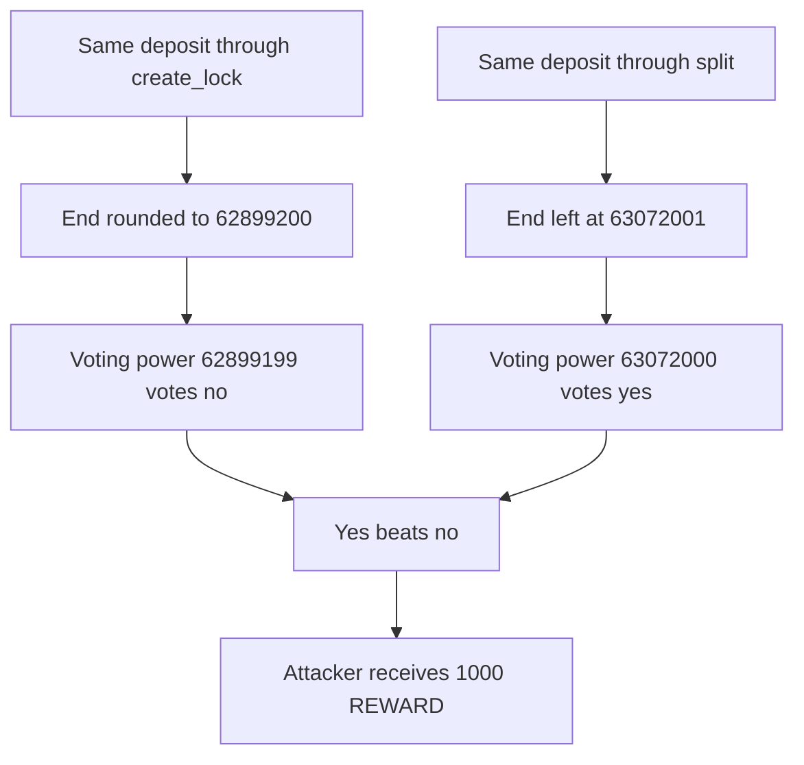

# KittenSwap — split skips the week rounding and inflates voting power

> **Vulnerability classes:** vuln/arithmetic/rounding · vuln/logic/reward-calculation · vuln/governance/proposal-manipulation

> **Reproduction:** a self-contained Foundry PoC that compiles and runs offline
> with only `forge-std` — no fork and no RPC. Trace: [output.txt](output.txt).
> PoC: [test/58018-h-07-inconsistent-rounding-of-lock-time-causes-voting-power_exp.sol](test/58018-h-07-inconsistent-rounding-of-lock-time-causes-voting-power_exp.sol).

<!-- non-defihacklabs -->
<!-- source-auditvault: https://github.com/Auditware/AuditVault/blob/main/findings/58018-h-07-inconsistent-rounding-of-lock-time-causes-voting-power.md -->
<!-- date: 2025-05 -->

---

## Key info

| | |
|---|---|
| **Impact** | **HIGH** — the same max lock is worth **62,899,199** when rounded and **63,072,000** when split, and the larger power takes a **1,000 REWARD** prize |
| **Protocol** | KittenSwap VotingEscrow |
| **Vulnerable code** | `VotingEscrow.split` writes `_locked.end = block.timestamp + MAXTIME` |
| **Bug class** | Lock-end rounding skipped on one path, so slope changes miss the week grid |
| **Finding** | Pashov Audit Group — KittenSwap security review, 7 May 2025 · H-07 · id 58018 |
| **Report** | [KittenSwap-security-review_2025-05-07.md](https://github.com/pashov/audits/blob/master/team/md/KittenSwap-security-review_2025-05-07.md) |
| **Source** | [AuditVault finding](https://github.com/Auditware/AuditVault/blob/main/findings/58018-h-07-inconsistent-rounding-of-lock-time-causes-voting-power.md) |
| **Status** | Audit finding. Reproduced here as a local synthetic at `block.timestamp = 1`. |
| **Compiler** | solc 0.8.27, cancun, via IR |

---

## TL;DR

`create_lock` rounds `block.timestamp + MAXTIME` down to `WEEK`. `split` does not. At timestamp 1, with `MAXTIME = 2 years` and a deposit of that same amount:

- rounded end `62,899,200` → voting power **62,899,199**
- raw end `63,072,001` → voting power **63,072,000**

The week-step checkpoint only reads `slope_changes` on Thursday boundaries, so it never sees the split's slope. The larger power votes yes, beats the rounded no vote, and collects **1,000 REWARD**.

## The vulnerable code

```solidity
// create_lock / increase_unlock_time
uint256 rounded = ((block.timestamp + MAXTIME) / WEEK) * WEEK;

// split
// FIX: _locked.end = ((block.timestamp + MAXTIME) / WEEK) * WEEK;
_locked.end = block.timestamp + MAXTIME; // @> VULN: lock end is not rounded down to WEEK
```

The checkpoint the finding quotes only applies slope changes on the week grid:

```solidity
t_i += WEEK;
if (t_i > t) {
    break;
} else {
    int128 d_slope = slope_changes[t_i]; // t_i is always a Thursday
}
```

Voting power of a live lock is `amount * (end - timestamp) / MAXTIME`. A later end is a larger power. Here `amount = MAXTIME`, so the unrounded lock is worth the full deposit and the rounded lock is short by the 172,801 seconds past the week boundary.

## Root cause

Every other lock path floors the unlock time onto `WEEK`. `split` stores the raw sum. Individual power uses that later end immediately, and the global checkpoint can never subtract the slope because `slope_changes` is keyed by a timestamp the week cursor does not visit.

## Preconditions

- `block.timestamp + MAXTIME` is not already on a week boundary. At timestamp 1 it is not.
- The caller owns a lock and can `split` it for the full amount.
- A vote or reward uses the resulting voting power.

## Attack walkthrough

1. The honest locker deposits `MAXTIME` through `create_lock`. End is `62,899,200`. Power is **62,899,199**. They vote no.
2. The attacker deposits the same amount and calls `split` for the full balance.
3. The new NFT's end is `1 + MAXTIME = 63,072,001`. Power is **63,072,000**.
4. `slopeSeenByCheckpoint` walks week timestamps up to that end. It hits the rounded end and misses the split end.
5. The attacker votes yes with **63,072,000**. Yes beats no.
6. `finalize` pays **1,000 REWARD** to the attacker.

Control: `split` uses `((block.timestamp + MAXTIME) / WEEK) * WEEK`. Both powers are **62,899,199**, the ends are equal and week-aligned, and the split lock cannot outvote the honest lock.

## Diagrams



## Impact

One deposit amount produces two voting powers, **62,899,199** and **63,072,000**. The larger one decides the vote and takes the **1,000 REWARD** prize. Reward streams that divide by voting weight pay this lock more than a correctly rounded max lock of the same size, and the slope scheduled at the raw end is invisible to the week checkpoint.

## Remediation

Set the split end with the same expression as `create_lock`: `((block.timestamp + MAXTIME) / WEEK) * WEEK`.

## Sources

- [AuditVault finding 58018](https://github.com/Auditware/AuditVault/blob/main/findings/58018-h-07-inconsistent-rounding-of-lock-time-causes-voting-power.md)
- [Pashov KittenSwap review, 7 May 2025](https://github.com/pashov/audits/blob/master/team/md/KittenSwap-security-review_2025-05-07.md)

### Taxonomy

- `severity/high` · `sector/governance`
- `vuln/arithmetic/rounding` · `vuln/logic/reward-calculation` · `vuln/governance/proposal-manipulation`
