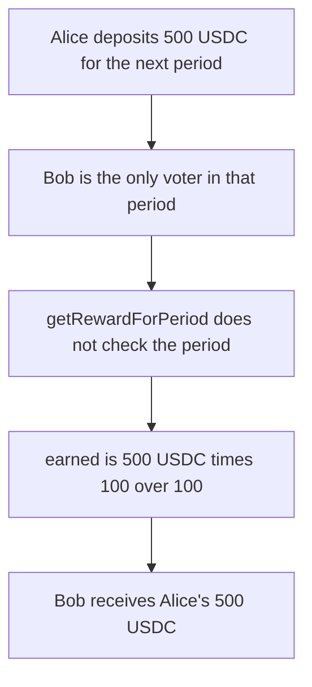

# KittenSwap — a voter claims the next period's incentives

> **Vulnerability classes:** vuln/logic/reward-calculation · vuln/logic/missing-check

> **Reproduction:** a self-contained Foundry PoC that compiles and runs offline
> with only `forge-std` — no fork and no RPC. Trace: [output.txt](output.txt).
> PoC: [test/58067-c-03-incentive-rewards-may-be-stolen-pashov-audit-group-none_exp.sol](test/58067-c-03-incentive-rewards-may-be-stolen-pashov-audit-group-none_exp.sol).

<!-- non-defihacklabs -->
<!-- source-auditvault: https://github.com/Auditware/AuditVault/blob/main/findings/58067-c-03-incentive-rewards-may-be-stolen-pashov-audit-group-none.md -->
<!-- date: 2025-06 -->

---

## Key info

| | |
|---|---|
| **Impact** | **HIGH** — the attacker receives the victim's **500 USDC** |
| **Protocol** | KittenSwap `VotingReward` |
| **Vulnerable code** | `getRewardForPeriod` forwards `_period` with no future-period check |
| **Bug class** | Incentives booked for the next period are claimable while that period is still open |
| **Finding** | Pashov Audit Group — KittenSwap, 12 June 2025 · C-03 · id 58067 |
| **Report** | [KittenSwap-security-review_2025-06-12.md](https://github.com/pashov/audits/blob/master/team/md/KittenSwap-security-review_2025-06-12.md) |
| **Source** | [AuditVault finding](https://github.com/Auditware/AuditVault/blob/main/findings/58067-c-03-incentive-rewards-may-be-stolen-pashov-audit-group-none.md) |
| **Status** | Reproduced here as a local synthetic of the audited claim. |
| **Compiler** | solc 0.8.27, cancun, via IR |

---

## TL;DR

`incentivize` and `_deposit` both write `getCurrentPeriod() + 1`. `getRewardForPeriod` checks that the caller owns the veNFT and then pays that period. It never checks that the period is not still in the future.

Alice deposits **500 USDC** for the next period. Bob votes into that same period before anyone else and claims it. He is the only voter, so `earned` is **500 USDC**. He receives Alice's **500 USDC**. Alice's balance is **0** and the reward contract is empty.

The fixed claim reverts while `_period > getCurrentPeriod()`. After the clock reaches that period, the same **500 USDC** is paid to Alice, who is the voter in the control. The attacker is paid **0**.

`run()` does not warp. At the replay timestamp the current period is 0, so the funded period is 1, and the claim of period 1 succeeds. The control test warps only outside `run()`, after the early claim has reverted.

## The vulnerable code

```solidity
function incentivize(address _token, uint256 _amount) external virtual nonReentrant {
    if (voter.isWhitelisted(_token) == false)
        revert NotWhitelistedRewardToken();
    uint256 currentPeriod = getCurrentPeriod() + 1;
    uint256 amount = _addReward(currentPeriod, _token, _amount);
}

function _deposit(uint256 _amount, uint256 _tokenId) external onlyVoter {
    uint256 nextPeriod = getCurrentPeriod() + 1;
    tokenIdVotesInPeriod[nextPeriod][_tokenId] += _amount;
    totalVotesInPeriod[nextPeriod] += _amount;
}

function getRewardForPeriod(uint256 _period, uint256 _tokenId, address _token) external virtual nonReentrant {
    if (!veKitten.isApprovedOrOwner(msg.sender, _tokenId))
        revert NotApprovedOrOwner();
    // @> VULN: _period is not checked against getCurrentPeriod(), so the next period is claimable now
    _getReward(_period, _tokenId, _token, msg.sender);
}
```

`earned` pays `tokenRewardsPerPeriod * votes / totalVotes`. One voter takes the whole balance.

## Root cause

The next period is still accepting votes. Paying it early freezes the share at whoever has voted so far. Bob votes 100, claims, and is paid `500e6 * 100 / 100`. A later voter is owed a share of a balance that is already zero.

## Preconditions

- USDC is whitelisted.
- Alice holds **500 USDC** and calls `incentivize`. The tokens move into `VotingReward` for period `getCurrentPeriod() + 1`.
- Bob owns a veNFT and is the first, and in this run the only, voter for that period.
- The block timestamp is still inside the current period. `run()` does not advance it.

## Attack walkthrough

1. Whitelist USDC. Mint **500 USDC** (500000000 base units) to Alice.
2. Alice calls `incentivize`. The balance is stored on period 1. Her balance is now **0**.
3. Bob votes **100**. `totalVotesInPeriod[1]` is 100 and his votes are 100.
4. `earned(1, Bob, USDC)` is **500 USDC**.
5. Bob calls `getRewardForPeriod(1, ...)`. The owner check passes. There is no period check. `_getReward` transfers **500 USDC** to Bob.
6. Bob's balance is **500 USDC**. The reward contract's balance is **0**.

Control: Alice funds the same **500 USDC** and Alice is the voter. `getRewardForPeriod` reverts with `FuturePeriod` while the period is still ahead. After `block.timestamp` reaches that period, Alice's claim pays her **500 USDC**. The test contract, standing in for an attacker who did not vote, holds **0**.

## Diagrams



## Impact

Bob receives the **500 USDC** Alice deposited. Alice is left with **0**. The incentive for the period is gone before the period opens, so any voter who arrives later cannot be paid. The fixed claim pays that same **500 USDC** to Alice once the period is no longer in the future, and pays the attacker nothing.

## Remediation

Reject `_period > getCurrentPeriod()` in `getRewardForPeriod` before `_getReward`. Incentives and votes for the next period then stay in the contract until that period is the current one.

## Sources

- [AuditVault finding 58067](https://github.com/Auditware/AuditVault/blob/main/findings/58067-c-03-incentive-rewards-may-be-stolen-pashov-audit-group-none.md)
- [Pashov KittenSwap review, 12 June 2025](https://github.com/pashov/audits/blob/master/team/md/KittenSwap-security-review_2025-06-12.md)

### Taxonomy

- `severity/high`
- `vuln/logic/reward-calculation` · `vuln/logic/missing-check`
