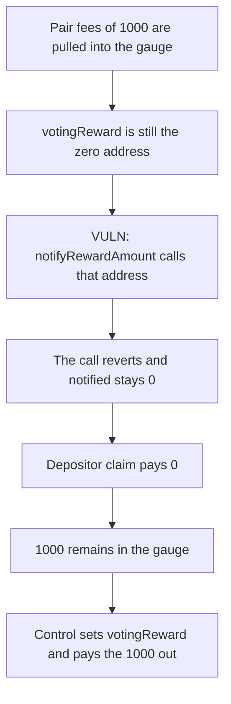

# KittenSwap: the gauge never sets votingReward, so fees are not paid

> **Vulnerability classes:** vuln/logic/state-update · vuln/logic/missing-check · vuln/dos/frozen-funds

<!-- non-defihacklabs -->
<!-- source-auditvault: https://github.com/Auditware/AuditVault/blob/main/findings/58068-h-01-votingreward-not-set-on-gauge-pashov-audit-group-none-k.md -->
<!-- date: 2025-06 -->

## Key info

| | |
|---|---|
| **Protocol** | KittenSwap Gauge |
| **Finding** | Pashov H-01, AuditVault 58068 |
| **Vulnerable code** | `Gauge.forwardFees` / `notifyRewardAmount` |
| **Harm** | A depositor claim pays 0. 1000 of pair fees sit in the gauge. The control sets votingReward and pays the 1000 |
| **Chain** | local synthetic |

## TL;DR

`Gauge` never assigns `votingReward` and has no setter. After pair fees are pulled in, `forwardFees` approves that address and calls `notifyRewardAmount`. The address is zero, so the call reverts and `notified` stays 0. `claim` therefore pays 0. The 1000 that was pulled remains in the gauge. A gauge constructed with a voting-reward contract transfers that 1000 to the depositor and ends empty.

## The vulnerable code

```solidity
token.approve(address(votingReward), claimed0);
// @> VULN: votingReward is unset, so the fee notification reverts and nothing is paid
votingReward.notifyRewardAmount(address(token), claimed0);
```

The fix sets `votingReward` in the constructor, before any fee notification.

## Root cause

The storage slot for `votingReward` is left at zero. The notify path does not check it. A call to the zero address cannot record a reward, so the amount that `claim` reads stays zero. Fees that have already been pulled into the gauge are not forwarded.

## Preconditions

`votingReward` is the zero address. `pullFees` mints 1000 into the gauge, which is the result of `pair.claimFees`. `forwardFees` is a separate call so the pull is not rolled back when the notification reverts. The depositor then calls `claim`. `run()` does not warp.

## Attack walkthrough

1. `pullFees(1000)` mints 1000 into the gauge and stores `held`.
2. `forwardFees` approves the zero address and calls `notifyRewardAmount`.
3. The call reverts. `notified` is not set. The outer `run` catches the revert.
4. `claim` returns 0 and transfers nothing.
5. The gauge balance is still 1000.

The control constructs the gauge with a `Reward` contract. `forwardFees` succeeds, `transferFrom` pays the depositor 1000, and the gauge balance is 0.

## Diagrams



## Impact

Depositors are paid 0. The 1000 of fees sits in the gauge and is not distributed. Until a gauge with `votingReward` set replaces this one, every notification of these fees fails the same way. The control pays the 1000 to the depositor.

## How to reproduce

```bash
cd 58068-h-01-votingreward-not-set-on-gauge-pashov-audit-group-none-k_exp
forge test -vv
```

`run()` does not warp. The control test pays 1000 and leaves the gauge empty.

## Sources

- AuditVault finding: https://github.com/Auditware/AuditVault/blob/main/findings/58068-h-01-votingreward-not-set-on-gauge-pashov-audit-group-none-k.md
- Pashov report: https://github.com/pashov/audits/blob/master/team/md/KittenSwap-security-review_2025-06-12.md
