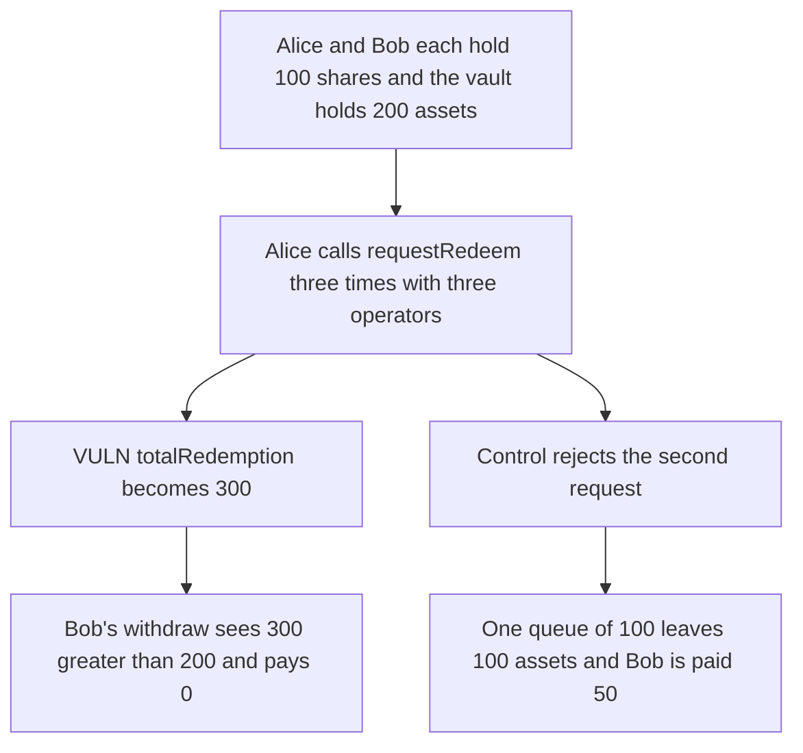

# Astrolab redemption queues the same shares once per operator and pays the other holder 0

> **Vulnerability classes:** vuln/logic/redemption-accounting · vuln/dos/share-price

<!-- non-defihacklabs -->
<!-- source-auditvault: https://github.com/Auditware/AuditVault/blob/main/findings/58096-c-01-inflating-redemption-request-and-dos-in-the-vault-pasho.md -->
<!-- date: 1970-01 -->

## Key info

| Field | Value |
|---|---|
| **Loss** | Bob is paid 0 instead of 50 assets. His 100 shares stay in the vault because totalRedemption is 300 and the vault holds 200 |
| **Vulnerable contract** | `Vault.requestRedeem` |
| **Attacker EOA** | `0x1111111111111111111111111111111111111111` |
| **Attack contract** | `Exploit` at `0x15452ec016c4dc8c549e7fe6ff4b26324ea8b7a4` |
| **Attack tx** | `Exploit.run()` |
| **Chain / block / date** | Ethereum model · block 0 · 1970-01 |
| **Compiler** | solc 0.8.27, cancun, via IR |
| **Bug class** | requestRedeem adds the owner's shares again for each new operator |



## TL;DR

`requestRedeem` checks that the caller owns the shares. It does not check that this owner already has a request, and the operator address is chosen by the caller. Each call adds `shares` to `totalRedemption`.

Alice holds 100 shares and Bob holds 100. The vault holds 200 assets. Alice queues 100 shares three times. `totalRedemption` is 300. Bob's withdraw compares 200 assets with 300 queued and pays 0. His 100 shares stay.

The fixed request stores one queue per owner. The second call reverts. `totalRedemption` stays 100, 100 assets remain accounted, and Bob's 100 shares are paid 50.

## The vulnerable code

```solidity
if (owner != msg.sender || shares == 0 || balanceOf(owner) < shares) revert Unauthorized();
totalRedemption += shares; // @> VULN: the same shares are added again for a new operator
requested[operator] = shares;
```

The quoted `requestRedeem` uses that owner check and then the redemption total is increased. `totalAccountedAssets` subtracts the inflated total from `totalAssets`.

## Impact

Bob is paid 0 instead of 50 assets. His 100 shares remain because the accounted-asset subtraction does not fit in the vault balance.
