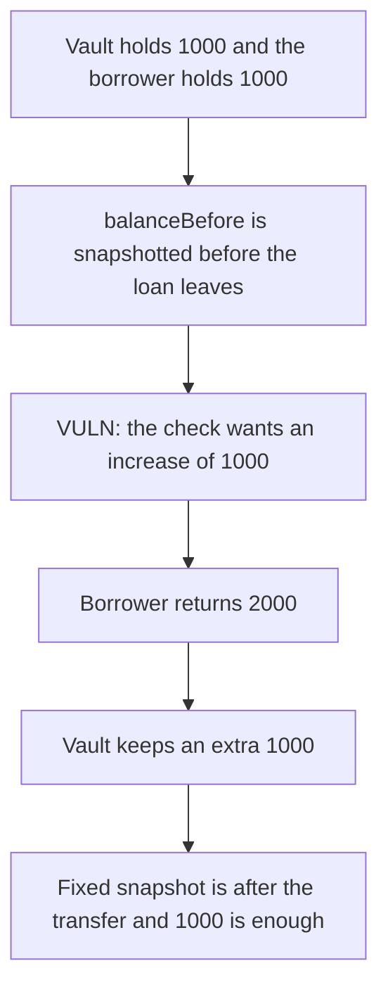

# Astrolab — the flash-loan check makes the borrower return the principal twice

> **Vulnerability classes:** vuln/logic/wrong-condition · vuln/logic/missing-validation

<!-- non-defihacklabs -->
<!-- source-auditvault: https://github.com/Auditware/AuditVault/blob/main/findings/58099-h-02-flash-loan-wrong-balance-check-pashov-audit-group-none.md -->
<!-- date: 2024-02 -->

## Key info

| | |
|---|---|
| **Protocol** | Astrolab |
| **Finding** | Pashov Audit Group H-02, AuditVault 58099 |
| **Vulnerable code** | `As4626.flashLoanSimple` |
| **Harm** | A 1000 USDC loan succeeds only if the borrower returns 2000; the vault keeps the extra 1000 |
| **Chain** | local synthetic |

## TL;DR

`balanceBefore` is read before the loan tokens are transferred out. The check then requires `balanceAfter - balanceBefore >= amount + fee`. With a zero flash fee, `toRepay` is 1000, but the delta is `repayment - 1000`. The borrower has to return 2000 for a 1000 loan. The vault finishes 1000 richer. A borrower who returns exactly 1000 reverts. Snapshotting after the transfer, which is the report's fix, accepts a repayment of 1000 and the vault balance does not change.

## The vulnerable code

```solidity
uint256 fee = 0;
uint256 toRepay = amount + fee;
// @> VULN: balanceBefore is recorded before the loan is transferred, so the check below demands `amount` on top of repayment.
uint256 balanceBefore = asset.balanceOf(address(this));
totalLent += amount;
asset.safeTransferFrom(address(this), receiver, amount);
IFlashLoanReceiver(receiver).executeOperation(address(asset), amount, fee, msg.sender, params);
if ((asset.balanceOf(address(this)) - balanceBefore) < toRepay) {
    revert FlashLoanDefault(msg.sender, amount);
}
```

The vault approves itself once, in the constructor, so `transferFrom` can move its own tokens. That is a different finding: without the approval the call reverts before this check runs. The approval is here only so this check is what executes.

```diff
- uint256 balanceBefore = asset.balanceOf(address(this));
  totalLent += amount;
  asset.safeTransferFrom(address(this), receiver, amount);
+ uint256 balanceBefore = asset.balanceOf(address(this));
  receiver.executeOperation(...);
  if ((asset.balanceOf(address(this)) - balanceBefore) < toRepay)
      revert FlashLoanDefault(msg.sender, amount);
```

Recording `balanceBefore` after the transfer makes the delta equal to the repayment. Comparing the old delta to `fee` instead of `toRepay`, which is the report's other diff, is the same requirement when the snapshot stays where it is: `repayment - amount >= fee`.

## Root cause

`balanceAfter - balanceBefore` is not the amount the borrower returned. The 1000 that `safeTransferFrom` just sent is still inside `balanceBefore`, so it is subtracted again. The check asks for `amount + fee` of *increase* on top of a balance that still included the loan. The borrower pays the principal twice and the fee once. Here the fee is 0, so the extra is exactly 1000.

## Preconditions

The vault holds 1000 USDC and has approved itself so `safeTransferFrom` does not revert. The flash fee is 0. The borrower holds another 1000, because that is what the check takes beyond the borrowed funds. No role is required.

## Attack walkthrough

1. The vault's balance reads 1000. The borrower holds 1000 of their own.
2. `flashLoanSimple` borrows 1000. `toRepay` is 1000.
3. `balanceBefore` is 1000, then the 1000 is sent to the borrower. The vault balance is 0.
4. The callback returns 2000. The vault balance is 2000.
5. `2000 - 1000 >= 1000`, so the check passes.
6. The vault is 1000 richer than it started. The borrower is at 0.

A second test calls the same function with a borrower who returns only 1000. `balanceAfter - balanceBefore` is 0, and the call reverts with `FlashLoanDefault`. Nothing moves.

The control snapshots after `safeTransferFrom` and uses the same `toRepay` of 1000. The honest borrower returns 1000. The vault ends at 1000. The extra taken is 0.

## Diagrams



## Impact

Every flash loan that succeeds pulls an extra `amount` out of the borrower and leaves it in the vault. For a 1000 USDC loan the borrower returns 2000 and the vault keeps 1000 that a correct check would have left with the borrower. A borrower who repays the 1000 in full, and nothing more, cannot use the function at all.

## Remediation

Read `balanceBefore` after `safeTransferFrom`, and keep the comparison against `amount + fee`. Or leave the snapshot where it is and compare the delta to `fee` only.

## How to reproduce

```bash
cd 58099-h-02-flash-loan-wrong-balance-check-pashov-audit-group-none_exp
forge test -vv
```

## Sources

- AuditVault finding: https://github.com/Auditware/AuditVault/blob/main/findings/58099-h-02-flash-loan-wrong-balance-check-pashov-audit-group-none.md
- Pashov report: https://github.com/pashov/audits/blob/master/team/md/Astrolab-security-review.md
- Reviewed tree: https://github.com/AstrolabDAO/strats/tree/afe24b344f9e25104cbdd240d5d4448f01b06e07
- File cited by the report: `src/abstract/As4626.sol` `flashLoanSimple`
