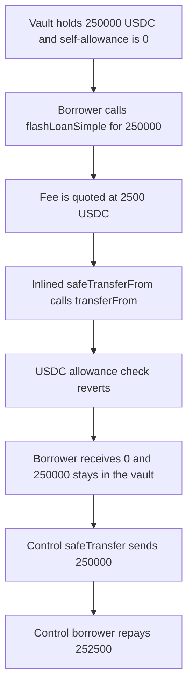

# Astrolab `flashLoanSimple` reverts because it `transferFrom`s its own USDC

> **Vulnerability classes:** vuln/logic/missing-check · vuln/dos/permanent

<!-- non-defihacklabs -->
<!-- source-auditvault: https://github.com/Auditware/AuditVault/blob/main/findings/58100-h-03-flash-loan-not-working-due-to-transferfrom-issue-pashov.md -->
<!-- date: 2024-01 -->

## Key info

| Field | Value |
|---|---|
| **Loss** | 250,000.000000 USDC cannot be flash-borrowed. The borrower receives 0. The control transfers 250,000 and is repaid 252,500 |
| **Vulnerable contract** | `FlashLender.flashLoanSimple` / inlined `SafeERC20.safeTransferFrom` |
| **Attacker EOA** | `0x1111111111111111111111111111111111111111` |
| **Attack contract** | `Exploit` |
| **Attack tx** | `Exploit.run()` |
| **Chain / block / date** | Ethereum model · block 0 · 2024-01 |
| **Compiler** | solc 0.8.27, cancun, via IR |
| **Bug class** | Self-`transferFrom` with zero allowance |

## TL;DR

`As4626.flashLoanSimple` sends the loan with `asset.safeTransferFrom(address(this), address(receiver), amount)`. USDC `transferFrom` requires `value <= allowed[from][msg.sender]`. The vault never approved itself, so `allowed[vault][vault]` is 0 and a borrow of 250,000 USDC reverts. The borrower receives 0 and the 250,000 stays in the vault. `totalLent` rolls back to 0. A fixed vault uses `safeTransfer`, which does not read allowance. The same borrower receives 250,000 USDC and repays 252,500 USDC (principal plus the 1% / 2,500 USDC fee). The fixed vault ends at 252,500 USDC.

## Background

Pashov Audit Group reviewed Astrolab (H-03) from 25 January 2024 to 31 January 2024. `flashLoanSimple` lives in `As4626`. The auditors traced the pull to USDC `FiatTokenV1.transferFrom`, which reverts with `ERC20: transfer amount exceeds allowance` when the spender has no allowance. Their fix is to replace `safeTransferFrom` with `safeTransfer`.

## The vulnerable code

```solidity
function flashLoanSimple(
    IFlashLoanReceiver receiver,
    uint256 amount,
    bytes calldata params
) external nonReentrant {
    uint256 available = availableBorrowable();
    if (amount > available || amount > maxLoan) revert AmountTooHigh(amount);

    uint256 fee = exemptionList[msg.sender] ? 0 : amount.bp(fees.flash);
    uint256 toRepay = amount + fee;

    uint256 balanceBefore = asset.balanceOf(address(this));
    totalLent += amount;

    asset.safeTransferFrom(address(this), address(receiver), amount);
    receiver.executeOperation(address(asset), amount, fee, msg.sender, params);

    if ((asset.balanceOf(address(this)) - balanceBefore) < toRepay)
        revert FlashLoanDefault(msg.sender, amount);

    emit FlashLoan(msg.sender, amount, fee);
}
```

solc via IR inlines `safeTransferFrom`. The executing statement is the `transferFrom` inside that helper:

```solidity
// @> VULN: inlined body of asset.safeTransferFrom(address(this), receiver, amount). allowance[vault][vault] is 0.
bool ok = token.transferFrom(from, to, value);
```

USDC then hits:

```solidity
require(value <= allowed[from][msg.sender], "ERC20: transfer amount exceeds allowance");
```

The recommended pull is `safeTransfer`, which does not consult allowance:

```diff
-        asset.safeTransferFrom(address(this), address(receiver), amount);
+        asset.safeTransfer(address(receiver), amount);
```

## Root cause

`safeTransferFrom(from, to, amount)` calls `token.transferFrom(from, to, amount)` with `msg.sender` equal to the vault. For a self-pull, `from` is also the vault, so USDC checks `allowed[vault][vault]`. Nothing in `flashLoanSimple` writes that allowance. It stays 0. Any `amount > 0` reverts before `executeOperation`. The fee quote and the `totalLent` increment are inside the reverting call, so neither sticks.

## Preconditions

- The vault holds 250,000 USDC of borrowable cash, and `maxLoan` is at least that amount.
- `fees.flash` is 100 (1%, basis 10,000), so the quoted fee is 2,500 USDC and a real repayment is 252,500 USDC.
- The caller is not on `exemptionList`.
- The vault has not approved itself. `allowance(vault, vault)` is 0.

## Attack walkthrough

1. The exploit mints 250,000 USDC to the vulnerable vault.
2. It reads `allowance(vault, vault)` and gets 0.
3. It calls `flashLoanSimple` for 250,000 USDC. The cash and `maxLoan` checks pass.
4. The fee is quoted at 2,500 USDC. `totalLent` is increased by 250,000 inside the call.
5. The inlined `safeTransferFrom` calls `transferFrom(vault, receiver, 250,000e6)`.
6. USDC reverts: 250,000e6 is greater than allowance 0.
7. The whole borrow reverts. The receiver's `received` stays 0. The vault still holds 250,000 USDC. `totalLent` is 0.
8. The control vault, also holding 250,000 USDC, is called the same way. Its borrower was pre-funded with the 2,500 USDC fee.
9. `safeTransfer` moves 250,000 USDC to that borrower.
10. The borrower repays 252,500 USDC. The fixed vault's balance is 252,500 USDC.

## Diagrams



## Impact

A legitimate flash borrow of 250,000 USDC cannot be used. The borrower receives 0 of the 250,000, and the vault's balance is unchanged at 250,000.000000 USDC. No fee is earned. The control path transfers the 250,000 principal and is repaid 252,500 USDC, leaving the fixed vault 2,500 USDC richer.

The audited repayment check snapshots the balance before the outbound transfer and compares the raw delta to `amount + fee`. A normal repay of `amount + fee` increases the balance by only the fee, so that check would still reject a successful pull. The control uses `safeTransfer` and accepts a vault that finishes `fee` richer, which is what the 252,500 repayment produces. The vulnerable call never reaches its check: `transferFrom` reverts first.

## PoC

```bash
cd 58100-h-03-flash-loan-not-working-due-to-transferfrom-issue-pashov_exp
forge test -vv
```

`test_exploit_flash_loan_reverts_and_loan_stays_put` asserts the borrow reverted, self-allowance is 0, the borrower received 0, the vault still holds 250,000e6, and `totalLent` is 0. It also asserts the control borrower received 250,000e6 and repaid 252,500e6. `test_control_transfer_and_repay` runs the fixed vault alone and asserts the same transfer and repayment.

## Sources

- AuditVault finding: https://github.com/Auditware/AuditVault/blob/main/findings/58100-h-03-flash-loan-not-working-due-to-transferfrom-issue-pashov.md
- Pashov report: https://github.com/pashov/audits/blob/master/team/md/Astrolab-security-review.md
- Reviewed source: https://github.com/AstrolabDAO/strats/blob/82ad070202c210c8b12133afbdb63c68c9f42918/src/abstract/As4626.sol
