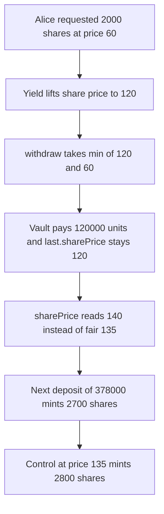

# Astrolab `withdraw` at the worst request price mints the next depositor 2,700 shares instead of 2,800

> **Vulnerability classes:** vuln/logic/price-calculation · vuln/logic/incorrect-calculation

<!-- non-defihacklabs -->
<!-- source-auditvault: https://github.com/Auditware/AuditVault/blob/main/findings/58101-h-04-withdraw-worst-price-will-distort-shareprice-pashov-aud.md -->
<!-- date: 2024-01 -->

## Key info

| Field | Value |
|---|---|
| **Loss** | Next depositor is minted 2,700 shares instead of 2,800 for the same 378,000 asset units |
| **Vulnerable contract** | `Vault.withdraw` |
| **Attacker EOA** | `0x1111111111111111111111111111111111111111` |
| **Attack contract** | `Exploit` |
| **Attack tx** | `Exploit.run()` |
| **Chain / block / date** | Ethereum model · block 0 · 2024-01 |
| **Compiler** | solc 0.8.27, cancun, via IR |
| **Bug class** | Stale `last.sharePrice` after a worst-price withdrawal |

## TL;DR

`_withdraw` pays a claimable request at `min(last.sharePrice, request.sharePrice)` and never writes the post-payout price back into `last.sharePrice`. Alice's 2,000 shares leave at the old request price 60 (the report's price 5) while the live price is 120 (the report's price 10). Assets fall by 120,000, not by 240,000, so the remaining shares are worth 135 (report 11.25). `sharePrice()` still values Bob's open claim at 120 and returns 140 (report 35/3, about 3.7% high). The next depositor paying 378,000 units is minted 2,700 shares. A vault that sets `last.sharePrice` to assets/supply after the payout mints 2,800 shares for the same payment.

Prices in this reduction are the report's prices times 12, and share counts are the report's counts times 100, so 11.25 and 35/3 are the integers 135 and 140.

## Background

Pashov Audit Group reviewed Astrolab (H-04) from 25 January 2024 to 31 January 2024. `As4626._withdraw` takes the worst of the current share price and the price stored on an existing redemption request. `sharePrice()` and `totalAccountedAssets()` then keep using `last.sharePrice`, which was snapshotted before that cheap payout. The report's example ends at a 3.7% gap: accounted price 11.67 versus fair price 11.25.

## The vulnerable code

```solidity
last.sharePrice = sharePrice();

// @> VULN: worst of last.sharePrice and the stale request price. Assets leave cheaper than sharePrice, and last.sharePrice is not rewritten.
uint256 worst = AsMaths.min(last.sharePrice, request.sharePrice);
uint256 price = claimable >= shares ? worst : last.sharePrice;
```

`sharePrice()` values the still-claimable shares at that stale `last.sharePrice`:

```solidity
function totalAccountedAssets() public view returns (uint256) {
    return totalAssets() - totalClaimableRedemption.mulDiv(
        last.sharePrice * weiPerAsset,
        weiPerShare ** 2
    );
}
```

The control writes the fair assets-per-share after the payout:

```solidity
last.sharePrice = totalAssets().mulDiv(weiPerShare ** 2, totalSupply * weiPerAsset);
```

## Root cause

A request stores `request.sharePrice` at request time. If the vault appreciates, `min(last.sharePrice, request.sharePrice)` pays the holder less than the live price. The assets that stay behind raise the value of every remaining share. `last.sharePrice` was set to the pre-payout `sharePrice()` and is not updated, so `totalAccountedAssets()` subtracts the remaining claim at the old price. The next `sharePrice()` is too high, and `convertToShares` mints too few shares.

## Preconditions

- Alice and Bob each have a claimable request for 2,000 shares taken when the price was 60 (report price 5).
- Yield then lifts assets to 1,200,000. With claims not yet in `totalClaimableRedemption`, `sharePrice()` is 120 (report price 10) and `syncPrice` stores it.
- Realizing the claims at that stored price keeps `sharePrice()` at 120. That is the fixed point in the report.
- Alice then withdraws her 2,000 shares. Bob's 2,000 stay claimable.
- The next depositor pays 378,000 units, which is 315 assets in the report's unscaled example.

## Attack walkthrough

1. The vault is seeded with 10,000 shares and 600,000 asset units. Price is 60.
2. Alice and Bob each request 2,000 shares. Each request stores price 60.
3. Yield adds 600,000 units. `syncPrice` sets `last.sharePrice` to 120.
4. Both requests become claimable. `sharePrice()` is still 120.
5. Alice withdraws. `min(120, 60)` is 60, so the vault pays 120,000 units and burns 2,000 shares.
6. Assets are 1,080,000, supply is 8,000, Bob's 2,000 shares are still claimable, and `last.sharePrice` is still 120.
7. Fair price is 1,080,000 / 8,000 = 135. Accounted price is (1,080,000 - 2,000 * 120) / 6,000 = 140.
8. The next depositor pays 378,000. `convertToShares` at 140 returns 2,700.
9. The control vault performs the same withdraw, then sets `last.sharePrice` to 135. The same payment mints 2,800 shares.

## Diagrams



## Impact

The next depositor pays 378,000 asset units and receives 2,700 shares. At the fair post-withdraw price they would receive 2,800 shares. The 100-share gap is the report's 3.7% price error (140 versus 135, which is 35/3 versus 11.25 before scaling). Existing shareholders keep the value that the cheap withdrawal left behind, and the new depositor buys in at the inflated accounted price.

## PoC

```bash
cd 58101-h-04-withdraw-worst-price-will-distort-shareprice-pashov-aud_exp
forge test -vv
```

`test_exploit_next_depositor_minted_wrong_shares` asserts the distorted price is 140, the fair price is 135, the caller received 2,700 shares, and the control vault minted 2,800. `test_control_fair_price_mints_more_shares` asserts the shortfall is 100 shares.

## Sources

- AuditVault finding: https://github.com/Auditware/AuditVault/blob/main/findings/58101-h-04-withdraw-worst-price-will-distort-shareprice-pashov-aud.md
- Pashov report: https://github.com/pashov/audits/blob/master/team/md/Astrolab-security-review.md
- Reviewed source: https://github.com/AstrolabDAO/strats/blob/82ad070202c210c8b12133afbdb63c68c9f42918/src/abstract/As4626.sol
