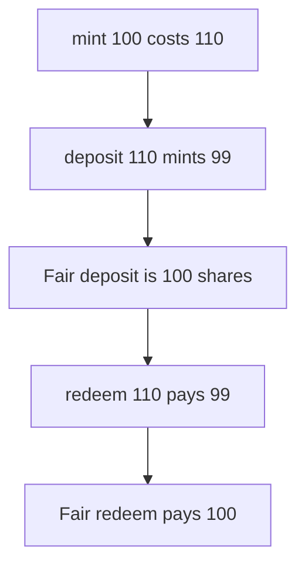

# Astrolab — deposit and redeem take 10 percent off the gross amount

> **Vulnerability classes:** vuln/logic/fee-calculation · vuln/defi/fee-manipulation

> **Reproduction:** a self-contained Foundry PoC that compiles and runs offline
> with only `forge-std` — no fork and no RPC. Trace: [output.txt](output.txt).
> PoC: [test/58102-h-05-fee-calculation-mismatch-in-mint-deposit-redeem-and-wit_exp.sol](test/58102-h-05-fee-calculation-mismatch-in-mint-deposit-redeem-and-wit_exp.sol).

<!-- non-defihacklabs -->
<!-- source-auditvault: https://github.com/Auditware/AuditVault/blob/main/findings/58102-h-05-fee-calculation-mismatch-in-mint-deposit-redeem-and-wit.md -->
<!-- date: 2024-01 -->

---

## Key info

| | |
|---|---|
| **Impact** | **HIGH** — deposit of 110 mints **99** shares instead of **100**, and redeem of 110 pays **99** instead of **100** |
| **Protocol** | Astrolab `As4626` |
| **Vulnerable code** | `previewDeposit` and `previewRedeem` use `subBp` on the gross amount |
| **Bug class** | The fee is taken off an amount that already includes the fee |
| **Finding** | Pashov Audit Group — Astrolab · id 58102 |
| **Report** | [Astrolab security review](https://github.com/pashov/audits/blob/master/team/md/Astrolab-security-review.md) |
| **Source** | [AuditVault finding](https://github.com/Auditware/AuditVault/blob/main/findings/58102-h-05-fee-calculation-mismatch-in-mint-deposit-redeem-and-wit.md) |
| **Compiler** | solc 0.8.27, cancun, via IR |

---

## TL;DR

Price is 1:1 and the entry and exit fee is 10 percent, the numbers in the report.

`previewMint(100)` uses `addBp` and costs **110**. That is a 10 asset fee, which is the intended charge. `previewDeposit(110)` uses `subBp` and mints **99** shares. The amount 110 already includes the fee, so the fair share count is `110 * 10000 / 11000 = 100`. The depositor is short **1 share**.

`previewRedeem(110)` uses the same `subBp` and pays **99** assets. The fair payout is **100**. The shareholder is short **1 asset**. `previewWithdraw(100)` uses `addBp` and burns 110 shares to pay 100, which is the consistent fee.

## The vulnerable code

```solidity
function previewDeposit(uint256 amount) public pure returns (uint256) {
    uint256 shares = convertToShares(amount);
    return shares * (BP - FEE) / BP;
}

function previewRedeem(uint256 shares) public pure returns (uint256) {
    uint256 assets = convertToAssets(shares);
    // @> VULN: subBp of the gross amount, not amount * base / (base + fee)
    return assets * (BP - FEE) / BP;
}
```

`subBp` is `amount * 9000 / 10000`. The report's fix is `amount * base / (base + fee)`.

## Root cause

`mint` and `withdraw` treat the user number as the net amount and add the fee on top. `deposit` and `redeem` treat the user number as the gross amount and then take 10 percent off it. The second pair charges the fee on a base that already contains the fee.

## Preconditions

- Share price is 1:1, as in the report's example.
- The fee is 1,000 bps, 10 percent.
- The worked amounts are 100 and 110, scaled by 1 ether.

## Attack walkthrough

1. `previewMint(100 ether)` returns 110 ether.
2. The fair deposit of 110 ether is 100 ether of shares.
3. A depositor pays 110 ether and is minted 99 ether of shares.
4. A shareholder redeems 110 ether of shares and is paid 99 ether of assets.
5. Each path is short 1 ether against `amount * 10000 / 11000`.

Control: both previews use `amount * 10000 / 11000`. The deposit mints 100 shares and the redeem pays 100 assets.

## Diagrams



## Impact

Every `deposit` and every `redeem` overcharges by the difference between `subBp` and `base / (base + fee)`. On the report's 110-unit example that is **1 unit** of shares on the way in and **1 unit** of assets on the way out. The extra stays in the vault and benefits the remaining shareholders.

## Remediation

`previewDeposit` should return `convertToShares(amount) * 10000 / 11000`. `previewRedeem` should return `convertToAssets(shares) * 10000 / 11000`. Leave `addBp` on `previewMint` and `previewWithdraw`.

## Sources

- [AuditVault finding 58102](https://github.com/Auditware/AuditVault/blob/main/findings/58102-h-05-fee-calculation-mismatch-in-mint-deposit-redeem-and-wit.md)
- [Pashov, Astrolab security review](https://github.com/pashov/audits/blob/master/team/md/Astrolab-security-review.md)

### Taxonomy

- `vuln/logic/fee-calculation` · `vuln/defi/fee-manipulation`
