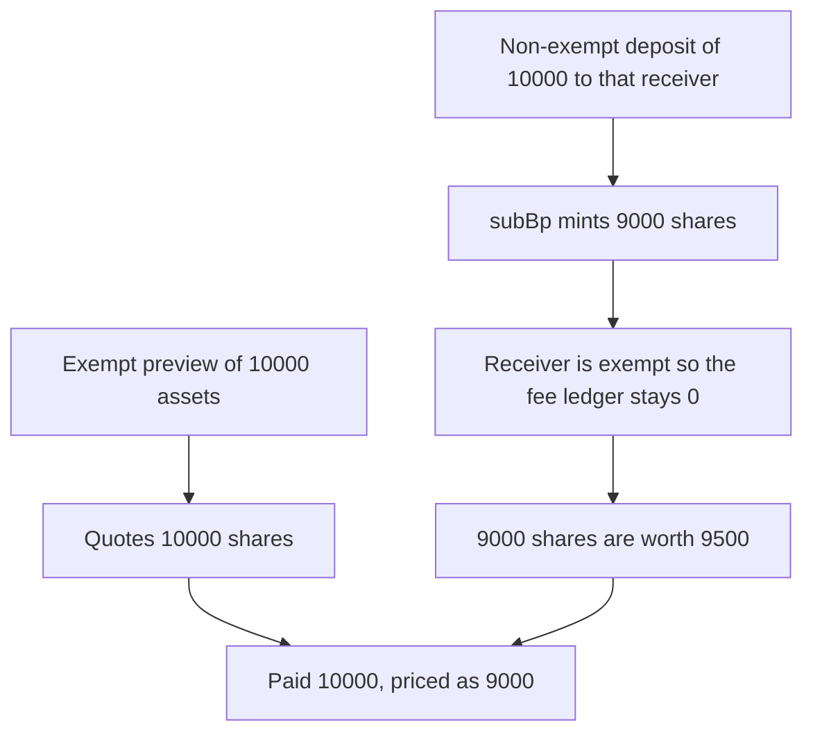

# Astrolab — deposit preview fees the caller, execution fees the receiver

> **Vulnerability classes:** vuln/logic/fee-calculation · vuln/logic/wrong-condition

> **Reproduction:** a self-contained Foundry PoC that compiles and runs offline
> with only `forge-std` — no fork and no RPC. Trace: [output.txt](output.txt).
> PoC: [test/58103-h-06-fee-target-mismatch-in-deposit-mint-withdraw-redeem-and_exp.sol](test/58103-h-06-fee-target-mismatch-in-deposit-mint-withdraw-redeem-and_exp.sol).

<!-- non-defihacklabs -->
<!-- source-auditvault: https://github.com/Auditware/AuditVault/blob/main/findings/58103-h-06-fee-target-mismatch-in-deposit-mint-withdraw-redeem-and.md -->
<!-- date: 2024-01 -->

---

## Key info

| | |
|---|---|
| **Impact** | **HIGH** — a depositor pays **10,000** assets and receives **9,000** shares, priced as a fee-free deposit of **9,000**. Those shares are worth **9,500**. The fee ledger stays **0** |
| **Protocol** | Astrolab As4626 vault |
| **Vulnerable code** | `previewDeposit` uses `exemptionList[msg.sender]`; `_deposit` uses `exemptionList[_receiver]` |
| **Bug class** | Entry-fee target disagrees between preview and execution |
| **Finding** | Pashov Audit Group — Astrolab security review, 25–31 January 2024 · H-06 · id 58103 |
| **Report** | [Astrolab-security-review.md](https://github.com/pashov/audits/blob/master/team/md/Astrolab-security-review.md) |
| **Source** | [AuditVault finding](https://github.com/Auditware/AuditVault/blob/main/findings/58103-h-06-fee-target-mismatch-in-deposit-mint-withdraw-redeem-and.md) |
| **Status** | Audit finding, commit `afe24b3` of AstrolabDAO/strats. Reproduced as a local synthetic. |
| **Compiler** | solc 0.8.27, cancun, via IR |

---

## TL;DR

The entry fee is 10%. An exempt account has already seeded the vault with 9,000 assets and 9,000 shares.

- The exempt receiver's `previewDeposit(10,000)` returns **10,000** shares.
- A non-exempt caller then `deposit(10,000, exemptReceiver)`.
- `previewDeposit` haircuts `msg.sender`, so execution mints **9,000** shares. That is the share amount a fee-free deposit of **9,000** would mint.
- `_deposit` looks at the exempt receiver and adds nothing to `claimableAssetFees`.
- The vault holds 19,000 assets and 18,000 shares. The 9,000 new shares are worth **9,500**. The depositor paid **10,000** and is short **500**, and the 1,000 share haircut was never booked as a fee.

## The vulnerable code

From `As4626.previewDeposit` and `As4626._deposit` at the audited commit:

```solidity
function previewDeposit(uint256 _amount) public view returns (uint256 shares) {
    uint256 gross = convertToShares(_amount);
    if (exemptionList[msg.sender]) { // @> VULN: entry fee is priced off msg.sender, not the receiver
        return gross;
    }
    shares = subBp(gross, ENTRY);
}

function _deposit(uint256 _amount, uint256 _shares, address _receiver) internal returns (uint256) {
    asset.transferFrom(msg.sender, address(this), _amount);
    if (!exemptionList[_receiver]) {
        claimableAssetFees += revBp(_amount, ENTRY); // execution keys the fee off _receiver
    }
    // ... mint _shares to _receiver
}
```

`subBp(amount, 1000)` is `amount * 9000 / 10000`. `deposit` mints `previewDeposit(_amount)` shares, so the caller's exemption decides the share count and the receiver's exemption decides the ledger.

## Root cause

The preview and the fee ledger do not name the same account. A caller and a receiver on opposite sides of `exemptionList` make the share mint and `claimableAssetFees` disagree. Here the caller is charged and the receiver is not, so the haircut never becomes a collectable fee and the depositor is minted the shares of a smaller deposit.

## Preconditions

- Entry fee is non-zero. This run uses 1,000 bps.
- The caller is not exempt and the receiver is.
- The vault already has shares, so the haircut is not given back by sole ownership of the pool. The seed is 9,000.

## Attack walkthrough

1. Exempt seed: 9,000 assets, 9,000 shares.
2. The exempt receiver calls `previewDeposit(10,000)` and is quoted **10,000** shares.
3. The non-exempt depositor calls `deposit(10,000, receiver)`.
4. `subBp` mints **9,000** shares.
5. `exemptionList[receiver]` is true, so `claimableAssetFees` stays **0**.
6. Vault assets are **19,000**, supply is **18,000**. The new shares claim `9000 * 19000 / 18000 = 9,500`.
7. Paid **10,000**, received shares priced as **9,000**, position worth **9,500**.

Control: `_deposit` uses `exemptionList[msg.sender]`, the same account as `previewDeposit`. The same caller still receives 9,000 shares, and those shares equal `previewDeposit(10,000)`. `claimableAssetFees` is `revBp(10,000, 1000)`, not zero. Preview and the fee ledger describe the same payer.

## Diagrams



## Impact

The depositor pays **10,000** and is treated as if they had paid **9,000**. The position is worth **9,500**, a **500** shortfall against the payment, and the **1,000** share haircut is invisible to fee collection. The symmetric case in the report, an exempt caller and a non-exempt receiver, books a fee that was never taken out of the shares.

## Remediation

Use `msg.sender` for the entry-fee decision in both `previewDeposit` and `_deposit`. Do the same for the exit fee in `previewWithdraw`, `previewRedeem`, and `_withdraw`, which the finding shows making the same `msg.sender` versus `_owner` mistake.

## Sources

- [AuditVault finding 58103](https://github.com/Auditware/AuditVault/blob/main/findings/58103-h-06-fee-target-mismatch-in-deposit-mint-withdraw-redeem-and.md)
- [Pashov Astrolab review](https://github.com/pashov/audits/blob/master/team/md/Astrolab-security-review.md)
- Audited tree: [AstrolabDAO/strats@afe24b3](https://github.com/AstrolabDAO/strats/tree/afe24b344f9e25104cbdd240d5d4448f01b06e07)

### Taxonomy

- `severity/high` · `sector/yield`
- `vuln/logic/fee-calculation` · `vuln/logic/wrong-condition`
