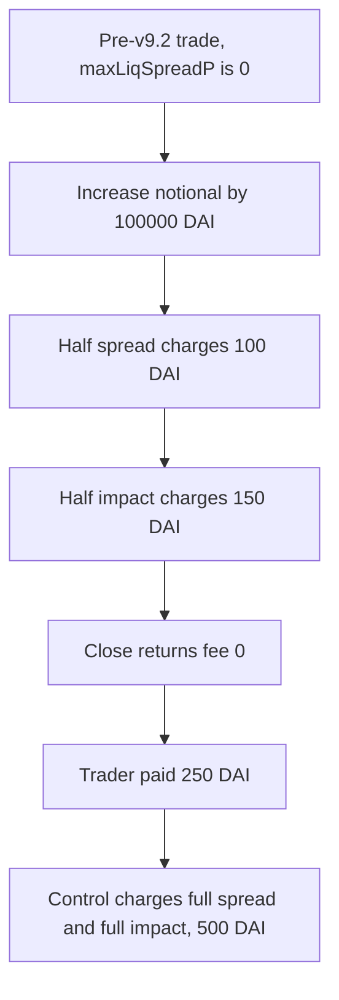

# gTrade charges 250 DAI instead of 500 DAI when a pre-v9.2 position is increased and closed

> **Vulnerability classes:** vuln/logic/fee-calculation · vuln/defi/fee-manipulation

<!-- non-defihacklabs -->
<!-- source-auditvault: https://github.com/Auditware/AuditVault/blob/main/findings/58121-h-01-inconsistent-spread-and-price-impact-charges-pashov-aud.md -->
<!-- date: 2024-07 -->

## Key info

| Field | Value |
|---|---|
| **Loss** | Trader pays 250 DAI instead of 500 DAI on a 100,000 DAI increase of a pre-v9.2 trade |
| **Vulnerable contract** | `PositionBook.increasePosition` / `getTradeClosingPriceImpact` |
| **Attacker EOA** | `0x1111111111111111111111111111111111111111` |
| **Attack contract** | `Exploit` |
| **Attack tx** | `Exploit.run()` |
| **Chain / block / date** | Ethereum model · block 0 · 2024-07 |
| **Compiler** | solc 0.8.27, cancun, via IR |
| **Bug class** | Half spread and half price impact on increase, zero on a legacy close |

## TL;DR

Increasing a position always calls `getMarketExecutionPrice(..., true)` and `impactFee(..., true)`, so only half the spread and half the price impact are charged, including for trades opened before v9.2. Closing those trades sees `maxLiqSpreadP == 0` and returns a fee of 0. On a 100,000 DAI increase the full spread is 200 DAI (20 bps) and the full impact is 300 DAI (30 bps), 500 DAI together. The trader pays 100 + 150 = 250 DAI on the increase and 0 on the close. The control charges both in full and collects 500 DAI.

## Background

Pashov Audit Group reviewed Gains Network gTrade (H-01) at commit `59a031048323276bfbec6c8751ae7c0ee81df5ab`. v9.2 started charging spread and price impact symmetrically. Trades opened earlier are marked by `maxLiqSpreadP == 0`. The increase path does not look at that flag. The close path does, and skips both charges.

## The vulnerable code

```solidity
uint256 market = getMarketExecutionPrice(10_000, SPREAD_BPS, existingTrade.long, true);

// @> VULN: the hardcoded true charges half the spread and half the impact for every trade, including pre-v9.2
uint256 spreadCharged = notional * (market - oracle) / oracle;
uint256 impactCharged = impactFee(notional, true);
```

The close of a legacy trade:

```solidity
if (trade.maxLiqSpreadP == 0) {
    return (0, marketPrice, 0);
}
```

The control passes `false` into both the spread price and the impact fee, which is the 100% charge the report asks for on a pre-v9.2 increase.

## Root cause

`prepareCallbackValues` hardcodes the half-spread flag and the half-impact flag. That 50% rate is the normal charge for a round trip that will also pay 50% on the way out. `getTradeClosingPriceImpact` returns zero impact, zero fee, and the raw market price whenever `maxLiqSpreadP` is 0. A legacy trade therefore pays the open-side half and never pays the close-side half.

## Preconditions

- The trade was opened before v9.2, so `maxLiqSpreadP` is 0.
- The trader increases it by 100,000 DAI of notional.
- Pair spread is 20 bps and price impact is 30 bps.
- The trader then closes or decreases that position.

## Attack walkthrough

1. The trader holds a pre-v9.2 long and increases it by 100,000 DAI.
2. `getMarketExecutionPrice` is called with `halfSpread = true`. A 20 bps spread moves the price by 10 bps, from 10,000 to 10,010.
3. Spread charged is 100,000 * 10 / 10,000 = 100 DAI. The full spread is 200 DAI.
4. `impactFee(notional, true)` uses 15 bps and charges 150 DAI. The full impact is 300 DAI.
5. The book pulls 250 DAI.
6. The trader closes. `maxLiqSpreadP == 0`, so the close returns fee 0.
7. Total paid is 250 DAI.
8. The control increase uses the full 20 bps and the full 30 bps and pulls 500 DAI.

## Diagrams



## Impact

The protocol collects 250 DAI where the full spread plus the full price impact is 500 DAI. The 250 DAI difference stays with the trader. The close cannot recover it, because a pre-v9.2 close is defined to charge neither spread nor impact.

## PoC

```bash
cd 58121-h-01-inconsistent-spread-and-price-impact-charges-pashov-aud_exp
forge test -vv
```

`test_exploit_trader_pays_half_then_nothing_on_close` asserts `paidWrong` is 250e18, `closeFee` is 0, and `paidFair` is 500e18.

## Sources

- AuditVault finding: https://github.com/Auditware/AuditVault/blob/main/findings/58121-h-01-inconsistent-spread-and-price-impact-charges-pashov-aud.md
- Pashov report: https://github.com/pashov/audits/blob/master/team/md/GainsNetwork-security-July2.md
- Reviewed source: https://github.com/GainsNetwork-org/gTrade-contracts/tree/59a031048323276bfbec6c8751ae7c0ee81df5ab
