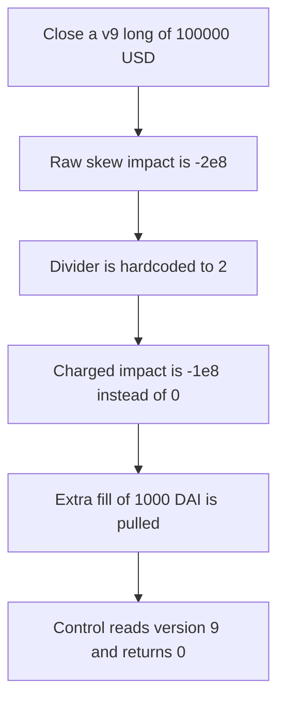

# gTrade charges a v9 close -1e8 of skew (1,000 DAI) instead of 0

> **Vulnerability classes:** vuln/logic/price-calculation · vuln/defi/price-manipulation

<!-- non-defihacklabs -->
<!-- source-auditvault: https://github.com/Auditware/AuditVault/blob/main/findings/58129-h-02-gettradeskewpriceimpactp-function-ignores-trade-contrac.md -->
<!-- date: 2025-05 -->

## Key info

| Field | Value |
|---|---|
| **Loss** | A v9 close pays 1,000 DAI of skew impact. The version-aware charge is 0 |
| **Vulnerable contract** | `PriceImpact.getTradeSkewPriceImpactP` |
| **Attacker EOA** | `0x1111111111111111111111111111111111111111` |
| **Attack contract** | `Exploit` |
| **Attack tx** | `Exploit.run()` |
| **Chain / block / date** | Ethereum model · block 0 · 2025-05 |
| **Compiler** | solc 0.8.27, cancun, via IR |
| **Bug class** | Skew divider ignores contract version |

## TL;DR

`getTradeSkewPriceImpactP` always divides the skew by 2. It never reads the trade's contract version. A long close of 100,000 USD on a flat book has raw skew -2e8 (2%). After the hardcoded division the close is charged -1e8 (1%), and the fill is 1,000 DAI worse. Trades opened before version 10 were not charged skew on the way in, so the close should return 0. The control reads `contractsVersion` and returns 0 for that close, taking no fill.

## Background

Pashov Audit Group reviewed Gains Network gTrade on 26 May 2025 (H-02). Skew price impact was introduced with contract version 10. Closing a trade opened earlier still runs the new formula and pays half the skew, even though the open did not pay the other half.

## The vulnerable code

```solidity
int256 raw = _getTradePriceImpactP(0, int256(tradeOpenInterestUsd) * tradeSkewMultiplier, DEPTH);

// @> VULN: divider is hardcoded to 2. The trade's contract version is never consulted.
int256 priceImpactDivider = int256(2);
priceImpactP = raw / priceImpactDivider;
```

The control includes the trade version:

```solidity
if (contractsVersion < 10 && !open) {
    priceImpactP = 0;
}
```

## Root cause

The production function has no `contractsVersion` argument. `priceImpactDivider` is the constant 2 so that open and close each pay half. That split is wrong for a trade whose open used an older contract: the close still pays the new half, and nothing in the function can see that the open did not.

## Preconditions

- The trade's contract version is 9, below 10.
- The close is a long, so the skew multiplier is -1.
- Pair skew depth is 5,000,000 USD and the book is otherwise flat.
- Trade open interest is 100,000 USD.

## Attack walkthrough

1. The trader closes the v9 long for 100,000 USD.
2. Raw impact is (0 - 100,000e18) * 1e10 / 5,000,000e18 = -2e8.
3. The divider is set to 2 without reading version 9.
4. Charged impact is -2e8 / 2 = -1e8. The correct legacy close impact is 0.
5. Fill taken is 100,000e18 * 1e8 / 1e10 = 1,000 DAI.
6. The control is called with the same version and the same close flag. It returns 0 and takes 0 DAI.

## Diagrams



## Impact

The trader's close is filled 1,000 DAI worse than a version-aware close. The book collects that 1,000 DAI. The impact that should have been 0 is -1e8.

## PoC

```bash
cd 58129-h-02-gettradeskewpriceimpactp-function-ignores-trade-contrac_exp
forge test -vv
```

`test_exploit_legacy_close_pays_half_skew` asserts the charged impact is -1e8, the control impact is 0, and the extra fill is 1,000e18 DAI.

## Sources

- AuditVault finding: https://github.com/Auditware/AuditVault/blob/main/findings/58129-h-02-gettradeskewpriceimpactp-function-ignores-trade-contrac.md
- Pashov report: https://github.com/pashov/audits/blob/master/team/md/GainsNetwork-security-review_2025-05-26.md
- gTrade contracts: https://github.com/GainsNetwork-org/gTrade-contracts
