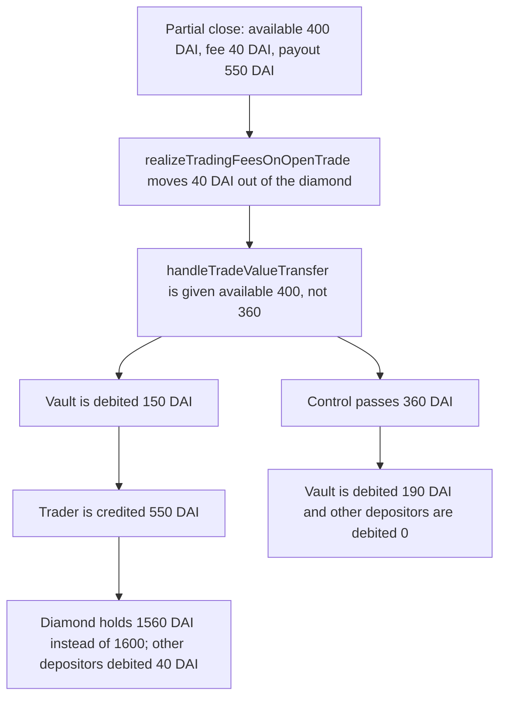

# Gains Network: decrease uses pre-fee available collateral and under-debits the vault

> **Vulnerability classes:** vuln/logic/fee-calculation · vuln/logic/incorrect-order-of-operations · vuln/logic/state-update

<!-- non-defihacklabs -->
<!-- source-auditvault: https://github.com/Auditware/AuditVault/blob/main/findings/58130-h-03-decrease-positions-updatetradesuccess-will-use-wrong-av.md -->
<!-- date: 2025-05 -->

## Key info

| Field | Value |
|---|---|
| **Loss** | Vault debited 150 DAI instead of 190 DAI. Trader credited 550 DAI. Other depositors debited 40 DAI (balance backing falls from 1,000 to 960) |
| **Vulnerable contract** | `GnsDiamond.updateTradeSuccess` / `TradingCommonUtils.handleTradeValueTransfer` |
| **Attacker EOA** | `0x1111111111111111111111111111111111111111` (keeper running the decrease) |
| **Attack contract** | `Exploit` |
| **Attack tx** | `Exploit.run()` |
| **Chain / block / date** | Ethereum model · block 0 · 2025-05 |
| **Compiler** | solc 0.8.27, cancun, via IR |
| **Bug class** | Closing fee is realized, then the vault pull still uses the pre-fee available collateral |

## TL;DR

On a partial close, `updateTradeSuccess` first realizes the closing fee, which removes that fee from collateral held in the diamond. It then calls `handleTradeValueTransfer` with the old `availableCollateralInDiamond`, which still includes the fee. The vault is debited 150 DAI. The fair debit, using available collateral minus the closing fee, is 190 DAI. The trader is credited 550 DAI on both paths. The 40 DAI difference is taken from other depositors' collateral sitting in the diamond. The control passes `availableCollateralInDiamond - closingFeeCollateral`, the vault is debited 190 DAI, and the other depositors are debited 0.

## Background

Pashov Audit Group reviewed Gains Network gTrade (report `GainsNetwork-security-review_2025-05-26`, commit `c9bc0b058b0bd336ff99ce31d50d152b32a32d43`). Finding H-03 is in `DecreasePositionSizeUtils.updateTradeSuccess`. The gToken vault is the counterparty: positive PnL is pulled from the vault, and losses are sent back. `availableCollateralInDiamond` is the portion of the payout that is already sitting in the diamond. `handleTradeValueTransfer` pulls `collateralSentToTrader - availableCollateralInDiamond` from the vault when the payout is larger.

## The vulnerable code

The audited function realizes the fee, then passes the pre-fee available amount through. The executed use of that stale amount is the vault-pull subtraction.

```solidity
_getMultiCollatDiamond().realizeTradingFeesOnOpenTrade(
    _existingTrade.user,
    _existingTrade.index,
    _values.closingFeeCollateral +
        (_values.collateralSentToTrader < 0 ? uint256(-_values.collateralSentToTrader) : 0),
    _answer.current
);

TradingCommonUtils.handleTradeValueTransfer(
    _existingTrade,
    _values.collateralSentToTrader,
    int256(_values.availableCollateralInDiamond)
);
```

```solidity
if (_collateralSentToTrader > _availableCollateralInDiamond) {
    // @> VULN: availableCollateralInDiamond was not reduced by closingFeeCollateral
    int256 collateralFromGToken = _collateralSentToTrader - _availableCollateralInDiamond;
    d.receiveCollateralFromVault(uint256(collateralFromGToken));
}
```

The report's fix subtracts the fee before the transfer:

```diff
         TradingCommonUtils.handleTradeValueTransfer(
             _existingTrade,
             _values.collateralSentToTrader,
-            int256(_values.availableCollateralInDiamond)
+            int256(_values.availableCollateralInDiamond - _values.closingFeeCollateral)
         );
```

## Root cause

`realizeTradingFeesOnOpenTrade` runs first. Its amount includes `closingFeeCollateral`, and the report's own comment says that amount reduces collateral available in the diamond. The token transfer in this reduction moves the 40 DAI fee to the fee sink. `handleTradeValueTransfer` is then given the available figure computed before that reduction. The vault pull is short by exactly the closing fee. The trader is still paid the full `collateralSentToTrader`, so the shortfall comes out of whatever other collateral is in the diamond.

## Preconditions

- A partial decrease with positive PnL, so `collateralSentToTrader` is greater than `availableCollateralInDiamond` and the vault-pull branch runs.
- `closingFeeCollateral` is non-zero. Here it is 40 DAI.
- The diamond also holds other depositors' collateral, which is what covers the short pull.
- No time delay. The whole decrease is one transaction.

## Attack walkthrough

Numbers are DAI with 18 decimals. The open position collateral in the diamond is 1,000. Other depositors have 1,000 in the same diamond. The partial slice caps `availableCollateralInDiamond` at 400. Partial PnL is +150, so `collateralSentToTrader` is 550. The closing fee is 40. The vault is funded with 1,000.

1. The keeper mints 3,000 DAI and sends 1,000 to the vault.
2. `fundPosition` pulls 2,000 DAI into the diamond.
3. `updateTradeSuccess` stores the remaining position collateral of 600.
4. `realizeTradingFeesOnOpenTrade` transfers 40 DAI to the fee sink. Diamond balance is 1,960.
5. The vault pull uses 550 − 400 = 150. The fair pull is 550 − (400 − 40) = 190.
6. The vault sends 150 DAI. The trader is credited 550 DAI.
7. Diamond balance is 1,960 − 0 + 150 − 550 = 1,560. It should still hold 600 remaining plus 1,000 other = 1,600. Other depositors are debited 40 DAI.
8. The control runs the same numbers through `GnsDiamondFixed`, which passes 360. The vault is debited 190 DAI, the trader is still credited 550 DAI, and the diamond balance is 1,600. Other depositors are debited 0.

## Diagrams



## Impact

The trader is credited 550 DAI on the buggy path and on the control. The vault is debited 150 DAI instead of 190 DAI. Other depositors' 1,000 DAI of collateral in the diamond is left 40 DAI short. Every partial decrease with a non-zero closing fee and a vault pull repeats that gap. The fee sink still receives its 40 DAI; the vault LPs simply never pay it, and the diamond's other collateral does.

## Remediation

Pass `availableCollateralInDiamond - closingFeeCollateral` into `handleTradeValueTransfer`, as the report recommends. With that input the same subtraction pulls 190 DAI, the trader still receives 550 DAI, and the diamond's remaining balance matches the 600 DAI position plus the other depositors.

## How to reproduce

```bash
cd 58130-h-03-decrease-positions-updatetradesuccess-will-use-wrong-av_exp
forge test -vv
```

`test_exploit_wrong_available_collateral` asserts the trader credit of 550 DAI, the vault debit of 150 DAI, the fair debit of 190 DAI, and the 40 DAI shortfall. `test_control_subtracts_closing_fee` asserts the vault debit of 190 DAI and an other-depositor debit of 0. Captured output is `output.txt`.

## Sources

- AuditVault finding: https://github.com/Auditware/AuditVault/blob/main/findings/58130-h-03-decrease-positions-updatetradesuccess-will-use-wrong-av.md
- Pashov report (Gains Network, 2025-05-26), H-03: https://github.com/pashov/audits/blob/master/team/md/GainsNetwork-security-review_2025-05-26.md
- Audited tree: `GainsNetwork-org/gTrade-contracts` @ `c9bc0b058b0bd336ff99ce31d50d152b32a32d43` (`DecreasePositionSizeUtils.updateTradeSuccess`, `TradingCommonUtils.handleTradeValueTransfer`)
