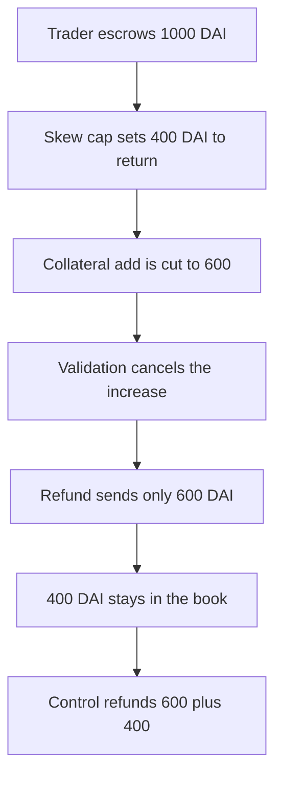

# gTrade keeps 400 DAI when a counter-trade increase is canceled

> **Vulnerability classes:** vuln/logic/fee-calculation · vuln/logic/incorrect-state-transition

<!-- non-defihacklabs -->
<!-- source-auditvault: https://github.com/Auditware/AuditVault/blob/main/findings/58131-h-04-traders-could-lose-assets-when-increasing-counter-trade.md -->
<!-- date: 2025-05 -->

## Key info

| Field | Value |
|---|---|
| **Loss** | 400 DAI of escrowed counter-trade collateral is not returned. The control returns all 1,000 |
| **Vulnerable contract** | `IncreaseBook.handleCanceled` |
| **Attacker EOA** | `0x1111111111111111111111111111111111111111` |
| **Attack contract** | `Exploit` |
| **Attack tx** | `Exploit.run()` |
| **Chain / block / date** | Ethereum model · block 0 · 2025-05 |
| **Compiler** | solc 0.8.27, cancun, via IR |
| **Bug class** | Cancel refund omits `counterTradeCollateralToReturn` |

## TL;DR

A trader escrows 1,000 DAI to increase a counter trade. The skew cap says 400 DAI of that collateral would push past zero skew, so `prepareCallbackValues` stores `counterTradeCollateralToReturn = 400` and cuts the add to 600. Validation then cancels the increase. `handleCanceled` refunds only the reduced `collateralAmount` of 600 and never adds the 400 back. The book keeps 400 DAI. The control refunds `collateralAmount + counterTradeCollateralToReturn` and returns all 1,000.

## Background

Pashov Audit Group reviewed Gains Network gTrade on 26 May 2025 (H-04). Counter trades are sized so they do not increase skew past zero. Collateral the cap refuses is supposed to be returned to the trader. The return value is computed and then dropped on the cancel path.

## The vulnerable code

```solidity
// prepareCallbackValues, for a collateral add on a counter trade
values.counterTradeCollateralToReturn =
    (values.exceedingPositionSizeCollateral * 1e3) / _partialTrade.leverage;
_partialTrade.collateralAmount -= uint120(values.counterTradeCollateralToReturn);

// handleCanceled
// @> VULN: refund is only the reduced collateralAmount. counterTradeCollateralToReturn stays in the book.
sent = collateralAmount;
dai.transfer(user, sent);
```

The recommended refund:

```solidity
sent = collateralAmount + counterTradeCollateralToReturn;
```

## Root cause

`prepareCallbackValues` mutates `_partialTrade.collateralAmount` down by the amount that must be returned, and stores that amount on `values`. `handleCanceled` is not given `values`. It transfers `_partialTrade.collateralAmount`, which is the post-reduction number. The returned collateral never leaves the diamond.

## Preconditions

- The existing trade is a counter trade.
- The increase escrows 1,000 DAI of collateral.
- The skew cap sets `counterTradeCollateralToReturn` to 400 DAI and reduces the add to 600.
- `validateCallback` returns a cancel reason other than none, so `handleCanceled` runs.

## Attack walkthrough

1. The trader approves and the book pulls 1,000 DAI.
2. The counter-trade cap sets 400 DAI aside for return and leaves 600 DAI as the add.
3. The increase is canceled.
4. `handleCanceled` sets the refund to 600 DAI.
5. 600 DAI is transferred to the trader. The book balance is 400 DAI.
6. The control book performs the same pull and the same cap, then refunds 600 + 400 = 1,000. Its balance is 0.

## Diagrams



## Impact

The trader loses 400 DAI of collateral that the protocol had already decided not to use. They sent 1,000 and received 600. The control returns the full 1,000.

## PoC

```bash
cd 58131-h-04-traders-could-lose-assets-when-increasing-counter-trade_exp
forge test -vv
```

`test_exploit_counter_trade_cancel_keeps_400` asserts the vulnerable refund is 600e18, the book holds 400e18, and the control refund is 1,000e18 with an empty book.

## Sources

- AuditVault finding: https://github.com/Auditware/AuditVault/blob/main/findings/58131-h-04-traders-could-lose-assets-when-increasing-counter-trade.md
- Pashov report: https://github.com/pashov/audits/blob/master/team/md/GainsNetwork-security-review_2025-05-26.md
- gTrade contracts: https://github.com/GainsNetwork-org/gTrade-contracts
