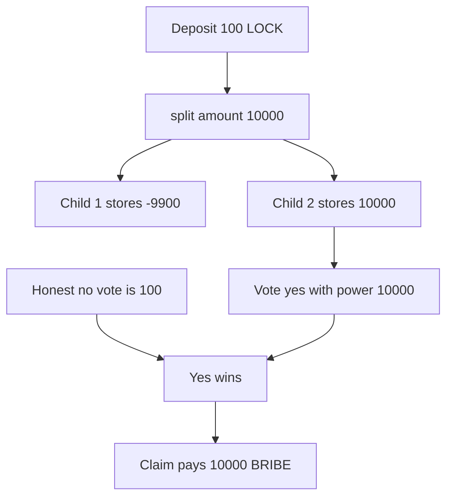

# KittenSwap — split mints an arbitrary locked amount

> **Vulnerability classes:** vuln/arithmetic/underflow · vuln/input-validation/missing · vuln/logic/missing-check

> **Reproduction:** a self-contained Foundry PoC that compiles and runs offline
> with only `forge-std` — no fork and no RPC. Trace: [output.txt](output.txt).
> PoC: [test/58150-c-01-split-can-be-abused-to-create-locked-data-with-an-arbit_exp.sol](test/58150-c-01-split-can-be-abused-to-create-locked-data-with-an-arbit_exp.sol).

<!-- non-defihacklabs -->
<!-- source-auditvault: https://github.com/Auditware/AuditVault/blob/main/findings/58150-c-01-split-can-be-abused-to-create-locked-data-with-an-arbit.md -->
<!-- date: 2025-05 -->

---

## Key info

| | |
|---|---|
| **Impact** | **HIGH** — a **100 LOCK** deposit is split into **-9,900** and **10,000**. The attacker votes with **10,000** and claims **10,000 BRIBE** |
| **Protocol** | KittenSwap VotingEscrow |
| **Vulnerable code** | `VotingEscrow.split` — `_locked.amount = value - _splitAmount` with no upper bound |
| **Bug class** | Signed subtraction of an unchecked split amount |
| **Finding** | Pashov Audit Group — KittenSwap security review, 7 May 2025 · C-01 · id 58150 |
| **Report** | [KittenSwap-security-review_2025-05-07.md](https://github.com/pashov/audits/blob/master/team/md/KittenSwap-security-review_2025-05-07.md) |
| **Source** | [AuditVault finding](https://github.com/Auditware/AuditVault/blob/main/findings/58150-c-01-split-can-be-abused-to-create-locked-data-with-an-arbit.md) |
| **Status** | Audit finding. Reproduced as a local synthetic. |
| **Compiler** | solc 0.8.27, cancun, via IR |

---

## TL;DR

`locked.amount` is an `int128`. `split` subtracts the caller-supplied `_amount` from it and does not require `_amount` to be at most the locked balance. A negative result is a valid `int128`, so Solidity 0.8 does not revert.

Deposit **100 LOCK**, call `split` with **10,000 LOCK**:

- child 1 stores **-9,900 LOCK**
- child 2 stores **10,000 LOCK**
- the escrow still holds only **200 LOCK** (the honest locker deposited 100 as well)

The attacker votes yes with power **10,000**, beats the honest no vote of **100**, and `claim` pays **10,000 BRIBE**.

## The vulnerable code

```solidity
int128 value = _locked.amount;
int128 _splitAmount = int128(uint128(_amount));
// FIX: require(_splitAmount > 0 && _splitAmount <= value, "amount");
_locked.amount = value - _splitAmount; // @> VULN: signed subtraction accepts an amount above the lock
_tokenId1 = _mint(msg.sender, _locked);
_locked.amount = _splitAmount;
_tokenId2 = _mint(msg.sender, _locked);
```

The finding's own PoC split a real lock by 100x and logged a child whose locked amount was 100 times the deposit. This reduction uses 100 ether and 10,000 ether so the negative sibling is obvious: `100 - 10000 = -9900`.

## Root cause

The only bound on `_amount` is `_amount > 0`. The subtraction is signed. It reverts only if the result leaves the `int128` range, not if it is negative. One child then carries the attacker-chosen positive amount, which `votingPower` and the bribe claim both treat as real.

## Preconditions

- The caller owns a lock with a positive `int128` amount.
- The chosen `_amount` fits in `uint128` and `int128`, and `value - _amount` is still inside `int128`.
- Something spends that amount: a vote, a bribe, or a later withdrawal. This run votes and claims.

## Attack walkthrough

1. An honest locker deposits **100 LOCK** and votes no. `noVotes = 100 ether`.
2. The attacker deposits **100 LOCK** and calls `split(id, 10_000 ether)`.
3. Child 1 is minted at **-9,900 ether**. Child 2 is minted at **10,000 ether**.
4. `lockToken.balanceOf(escrow)` is **200 ether**. The 10,000 was not deposited.
5. The attacker votes yes with `votingPower` **10,000 ether**. Yes beats no.
6. `claim` transfers that voting power in BRIBE. The attacker receives **10,000 BRIBE**.

Control: `split` requires `_splitAmount <= value` and reverts the 10,000 call, leaving the 100 ether lock untouched. A fair split of 40 ether from 100 ether produces children that sum to **100 ether**.

## Diagrams



## Impact

The attacker increases a locked balance without depositing the difference, then votes and claims with that balance. Here the claim is **10,000 BRIBE** against a **100 LOCK** deposit, and the paired child is **-9,900**, so the two children do not conserve the original lock. The same inflated balance is what the finding says can later be withdrawn and can be used against gauges and bribes.

## Remediation

Require `_splitAmount > 0 && _splitAmount <= value` before the subtraction, and keep the sum of the two new locks equal to the burned lock.

## Sources

- [AuditVault finding 58150](https://github.com/Auditware/AuditVault/blob/main/findings/58150-c-01-split-can-be-abused-to-create-locked-data-with-an-arbit.md)
- [Pashov KittenSwap review, 7 May 2025](https://github.com/pashov/audits/blob/master/team/md/KittenSwap-security-review_2025-05-07.md)

### Taxonomy

- `severity/high` · `sector/governance` · `sector/nft`
- `vuln/arithmetic/underflow` · `vuln/input-validation/missing` · `vuln/logic/missing-check`
