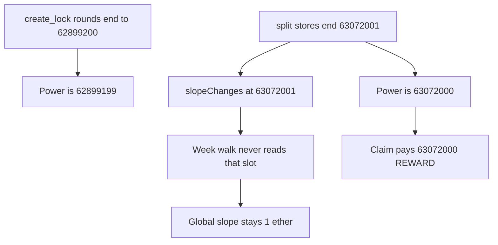

# KittenSwap - split does not round the lock to the week

> **Vulnerability classes:** vuln/logic/rounding · vuln/governance/voting-power · vuln/arithmetic/slope

> **Reproduction:** a self-contained Foundry PoC that compiles and runs offline
> with only `forge-std` - no fork and no RPC. Trace: [output.txt](output.txt).
> PoC: [test/58158-h-07-inconsistent-rounding-of-lock-time-causes-voting-power_exp.sol](test/58158-h-07-inconsistent-rounding-of-lock-time-causes-voting-power_exp.sol).

<!-- non-defihacklabs -->
<!-- source-auditvault: https://github.com/Auditware/AuditVault/blob/main/findings/58158-h-07-inconsistent-rounding-of-lock-time-causes-voting-power.md -->
<!-- date: 2025-05 -->

---

## Key info

| | |
|---|---|
| **Loss** | The split lock claims **63072000 REWARD**. A week-aligned max lock of the same deposit is worth **62899199 REWARD**. Excess **172801 REWARD**. After both locks are expired the global slope is still **1 ether** |
| **Protocol** | KittenSwap VotingEscrow |
| **Vulnerable code** | `VotingEscrow.split` - `_locked.end = block.timestamp + MAXTIME` |
| **Bug class** | Unlock time is not rounded to the week, so the slope change is never applied |
| **Finding** | Pashov Audit Group - KittenSwap security review, 7 May 2025 · H-07 · id 58158 |
| **Report** | [KittenSwap-security-review_2025-05-07.md](https://github.com/pashov/audits/blob/master/team/md/KittenSwap-security-review_2025-05-07.md) |
| **Source** | [AuditVault finding](https://github.com/Auditware/AuditVault/blob/main/findings/58158-h-07-inconsistent-rounding-of-lock-time-causes-voting-power.md) |
| **Status** | Audit finding. Reproduced as a local synthetic. |
| **Chain / block / date** | Ethereum model · block 0 · 2025-05 |
| **Compiler** | solc 0.8.27, cancun, via IR |

---

## TL;DR

`create_lock` sets the unlock to `((block.timestamp + MAXTIME) / WEEK) * WEEK`. `split` sets it to `block.timestamp + MAXTIME` and does not round.

`MAXTIME` is 2 * 365 days (`63072000` seconds). `WEEK` is 7 days. At timestamp 1:

- rounded end = **62899200**, voting power = **62899199 ether**
- split end = **63072001**, voting power = **63072000 ether**

The checkpoint walks week boundaries and reads `slopeChanges` only there. The slope booked at **63072001** is never subtracted. After week 105 both locks are expired, and the global slope is still **1 ether**. The reward claim pays the split power: **63072000 REWARD**, which is **172801 REWARD** more than the week-aligned lock.

## The vulnerable code

```solidity
rawEnd = block.timestamp + MAXTIME; // @> VULN: split does not round the new end down to the week
L.end = rawEnd;
```

The checkpoint, from the same review:

```solidity
cursor += WEEK;
if (cursor > t) {
    cursor = t;
} else {
    d = slopeChanges[cursor]; // only a week timestamp is read
    lastSlopeDelta = d;
}
```

The fix is `_locked.end = ((block.timestamp + MAXTIME) / WEEK) * WEEK`.

## Root cause

Slope removal is scheduled at `locked.end`. The global walk only visits multiples of `WEEK`. An end that is not on that grid is never loaded, so that lock's slope stays in `globalSlope`, and the lock's own bias uses the longer end, so its voting power is larger than every other max lock.

## Preconditions

- The caller owns a lock and can split it.
- `block.timestamp + MAXTIME` is not already a multiple of `WEEK`. At timestamp 1 it is not.
- Rewards or votes read `votingPower`, which is `slope * (end - now)`.

## Attack walkthrough

1. Lock `63072000 ether` of LOCK with `create_lock`. End is **62899200**. Power is **62899199 ether**.
2. Lock the same amount and `split` all of it. The child end is **63072001**. Power is **63072000 ether**.
3. `slopeAt(105 weeks)` applies the honest slope change at **62899200** and skips **63072001**. Residual slope is **1 ether**.
4. `claim` pays **63072000 ether** of REWARD to the attacker.

Control: `split` rounds the end. Power stays **62899199 ether**. The same `slopeAt` returns **0**.

## Diagrams



## Impact

A splitter gets **172801 ether** more voting power than a max lock created the normal way, and is paid that power in rewards: **63072000 REWARD** instead of **62899199**. The global slope is still **1 ether** after both locks have expired, so later total-power decay is wrong as well.

## Remediation

Round the split end the same way as `create_lock`: `((block.timestamp + MAXTIME) / WEEK) * WEEK`.

## Sources

- [AuditVault finding 58158](https://github.com/Auditware/AuditVault/blob/main/findings/58158-h-07-inconsistent-rounding-of-lock-time-causes-voting-power.md)
- [Pashov KittenSwap review, 7 May 2025](https://github.com/pashov/audits/blob/master/team/md/KittenSwap-security-review_2025-05-07.md)

### Taxonomy

- `severity/high` · `sector/governance` · `sector/dex`
- `vuln/logic/rounding` · `vuln/governance/voting-power` · `vuln/arithmetic/slope`
