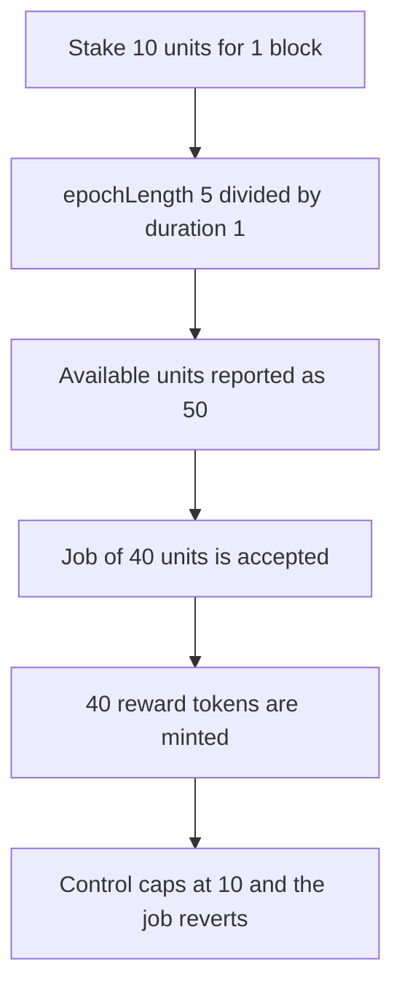

# Subsquid reports 50 computation units for a stake that only bought 10, and a 40-unit job releases 40 reward

> **Vulnerability classes:** vuln/logic/incorrect-calculation · vuln/logic/reward-calculation

<!-- non-defihacklabs -->
<!-- source-auditvault: https://github.com/Auditware/AuditVault/blob/main/findings/58246-h-02-computationunitsavailable-can-overestimate-number-of-av.md -->
<!-- date: 2024-01 -->

## Key info

| Field | Value |
|---|---|
| **Loss** | 40 reward tokens released for a job the real 10 units cannot cover. Reported available units are 50 |
| **Vulnerable contract** | `Gateway.computationUnitsAvailable` |
| **Attacker EOA** | `0x1111111111111111111111111111111111111111` |
| **Attack contract** | `Exploit` |
| **Attack tx** | `Exploit.run()` |
| **Chain / block / date** | Ethereum model · block 0 · 2024-01 |
| **Compiler** | solc 0.8.27, cancun, via IR |
| **Bug class** | Epoch divided by a shorter-than-epoch lock |

## TL;DR

A gateway stakes for 10 computation units with a lock of 1 block. `epochLength` is 5, so `computationUnitsAvailable` returns `10 * 5 / 1 = 50`. A job of 40 units is accepted and 40 reward tokens are minted. The stake only bought 10 units, so that job should revert. The control caps the job at the real 10 and the 40-unit call reverts, releasing no reward.

## The vulnerable code

```solidity
// @> VULN: duration shorter than an epoch inflates units. 10 * 5 / 1 = 50.
total = (computationUnits * EPOCH) / (lockEnd - lockStart);
```

The report's own log is the same pair of numbers: stake compute units 10, available compute units 50.

## Root cause

`computationUnits` is the total bought for the whole lock. Dividing the epoch length by a lock shorter than one epoch multiplies that total instead of spreading it. Nothing in `stake` requires `duration >= epochLength`.

## Attack walkthrough

1. Stake 10 units for 1 block. The lock covers the current block, so no time jump is required.
2. Available units read 50. The real count is 10.
3. `acceptJob(40)` passes `50 >= 40` and mints 40 reward tokens.
4. The control uses `computationUnits` (10). `acceptJob(40)` reverts. Accepted units stay 0.

## Diagrams



## Impact

Workers are allocated 40 units of compute and paid 40 reward tokens. The stake only entitled the gateway to 10 units. The extra 40 reward is released and the operator can unstake the underlying tokens once the 1-block lock ends.

## PoC

```bash
cd 58246-h-02-computationunitsavailable-can-overestimate-number-of-av_exp
forge test -vv
```

`test_exploit_inflated_units_release_reward` asserts real units 10, available 50, reward 40e18, and that the control job reverted.

## Sources

- AuditVault finding: https://github.com/Auditware/AuditVault/blob/main/findings/58246-h-02-computationunitsavailable-can-overestimate-number-of-av.md
- Pashov report: https://github.com/pashov/audits/blob/master/team/md/Subsquid-security-review.md
- Reviewed source: https://github.com/subsquid/subsquid-network-contracts/tree/3545236f5b34076820fe747eb607a16d8b664a08
