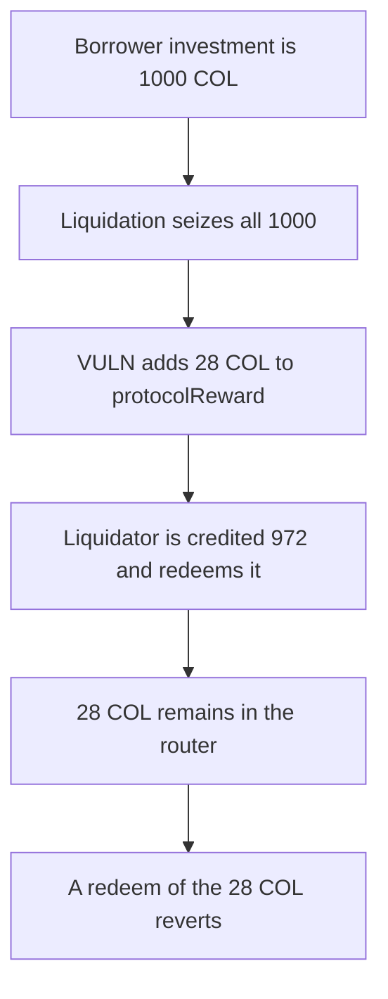

# LEND: 2.8% of every liquidation stays in the router forever

> **Vulnerability classes:** `vuln/logic/reward-calculation` · `vuln/logic/liquidation-logic`

<!-- non-defihacklabs -->
<!-- source-auditvault: https://github.com/Auditware/AuditVault/blob/main/findings/58371-h-2-protocol-rewards-tokens-permanently-stuck-sherlock-lend.md -->
<!-- date: 2025-05 -->

## Key info

| Field | Value |
|---|---|
| **Loss** | 28 COL of a 1000 COL seizure. The liquidator can redeem 972. The 28 has no owner |
| **Vulnerable contract** | `CoreRouter.liquidateSeizeUpdate` |
| **Attacker EOA** | `0x1111111111111111111111111111111111111111` (the liquidator) |
| **Attack contract** | `Exploit` |
| **Attack tx** | `Exploit.run()` |
| **Chain / block / date** | Ethereum model · block 0 · 2025-05 |
| **Compiler** | solc 0.8.27, cancun, via IR |
| **Bug class** | Protocol seize share is accrued and never withdrawn |

## TL;DR

On every liquidation, `CoreRouter` multiplies the seized collateral by `PROTOCOL_SEIZE_SHARE_MANTISSA` (2.8e16) and stores the product in `protocolReward`. The borrower loses the full seize. The liquidator is credited `seize - reward` and can `redeem` that credit. Nothing ever reads `protocolReward` except to add to it. A 1000 COL seizure leaves 28 COL in the router with no claim.

## The vulnerable code

```solidity
uint256 currentReward = mul_(seizeTokens, Exp({mantissa: lendStorage.PROTOCOL_SEIZE_SHARE_MANTISSA()}));
lendStorage.updateProtocolReward(lTokenCollateral, lendStorage.protocolReward(lTokenCollateral) + currentReward); // @> VULN: 2.8% of seized collateral is added to protocolReward, which no function ever pays out
```

The recommended change is a withdrawal or a reserve sink for `protocolReward`. The audited code has neither. `redeem` only pays `totalInvestment`.

## Root cause

`updateProtocolReward` is the only writer, and it replaces the mapping with a larger value. `CoreRouter.redeem` transfers `collateral` against `totalInvestment`, which was increased by `seizeTokens - currentReward`, not by `currentReward`.

## Preconditions

- A borrower has 1000 COL of `totalInvestment` and the router holds that collateral.
- `PROTOCOL_SEIZE_SHARE_MANTISSA` is 2.8e16.
- The lendtroller returns 1000 seize tokens for the repayment.

## Attack walkthrough

1. The router custodies 1000 COL for the borrower.
2. The liquidator calls `liquidate`. The seize is 1000 COL.
3. 28 COL is added to `protocolReward`. The liquidator is credited 972 COL.
4. The liquidator redeems 972 COL.
5. The router still holds 28 COL. Redeeming that 28 reverts with `Insufficient balance`.

## Diagrams



## Impact

The protocol's 2.8% seize share cannot be moved to a treasury, a reserve, or any other spender. On this seizure that is 28 COL. The same fraction of every later liquidation is added to the same stranded balance. Suppliers and the liquidator are paid. The protocol is not.

## Remediation

Add a privileged or governance path that transfers `protocolReward[lToken]` out of the router and sets the mapping back down, or fold the amount into the existing reserve. Do not only increment the mapping.

## How to reproduce

```bash
cd 58371-h-2-protocol-rewards-tokens-permanently-stuck-sherlock-lend_exp
forge test -vv
```

`test_protocol_reward_is_stuck` asserts the 28 COL residual. `test_control_stuck_reward_cannot_be_redeemed` asserts a redeem of that residual reverts. Captured output is `output.txt`.

## Sources

- AuditVault finding: https://github.com/Auditware/AuditVault/blob/main/findings/58371-h-2-protocol-rewards-tokens-permanently-stuck-sherlock-lend.md
- Sherlock issue 184: https://github.com/sherlock-audit/2025-05-lend-audit-contest-judging/issues/184
- Blamed lines: https://github.com/sherlock-audit/2025-05-lend-audit-contest/blob/main/Lend-V2/src/LayerZero/CoreRouter.sol#L300
- Taxonomy: genome reward-accounting, liquidation-incentives, dos/frozen-funds, loss-of-funds/locked-funds, known-pattern, always, redesign-logic, blast-radius/protocol-wide. Tags severity/high, sector/lending, sector/bridge, sector/governance, platform/sherlock.
