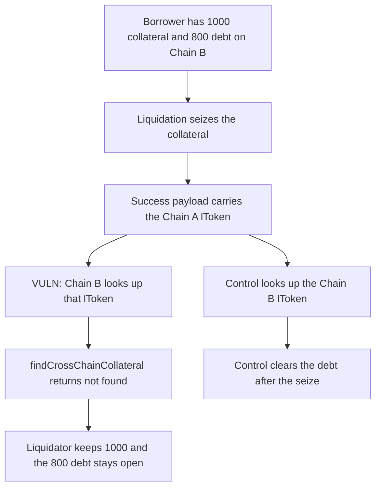

# LEND: cross-chain liquidation seizes collateral and never repays the debt

> **Vulnerability classes:** `vuln/logic/liquidation-logic`

<!-- non-defihacklabs -->
<!-- source-auditvault: https://github.com/Auditware/AuditVault/blob/main/findings/58373-h-4-cross-chain-liquidation-uses-incorrect-ltoken-address-pr.md -->
<!-- date: 2025-05 -->

## Key info

| Field | Value |
|---|---|
| **Loss** | Liquidator receives 1000 collateral. The 800 debt stays open |
| **Vulnerable contract** | `CrossChainRouter._handleLiquidationSuccess` |
| **Attacker EOA** | `0x1111111111111111111111111111111111111111` |
| **Attack contract** | `Exploit` |
| **Attack tx** | `Exploit.run()` |
| **Chain / block / date** | Ethereum model of the Chain B router · block 0 · 2025-05 |
| **Compiler** | solc 0.8.27, cancun, via IR |
| **Bug class** | Chain A lToken used to find a Chain B borrow |

## TL;DR

Liquidation seizes collateral, then the success handler looks up `payload.destlToken`. That address is the Chain A lToken. Chain B's `lTokenToUnderlying` does not know it, `findCrossChainCollateral` misses the borrow, and the debt is not reduced. The liquidator keeps 1000 collateral while 800 of debt remains.

## Background

Sherlock's May 2025 LEND contest, issue 308, judged high. `_executeLiquidationCore` correctly translates the collateral to the Chain A lToken before the seize message. `_handleLiquidationSuccess` then uses that same `destlToken` to find the borrow on Chain B. The position was stored under the Chain B lToken, so the lookup fails and repayment is skipped. The fix looks up Chain B's lToken from `payload.srcToken`.

## The vulnerable code

```solidity
address underlying = lendStorage.lTokenToUnderlying(payload.destlToken); // @> VULN
```

`destlToken` is the Chain A market. The mapping on Chain B only has the Chain B lToken, so `underlying` is the zero address and the later find returns false.

```diff
- address underlying = lendStorage.lTokenToUnderlying(payload.destlToken);
- (bool found,) = findCrossChainCollateral(sender, underlying, currentEid, 0, payload.destlToken, payload.srcToken);
+ address lToken = underlyingToLToken[payload.srcToken];
+ (bool found,) = findCrossChainCollateral(sender, payload.srcToken, srcEid, currentEid, lToken, payload.srcToken);
```

## Root cause

The token address that identifies the collateral on Chain A is reused as if it identified the borrow market on Chain B. The two deployments do not share addresses.

## Preconditions

- The borrower has a cross-chain position: collateral recorded on Chain B under the Chain B lToken, debt still open.
- A liquidation seizes the collateral and sends a success payload whose `destlToken` is the Chain A lToken.

## Attack walkthrough

1. The position is seeded with 1000 collateral and 800 debt. Only the Chain B lToken is registered.
2. `liquidate` transfers the 1000 collateral to the liquidator.
3. The success handler calls `lTokenToUnderlying` with the Chain A lToken and gets address zero.
4. The find misses. The handler returns before clearing debt. Debt is still 800.

## Diagrams



## Impact

The liquidator holds 1000 collateral and the protocol still records 800 of unpaid debt. The position is undercollateralized. Repeating this leaves borrows that can no longer be covered by the collateral that was already seized. The control, which resolves the Chain B lToken, sets the debt to 0 after the same seize.

## Remediation

In the success handler, derive Chain B's lToken from `payload.srcToken` and pass that address to `findCrossChainCollateral`, along with the source and current endpoint ids. Do not pass `payload.destlToken`.

## How to reproduce

```bash
cd 58373-h-4-cross-chain-liquidation-uses-incorrect-ltoken-address-pr_exp
forge test -vv
```

`test_exploit_seize_without_repayment` asserts debt stays 800, the liquidator received 1000, and repayment did not run. `test_control_chain_b_ltoken_repays` asserts the corrected lookup clears the debt. Captured output is `output.txt`.

## Sources

- AuditVault finding: https://github.com/Auditware/AuditVault/blob/main/findings/58373-h-4-cross-chain-liquidation-uses-incorrect-ltoken-address-pr.md
- Sherlock issue 308: https://github.com/sherlock-audit/2025-05-lend-audit-contest-judging/issues/308
- Blamed line: https://github.com/sherlock-audit/2025-05-lend-audit-contest-sylvarithos/blob/551944cd87d138620b89c11674a92f1dcbe0efbe/Lend-V2/src/LayerZero/CrossChainRouter.sol#L445
