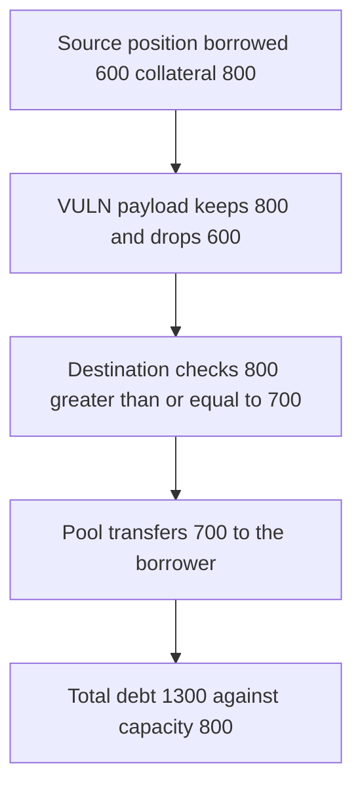

# LEND: a cross-chain borrow of 700 ignores 600 of existing debt

> **Vulnerability classes:** `vuln/logic/state-update`

<!-- non-defihacklabs -->
<!-- source-auditvault: https://github.com/Auditware/AuditVault/blob/main/findings/58375-h-6-cross-chain-borrow-ignores-existing-debt-in-collateral-v.md -->
<!-- date: 2025-05 -->

## Key info

| Field | Value |
|---|---|
| **Loss** | Destination lenders pay 700 USDT. Remaining capacity was 200. Total debt becomes 1300 against 800 |
| **Vulnerable contract** | `CrossChainRouter.borrowCrossChain` |
| **Attacker EOA** | `0x1111111111111111111111111111111111111111` |
| **Attack contract** | `Exploit` |
| **Attack tx** | `Exploit.run()` |
| **Chain / block / date** | Ethereum model · block 0 · 2025-05 |
| **Compiler** | solc 0.8.27, cancun, via IR |
| **Bug class** | Collateral payload omits existing borrows |

## TL;DR

`borrowCrossChain` reads `(borrowed, collateral)` and forwards only `collateral`. With borrowed 600 and collateral 800, the destination sees 800 and allows a new 700 borrow. The user owes 1300 against 800 of borrowing power. The destination pool is emptied.

## The vulnerable code

```solidity
(, uint256 collateral) = lendStorage.getHypotheticalAccountLiquidityCollateral(msg.sender, lToken, 0, 0); // @> VULN: only collateral is kept; the borrowed return value is discarded
require(collateral >= destBorrowed, "Insufficient collateral");
```

The second line is the destination check quoted in the report. `destBorrowed` is the new borrow, because the source debt was never sent. The fix is to send `collateral - borrowed`.

## Root cause

The source message carries raw borrowing power, not remaining capacity. The destination compares that figure to its own new debt only.

## Preconditions

- Source liquidity is borrowed 600 and collateral 800, matching the report's 1000 collateral at an 80% factor with 600 already borrowed.
- The destination pool has 700 of cash and no prior debt for this user.
- The user requests 700.

## Attack walkthrough

1. Fund the destination with 700.
2. Call `borrowCrossChain(700)`.
3. The payload collateral is 800.
4. The destination check passes and pays 700.
5. Combined debt is 1300.

## Diagrams



## Impact

The destination pool's 700 USDT is lent to a user who had 200 of room left. Lenders on the destination are undercollateralized by 500 beyond remaining capacity, and by 500 beyond the whole 800 if the source debt is counted too. The position cannot be liquidated back to solvency from the collateral that was declared.

## Remediation

Send `collateral - borrowed` from the source, and keep the destination check against that remaining capacity.

## How to reproduce

```bash
cd 58375-h-6-cross-chain-borrow-ignores-existing-debt-in-collateral-v_exp
forge test -vv
```

Captured output is `output.txt`.

## Sources

- AuditVault finding: https://github.com/Auditware/AuditVault/blob/main/findings/58375-h-6-cross-chain-borrow-ignores-existing-debt-in-collateral-v.md
- Sherlock issue 341: https://github.com/sherlock-audit/2025-05-lend-audit-contest-judging/issues/341
- Blamed lines: https://github.com/sherlock-audit/2025-05-lend-audit-contest/blob/main/Lend-V2/src/LayerZero/CrossChainRouter.sol#L139
- Taxonomy: genome debt-accrual-update, cross-contract-state-consistency, logic/missing-check, loss-of-funds/direct-drain, known-pattern, cross-chain-message, add-check, blast-radius/single-user. Tags severity/high, sector/lending, sector/bridge, sector/stable.

