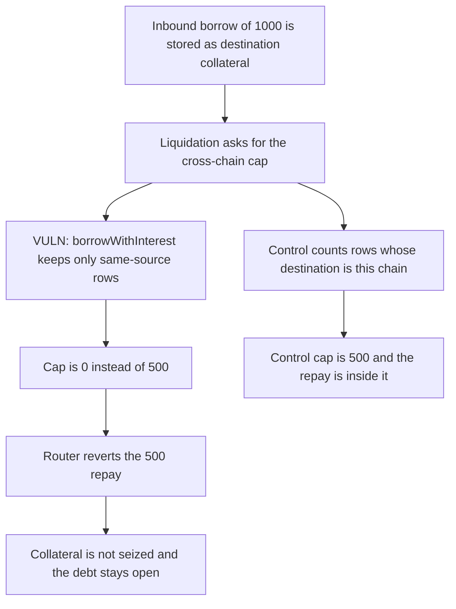

# LEND: cross-chain liquidation cap ignores destination-chain debt

> **Vulnerability classes:** `vuln/logic/liquidation-logic` · `vuln/bridge/missing-validation`

<!-- non-defihacklabs -->
<!-- source-auditvault: https://github.com/Auditware/AuditVault/blob/main/findings/58377-h-8-cross-chain-liquidations-will-be-blocked-due-to-incorrec.md -->
<!-- date: 2025-05 -->

## Key info

| Field | Value |
|---|---|
| **Loss** | A 500 repay of a real 1000 destination-chain debt is rejected. Collateral is not seized |
| **Vulnerable contract** | `LendStorage.getMaxLiquidationRepayAmount` |
| **Attacker EOA** | `0x1111111111111111111111111111111111111111` |
| **Attack contract** | `Exploit` |
| **Attack tx** | `Exploit.run()` |
| **Chain / block / date** | Ethereum model · block 0 · 2025-05 |
| **Compiler** | solc 0.8.27, cancun, via IR |
| **Bug class** | Liquidation cap reads only same-chain-origin borrows |

## TL;DR

`getMaxLiquidationRepayAmount` sizes a cross-chain liquidation with `borrowWithInterest`. That helper sums borrows that originated on the current chain. A borrow whose destination is the current chain, and whose source is another chain, is stored and then skipped. The cap is 0. The router's `require(repayAmount <= maxLiquidationAmount)` reverts a 500 repay of a 1000 debt, so the position cannot be liquidated.

## The vulnerable code

```solidity
currentBorrow += isSameChain
    ? borrowWithInterestSame(borrower, lToken)
    : borrowWithInterest(borrower, lToken); // @> VULN: destination-chain borrows are absent from borrowWithInterest, so the cap is 0
uint256 maxRepay = (currentBorrow * closeFactorMantissa) / 1e18;
```

`borrowWithInterest` keeps a collateral row only when `destEid == currentEid && srcEid == currentEid`. An inbound cross-chain borrow has a different `srcEid`, so it adds nothing.

The fix counts borrows whose destination is this chain:

```diff
- if (collaterals[i].destEid == currentEid && collaterals[i].srcEid == currentEid)
+ if (collaterals[i].destEid == currentEid)
```

## Preconditions

- Close factor is 50 percent.
- The borrower owes 1000 on this chain from a borrow that originated on another chain.
- No same-chain borrow of that token is open, so the other mapping is empty.
- A liquidator repays 500, the close-factor maximum of the real debt.

## Attack walkthrough

1. The destination ledger records principal 1000, source chain 1, destination chain 2.
2. `getMaxLiquidationRepayAmount` calls `borrowWithInterest` because this is not a same-chain liquidation.
3. The collateral row fails the `srcEid == currentEid` filter. `currentBorrow` stays 0.
4. `maxRepay` is 0 times the close factor.
5. The router reverts `Exceeds max liquidation` on a 500 repay.
6. The control that counts destination borrows returns a cap of 500.

## Diagrams



## Impact

Liquidators cannot close an underwater cross-chain debt on the chain where the collateral sits. In this run the real debt is 1000, the fair close-factor repay is 500, and the computed cap is 0. The collateral that should have been seized stays where it is. Lenders are left with debt that the liquidation path will not reduce.

## How to reproduce

```bash
cd 58377-h-8-cross-chain-liquidations-will-be-blocked-due-to-incorrec_exp
forge test -vv
```

`test_exploit_cross_chain_liquidation_cap_is_zero` asserts the cap is 0 and the 500 repay reverts. `test_control_destination_borrows_allow_half_repay` asserts the destination-aware cap is 500.

## Sources

- AuditVault finding: https://github.com/Auditware/AuditVault/blob/main/findings/58377-h-8-cross-chain-liquidations-will-be-blocked-due-to-incorrec.md
- Sherlock judging issue 578: https://github.com/sherlock-audit/2025-05-lend-audit-contest-judging/issues/578
- Blamed function: https://github.com/sherlock-audit/2025-05-lend-audit-contest/blob/main/Lend-V2/src/LayerZero/LendStorage.sol#L573-L591
