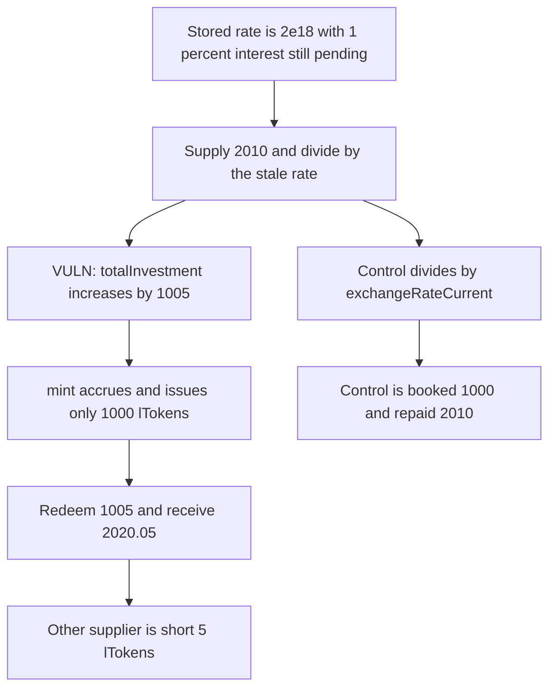

# Stale exchangeRateStored lets a supplier book extra lTokens and redeem other depositors

> **Vulnerability classes:** vuln/logic/price-calculation · vuln/logic/state-update

<!-- non-defihacklabs -->
<!-- source-auditvault: https://github.com/Auditware/AuditVault/blob/main/findings/58378-h-9-outdated-exchange-rate-utilization-sherlock-lend-git.md -->
<!-- date: 2025-05 -->

## Key info

| Field | Value |
|---|---|
| **Loss** | 10.05 underlying taken from an existing supplier. 2010 in, 2020.05 out |
| **Vulnerable contract** | `CoreRouter.supply` |
| **Attacker EOA** | `0x1111111111111111111111111111111111111111` |
| **Attack contract** | `Exploit` |
| **Attack tx** | `Exploit.run()` |
| **Chain / block / date** | Ethereum model · block 0 · 2025-05 |
| **Compiler** | solc 0.8.27, cancun, via IR |
| **Bug class** | Supply accounting uses `exchangeRateStored` while `mint` accrues interest first |

## TL;DR

`supply` reads `exchangeRateStored` before `mint`. With 1 percent of borrow interest still pending, that rate is 2e18 while the rate after accrual is 2.01e18. A 2010 deposit is booked as 1005 lTokens and the lToken only mints 1000. Redeeming the booked 1005 burns 5 lTokens that belonged to the supplier who was already in the market and pays 2020.05 underlying. The control reads `exchangeRateCurrent`, books 1000, and is repaid exactly 2010.

## Background

Sherlock's May 2025 LEND contest, issue H-9. `CoreRouter.supply` is the same-chain deposit path. It transfers underlying, asks the lToken to mint, and records `totalInvestment` from a rate captured before the mint. Compound-style `mint` accrues interest before it computes shares. `exchangeRateStored` does not.

## The vulnerable code

```solidity
token.approve(address(lToken), _amount);
// @> VULN: exchangeRateStored ignores pending interest, so mintTokens exceeds the lTokens mint() actually issues
uint256 exchangeRateBefore = lToken.exchangeRateStored();
require(lToken.mint(_amount) == 0, "Mint failed");
uint256 mintTokens = (_amount * 1e18) / exchangeRateBefore;
totalInvestment[msg.sender] += mintTokens;
```

`redeem` then burns `totalInvestment` lTokens held by the router, not an lToken balance that belongs only to the caller. The router is the single lToken holder for every supplier.

## Root cause

The accounting rate is taken before accrual and the mint rate is taken after it. Pending interest makes the stored rate smaller, so the router records more shares than `mint` created. Those extra shares are taken from the lTokens already sitting on the router for other suppliers.

## Preconditions

- The market has a nonzero lToken supply and a nonzero borrow balance. Here both cash and `totalBorrows` start at 10000, so the stored rate is 2e18.
- Interest has not been accrued yet. The first `accrueInterest` adds 1 percent of `totalBorrows`.
- Another supplier's 10000 lTokens are already on the router.

## Attack walkthrough

1. `exchangeRateStored` returns 2e18. The pending 100 of interest is not in `totalBorrows`.
2. The attacker supplies 2010. `mintTokens` is `2010e18 / 2e18 = 1005`.
3. `mint` accrues first. `totalBorrows` becomes 10100, the rate becomes 2.01e18, and the router receives 1000 lTokens.
4. `totalInvestment` is increased by 1005.
5. Redeeming 1005 burns through the other supplier's lTokens and pays `1005 * 2.01 = 2020.05`.
6. The attacker is ahead by 10.05. The router has 9995 lTokens left against the other supplier's 10000 claim.
7. The control uses `exchangeRateCurrent`, books 1000, and withdraws 2010. The other supplier's lToken balance is unchanged.

## Diagrams



## Impact

The attacker deposits 2010 underlying and receives 2020.05. The 10.05 difference is 5 lTokens of the existing supplier, burned at the post-accrual rate of 2.01e18. The control returns the deposit with no profit and leaves the existing 10000 lTokens in place.

## Remediation

Read `exchangeRateCurrent` before computing `mintTokens`, which is the diff in the Sherlock report. That accrues interest first so the booked share count matches what `mint` issues.

## How to reproduce

```bash
cd 58378-h-9-outdated-exchange-rate-utilization-sherlock-lend-git_exp
forge test
```

`test_exploit_stale_exchange_rate_mints_extra_ltokens` asserts a 10.05 profit, a 1005 booking, and a 5 lToken shortfall. `test_control_exchangeRateCurrent_repays_deposit` asserts a flat 2010 round trip. Captured output is `output.txt`.

## Sources

- AuditVault finding: https://github.com/Auditware/AuditVault/blob/main/findings/58378-h-9-outdated-exchange-rate-utilization-sherlock-lend-git.md
- Sherlock issue: https://github.com/sherlock-audit/2025-05-lend-audit-contest-judging/issues/628
