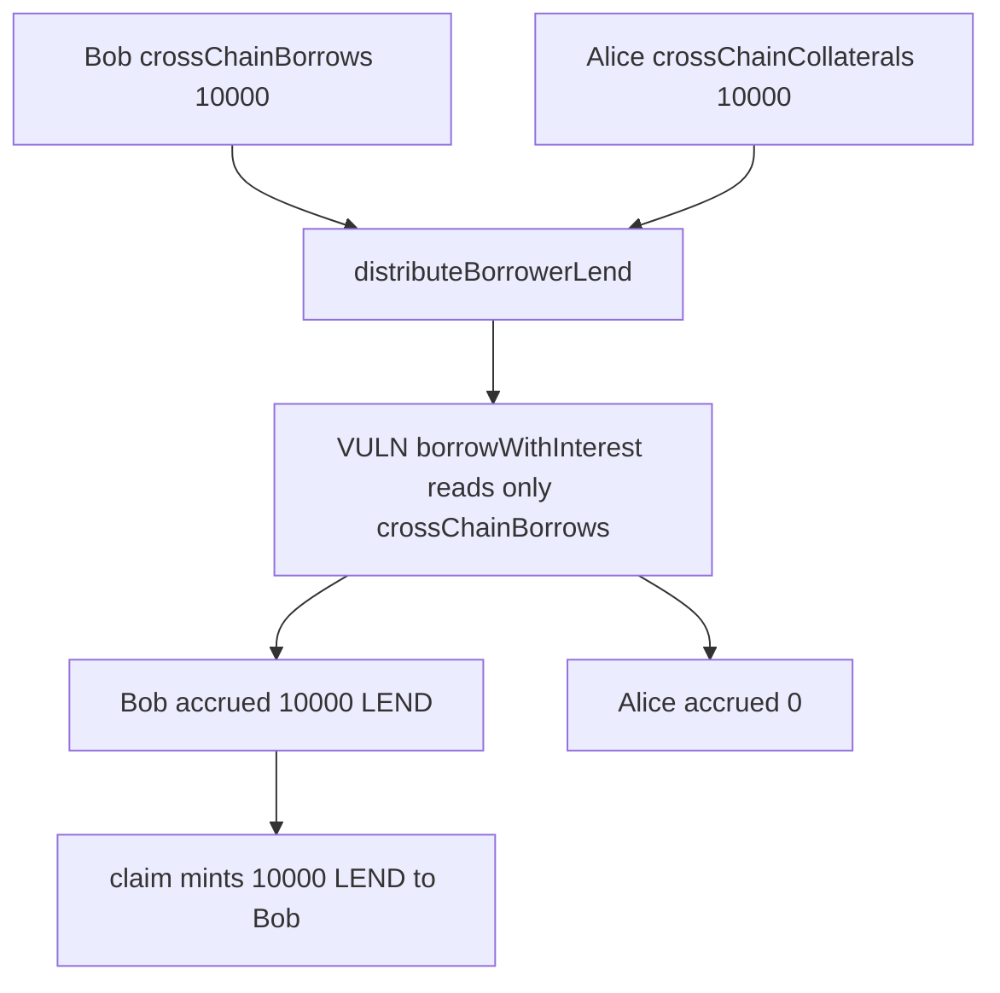

# LEND: cross-chain borrows pay the wrong user 10000 LEND

> **Vulnerability classes:** `vuln/logic/reward-calculation`

<!-- non-defihacklabs -->
<!-- source-auditvault: https://github.com/Auditware/AuditVault/blob/main/findings/58381-h-12-incorrect-lend-reward-distribution-for-cross-chain-borr.md -->
<!-- date: 2025-05 -->

## Key info

| Field | Value |
|---|---|
| **Loss** | Alice, who borrowed 10000 on this chain, gets 0 LEND. Bob, who did not, is minted 10000 LEND |
| **Vulnerable contract** | `LendStorage.distributeBorrowerLend` |
| **Attacker EOA** | `0x1111111111111111111111111111111111111111` (Bob) |
| **Attack contract** | `Exploit` |
| **Attack tx** | `Exploit.run()` |
| **Chain / block / date** | Ethereum model · block 0 · 2025-05 |
| **Compiler** | solc 0.8.27, cancun, via IR |
| **Bug class** | Reward base reads the wrong cross-chain mapping |

## TL;DR

`distributeBorrowerLend` sets `borrowerAmount` from `borrowWithInterest`. That helper sums `crossChainBorrows` (debt originated on this chain, executed elsewhere) and skips real `crossChainCollaterals` (debt executed here). Bob is paid 10000 LEND. Alice is paid 0.

## The vulnerable code

```solidity
uint256 borrowerAmount = div_(add_(borrowWithInterest(borrower, lToken_), borrowWithInterestSame(borrower, lToken_)), Exp({mantissa: LToken(lToken_).borrowIndex()})); // @> VULN: borrowWithInterest counts crossChainBorrows and ignores borrows executed on this chain
```

`borrowWithInterest` enters the `borrows.length > 0` branch and never looks at collaterals. The collateral branch itself also requires `srcEid == destEid == currentEid`, which a real cross-chain collateral row does not satisfy.

## Root cause

The reward base is "where the borrow record was created" rather than "where the cash was borrowed".

## Preconditions

- Bob has a `crossChainBorrows` row of 10000 with `srcEid` equal to this chain.
- Alice has a `crossChainCollaterals` row of 10000 with `destEid` equal to this chain and a different `srcEid`.
- The borrow-side LEND index moves from `1e36` to `2e36`. Both notionals use borrow index `1e18`.

## Attack walkthrough

1. Record Bob's originated-here borrow and Alice's executed-here borrow.
2. Distribute to Bob. `borrowerAmount` is 10000e18 and accrual is 10000e18.
3. Distribute to Alice. `borrowerAmount` is 0.
4. Bob claims 10000 LEND.

## Diagrams



## Impact

LEND emissions on this chain are paid to users whose debt was executed elsewhere, and withheld from users whose debt was executed here. In this distribution that is a 10000 LEND misallocation.

## Remediation

Size `borrowerAmount` from borrows executed on this chain (`crossChainCollaterals` plus same-chain debt) and exclude `crossChainBorrows`.

## How to reproduce

```bash
cd 58381-h-12-incorrect-lend-reward-distribution-for-cross-chain-borr_exp
forge test -vv
```

Captured output is `output.txt`.

## Sources

- AuditVault finding: https://github.com/Auditware/AuditVault/blob/main/findings/58381-h-12-incorrect-lend-reward-distribution-for-cross-chain-borr.md
- Sherlock issue 669: https://github.com/sherlock-audit/2025-05-lend-audit-contest-judging/issues/669
- Blamed function: https://github.com/sherlock-audit/2025-05-lend-audit-contest/blob/main/Lend-V2/src/LayerZero/LendStorage.sol#L365
- Taxonomy: genome reward-accounting, reward-calculation, variant, math-is-safe, fix-arithmetic. Tags severity/high, sector/lending, sector/bridge, sector/stable, platform/sherlock.

