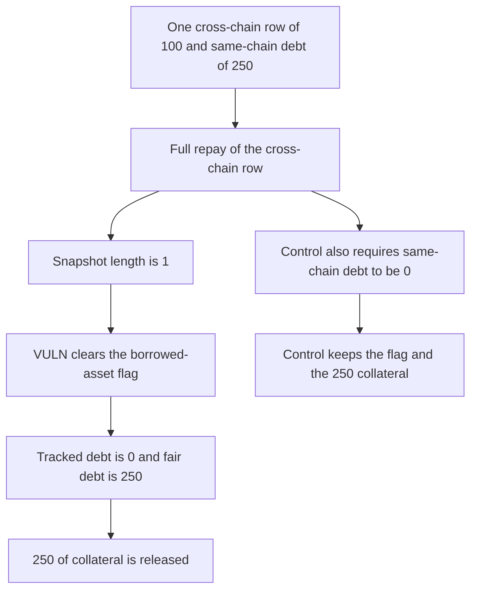

# LEND: a full cross-chain repay clears the borrowed-asset flag while 250 of same-chain debt remains

> **Vulnerability classes:** vuln/logic/liquidation-logic

<!-- non-defihacklabs -->
<!-- source-auditvault: https://github.com/Auditware/AuditVault/blob/main/findings/58382-h-13-incorrect-debt-tracking-in-updaterepaymentstate-sherlo.md -->
<!-- date: 2025-05 -->

## Key info

| Field | Value |
|---|---|
| **Loss** | Tracked debt is 0. Fair remaining debt is 250. 250 of collateral is released |
| **Vulnerable contract** | `CrossChainRouter._updateRepaymentState` |
| **Attacker EOA** | `0x1111111111111111111111111111111111111111` (the borrower) |
| **Attack contract** | `Exploit` |
| **Attack tx** | `Exploit.run()` |
| **Chain / block / date** | Ethereum model · block 0 · 2025-05 |
| **Compiler** | solc 0.8.27, cancun, via IR |
| **Bug class** | Borrowed-asset cleanup ignores remaining same-chain principal |

## TL;DR

`_updateRepaymentState` snapshots `userCrossChainCollaterals` and, after a full repay, removes the borrowed asset when that snapshot's length is 1. The length is the pre-removal count, so a single cross-chain row is treated as the last debt. Same-chain principal of 250 is still stored. The collateral check walks the borrowed-asset flag, sees nothing, and releases 250. The fair books still show 250 of debt. The control removes the flag only when same-chain principal is also 0, and the collateral stays.

## Background

Sherlock's May 2025 LEND contest, H-13, issue 672. The audited function is `CrossChainRouter._updateRepaymentState`. The in-repo code snapshots the cross-chain array before `removeCrossChainCollateral`, so the length does not shrink inside the check. What that length check does do is clear `userBorrowedAssets` whenever the repaid row was the only cross-chain row. `userBorrowedAssets` is what `getHypotheticalAccountLiquidityCollateral` walks, and that walk includes same-chain debt through `borrowWithInterestSame`. Clearing the flag drops the 250 same-chain principal out of the debt the collateral check can see. The report's suggested fix of reading the length before removal is already what this snapshot does. The control also requires same-chain principal to be 0 before the flag is cleared.

## The vulnerable code

```solidity
LendBook.Borrow[] memory userCrossChainCollaterals = book.getCrossChainCollaterals(borrower, token);
if (repayAmountFinal == borrowedAmount) {
    book.removeCrossChainCollateral(borrower, token, index);
    // @> VULN: length == 1 is the pre-removal snapshot, so the borrowed asset is cleared while same-chain debt remains
    if (userCrossChainCollaterals.length == 1) {
        book.removeUserBorrowedAsset(borrower);
    }
}
trackedDebt = book.borrowedAssetListed(borrower) ? book.sameChainDebt(borrower) : 0;
fairDebt = book.sameChainDebt(borrower);
```

## Root cause

The cleanup decides that the asset has no debt from the cross-chain array alone. A length of 1 means this repay removed the only cross-chain row. It does not mean same-chain `borrowBalance` is zero. The collateral release trusts the flag.

## Preconditions

- The borrower has one cross-chain row with principal 100, and same-chain debt of 250.
- The borrowed asset is listed, and 250 of collateral is posted.
- The repay amount equals the cross-chain borrowed amount.

## Attack walkthrough

1. The position is seeded: cross-chain principal 100, same-chain debt 250, collateral 250, asset listed.
2. The 100 is repaid in full. The snapshot length is 1, so the borrowed-asset flag is cleared.
3. Tracked debt, which follows the flag, is 0. Fair remaining debt is 250.
4. The collateral check sees an unlisted asset and transfers 250 to the borrower.
5. The control keeps the flag because same-chain debt is not 0. Its release sends 0, and the 250 collateral stays.

## Diagrams



## Impact

The borrower receives 250 of collateral. The protocol still records 250 of same-chain principal. The debt figure the collateral check uses is 0, so the books are short by 250 against the fair remaining debt. The control leaves the 250 collateral locked and still tracks 250 of debt.

## Remediation

Clear the borrowed-asset flag only when the repaid row was the last cross-chain row and same-chain principal for that asset is 0. Do not treat a cross-chain length of 1 as proof that no debt remains.

## How to reproduce

```bash
cd 58382-h-13-incorrect-debt-tracking-in-updaterepaymentstate-sherlo_exp
forge test -vv
```

`test_exploit_releases_collateral_against_remaining_debt` asserts same-chain debt of 250, a cleared flag, tracked debt 0, fair debt 250, and a 250 release. `test_control_keeps_the_debt_flag` asserts tracked debt stays 250 and nothing is released. Captured output is `output.txt`.

## Sources

- AuditVault finding: https://github.com/Auditware/AuditVault/blob/main/findings/58382-h-13-incorrect-debt-tracking-in-updaterepaymentstate-sherlo.md
- Sherlock issue 672: https://github.com/sherlock-audit/2025-05-lend-audit-contest-judging/issues/672
- Audited function: https://github.com/sherlock-audit/2025-05-lend-audit-contest/blob/713372a1ccd8090ead836ca6b1acf92e97de4679/Lend-V2/src/LayerZero/CrossChainRouter.sol#L505
