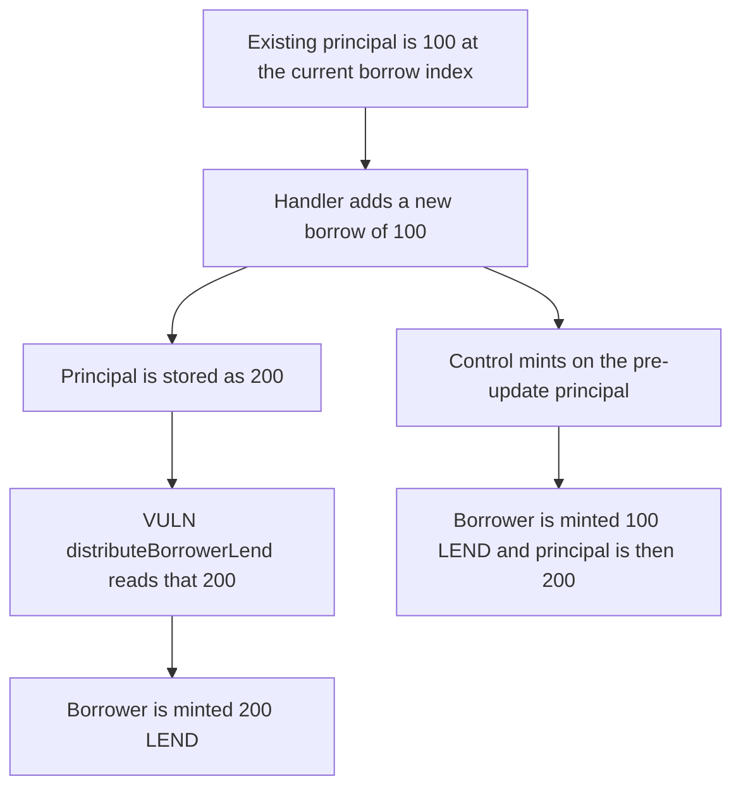

# LEND rewards are paid on a borrow that was just written, so the borrower gets 200 instead of 100

> **Vulnerability classes:** vuln/logic/reward-calculation · vuln/logic/incorrect-order-of-operations

<!-- non-defihacklabs -->
<!-- source-auditvault: https://github.com/Auditware/AuditVault/blob/main/findings/58384-h-15-incorrect-distribution-of-lend-tokens-to-users-sherlock.md -->
<!-- date: 2025-05 -->

## Key info

| Field | Value |
|---|---|
| **Loss** | 100 LEND overpaid. The borrower is minted 200. The principal open during the accrual window was 100 |
| **Vulnerable contract** | `LendStorage.handleBorrowCrossChainRequest` |
| **Attacker EOA** | `0x1111111111111111111111111111111111111111` |
| **Attack contract** | `Exploit` at `0x15452ec016c4dc8c549e7fe6ff4b26324ea8b7a4` |
| **Attack tx** | `Exploit.run()` |
| **Chain / block / date** | Ethereum model · block 0 · 2025-05 |
| **Compiler** | solc 0.8.27, cancun, via IR |
| **Bug class** | `distributeBorrowerLend` runs after `crossChainCollaterals` already includes the new principal |

## TL;DR

`_handleBorrowCrossChainRequest` updates the borrower's cross-chain collateral row and then calls `distributeBorrowerLend`. That function's `borrowWithInterest` reads the same row. A user who already owed 100, and who is borrowing 100 more, is paid rewards on 200. Distributing first pays 100, which is the principal that was open for the window, and only then stores 200.

## Background

Sherlock's May 2025 LEND contest, issue 773, reported by patitonar and others. The destination-chain handler in `CrossChainRouter` wrote `crossChainCollaterals` and then called `LendStorage.distributeBorrowerLend`. The reward base is `borrowWithInterest`, which walks `crossChainCollaterals` when that mapping is the one populated. The new principal is inside the sum even though it was not borrowed during the accrual window. This model runs the handler directly. The mis-pay is the order of those two writes, not a second chain.

## The vulnerable code

```solidity
uint256 newPrincipleWithAmount = (rows[index].principle * INDEX) / rows[index].borrowIndex;
rows[index].principle = newPrincipleWithAmount + amount;
rows[index].borrowIndex = INDEX;
collaterals[sender][lToken][index] = rows[index];
// @> VULN: distributeBorrowerLend runs after the new principal is stored, so the reward includes principal that was not borrowed during this window
paid = distributeBorrowerLend(lToken, sender);
```

`borrowWithInterest` adds `(principle * index) / storedIndex` when both `srcEid` and `destEid` equal the current endpoint. The index ratio here is 1, so the sum equals the stored principal. After the update that principal is 200, and 200 LEND is minted.

`LendStorageFixed.handleBorrow` mints `row.principle` first, which is 100, and only then adds the new borrow. The user receives 100 LEND and the stored principal ends at 200.

## Root cause

The reward distribution and the principal update share one mapping, and the distribution is second. Anything `borrowWithInterest` reads includes the borrow that the same call just appended. The accrual window did not include that borrow.

## Preconditions

- The borrower already has a cross-chain collateral row of 100 whose `srcEid` and `destEid` are the current endpoint, which is the filter `borrowWithInterest` applies.
- A new borrow of 100 is applied to that row. The borrow index is unchanged at `1e18`, so the index ratio is 1.
- `distributeBorrowerLend` mints LEND equal to the borrowed amount it reads.

## Attack walkthrough

1. The handler loads the existing row and computes `100 + 100`.
2. `rows[index].principle` is set to 200 and written back.
3. `distributeBorrowerLend` calls `borrowWithInterest`, which sums 200.
4. 200 LEND is minted to the borrower.
5. The fixed handler mints 100 first and then stores principal 200.

## Diagrams



## Impact

The borrower receives 100 LEND that did not accrue. The protocol mints 200 instead of 100 for the same borrow. The fixed order pays the 100 that was actually open and still records the new principal afterwards.

## Remediation

Call `distributeBorrowerLend` before `updateCrossChainCollateral` or `addCrossChainCollateral`, which is the order the Sherlock report asks for. `LendStorageFixed.handleBorrow` mints first.

## How to reproduce

```bash
cd 58384-h-15-incorrect-distribution-of-lend-tokens-to-users-sherlock_exp
forge test -vv
```

`test_exploit_reward_includes_the_new_principal` asserts 200 LEND minted. `test_control_distributes_before_the_new_principal` asserts 100 LEND minted and a stored principal of 200 afterwards. Captured output is `output.txt`.

## Sources

- AuditVault finding: https://github.com/Auditware/AuditVault/blob/main/findings/58384-h-15-incorrect-distribution-of-lend-tokens-to-users-sherlock.md
- Sherlock judging issue 773: https://github.com/sherlock-audit/2025-05-lend-audit-contest-judging/issues/773
