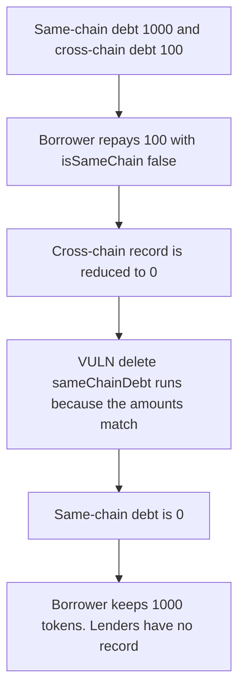

# LEND: a cross-chain repayment erases a same-chain debt of 1,000

> **Vulnerability classes:** `vuln/logic/state-update` · `vuln/access-control/missing-auth`

<!-- non-defihacklabs -->
<!-- source-auditvault: https://github.com/Auditware/AuditVault/blob/main/findings/58385-h-16-coreroutersols-repayborrowinternal-incorrectly-updates.md -->
<!-- date: 2025-05 -->

## Key info

| Field | Value |
|---|---|
| **Loss** | Repaying a 100-token cross-chain loan deletes a 1,000-token same-chain debt. The borrower keeps the 1,000. Lenders have no record left to collect |
| **Vulnerable contract** | `CoreRouter.repayBorrowInternal` |
| **Attacker EOA** | `0x1111111111111111111111111111111111111111` (the borrower) |
| **Attack contract** | `Exploit` |
| **Attack tx** | `Exploit.run()` |
| **Chain / block / date** | Ethereum model · block 0 · 2025-05 |
| **Compiler** | solc 0.8.27, cancun |
| **Bug class** | The same-chain balance update is not guarded by `_isSameChain` |

## TL;DR

`repayBorrowInternal` computes `borrowedAmount` from the cross-chain record when `_isSameChain` is false, repays that record, and then still runs the block that updates same-chain debt. A repayment of 100 equals the cross-chain borrowed amount, so `delete sameChainDebt` removes a separate 1,000 loan. The borrower keeps those 1,000 tokens. The fixed path, which skips the same-chain write, leaves the 1,000 debt in place.

## The vulnerable code

```solidity
if (!_isSameChain) {
    crossChainDebt[borrower] = borrowedAmount - repayAmountFinal;
}
if (repayAmountFinal == borrowedAmount) {
    delete sameChainDebt[borrower]; // @> VULN: this delete runs even when _isSameChain is false
    delete borrowedAsset[borrower];
}
```

```diff
- if (repayAmountFinal == borrowedAmount) {
-     delete sameChainDebt[borrower];
-     delete borrowedAsset[borrower];
- }
+ if (_isSameChain && repayAmountFinal == borrowedAmount) {
+     delete sameChainDebt[borrower];
+     delete borrowedAsset[borrower];
+ }
```

## Root cause

Same-chain and cross-chain debts are different storage slots, but the cleanup after a repayment always writes the same-chain slot. Equality is tested against the cross-chain amount, so a full cross-chain repay looks like a full same-chain repay.

## Preconditions

- The borrower has a same-chain debt of 1,000 and has received those tokens.
- The borrower has a separate cross-chain debt of 100 and has received those tokens.
- The caller repays exactly 100 with `_isSameChain == false`.

## Attack walkthrough

1. `borrow` records same-chain debt of 1,000 and sends 1,000 tokens.
2. `borrowForCrossChain` records 100 and sends 100 tokens.
3. `repayBorrow(..., false)` pays 100 back.
4. `delete sameChainDebt` runs because 100 equals the cross-chain borrowed amount.
5. The borrower still holds the 1,000 same-chain proceeds.
6. Recorded same-chain debt is 0. The pool holds 1,000 and cannot collect the erased loan.

## Diagrams



## Impact

Lenders who funded the 1,000 same-chain loan lose that claim. The borrower keeps the tokens. One cross-chain repayment was enough. The control repayment leaves `sameChainDebt` at 1,000.

## How to reproduce

```bash
cd 58385-h-16-coreroutersols-repayborrowinternal-incorrectly-updates_exp
forge test -vv
```

## Sources

- AuditVault finding: https://github.com/Auditware/AuditVault/blob/main/findings/58385-h-16-coreroutersols-repayborrowinternal-incorrectly-updates.md
- Sherlock judging issue 782: https://github.com/sherlock-audit/2025-05-lend-audit-contest-judging/issues/782
- `CoreRouter.repayBorrowInternal`: https://github.com/sherlock-audit/2025-05-lend-audit-contest/blob/main/Lend-V2/src/LayerZero/CoreRouter.sol#L459
