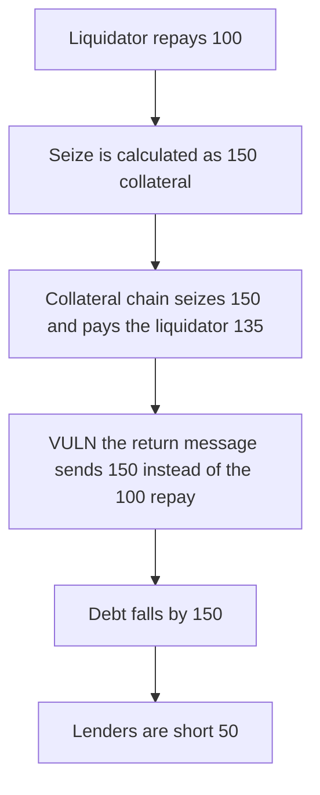

# LEND: cross-chain liquidation books the seize as the repay

> **Vulnerability classes:** `vuln/logic/liquidation-logic` · `vuln/bridge/missing-validation`

<!-- non-defihacklabs -->
<!-- source-auditvault: https://github.com/Auditware/AuditVault/blob/main/findings/58388-h-19-cross-chain-liquidation-uses-collateral-seize-amount-in.md -->
<!-- date: 2025-05 -->

## Key info

| Field | Value |
|---|---|
| **Loss** | Borrower debt falls by 150 while only 100 was repaid. Lenders are short 50 |
| **Vulnerable contract** | `CrossChainRouter._handleLiquidationExecute` |
| **Attacker EOA** | `0x1111111111111111111111111111111111111111` (the liquidator) |
| **Attack contract** | `Exploit` |
| **Attack tx** | `Exploit.run()` |
| **Chain / block / date** | Ethereum model · block 0 · 2025-05 |
| **Compiler** | solc 0.8.27, cancun, via IR |
| **Bug class** | The return LayerZero payload reuses the seize amount as the debt repay |

## TL;DR

A cross-chain liquidation tells the collateral chain how many collateral tokens to seize. That amount is correct on the way out. On the way back, `_handleLiquidationExecute` sends the same `payload.amount` and `_handleLiquidationSuccess` passes it to `repayCrossChainBorrowInternal` as the repay. The liquidator paid 100. Debt is reduced by the 150 seize. The borrower owes 50 less than the cash that came in. This run does not mint a profit token. The gap is the debt accounting.

## The vulnerable code

```solidity
collateral.transfer(liquidator, liquidatorShare);
_send(amount, LIQUIDATION_SUCCESS, repayAmount); // @> VULN: success payload reuses the seize amount
```

`repayAmount` is still in scope. The return message should carry it:

```diff
- _send(amount, LIQUIDATION_SUCCESS, repayAmount);
+ _send(repayAmount, LIQUIDATION_SUCCESS, repayAmount);
```

## Root cause

One `Payload.amount` field is used for two different quantities. `_executeLiquidationCore` correctly puts `seizeTokens` in it for the collateral chain. `_handleLiquidationExecute` then forwards that field unchanged, and the debt chain treats it as the repayment. The two numbers differ whenever the liquidation incentive is not 1.

## Preconditions

- The borrower owes 200 on the debt chain and has collateral on the other chain.
- The liquidator repays 100. The comptroller's seize for that repay is 150.
- Protocol seize share is 10 percent, so the liquidator receives 135 collateral. That premium is intended. The bug is the extra 50 of debt that is erased.

## Attack walkthrough

1. The router pulls 100 debt tokens from the liquidator. `cashIn` is 100.
2. The execute message carries 150, the seize. The collateral leg keeps a 15 protocol share and pays the liquidator 135.
3. The success message sends 150, not the 100 repay.
4. `repayCrossChainBorrowInternal` subtracts 150 from the 200 debt. Debt left is 50. It should be 100.
5. `debtReducedBy - cashIn` is 50.

## Diagrams



## Impact

Lenders' books drop by 50 more than the cash the liquidation brought in. The borrower owes 50 instead of 100. The liquidator's 135 collateral is the normal 10 percent protocol share taken out of a 150 seize, not the accounting gap. Repeat the liquidation and the gap scales with the difference between seize and repay.

## How to reproduce

```bash
cd 58388-h-19-cross-chain-liquidation-uses-collateral-seize-amount-in_exp
forge test -vv
```

`test_debt_falls_by_the_seize_not_the_repay` asserts cash in is 100, debt reduced is 150, debt left is 50, and the gap is 50.

## Sources

- AuditVault finding: https://github.com/Auditware/AuditVault/blob/main/findings/58388-h-19-cross-chain-liquidation-uses-collateral-seize-amount-in.md
- Sherlock judging issue 836: https://github.com/sherlock-audit/2025-05-lend-audit-contest-judging/issues/836
- Router: https://github.com/sherlock-audit/2025-05-lend-audit-contest/blob/main/Lend-V2/src/LayerZero/CrossChainRouter.sol#L312
