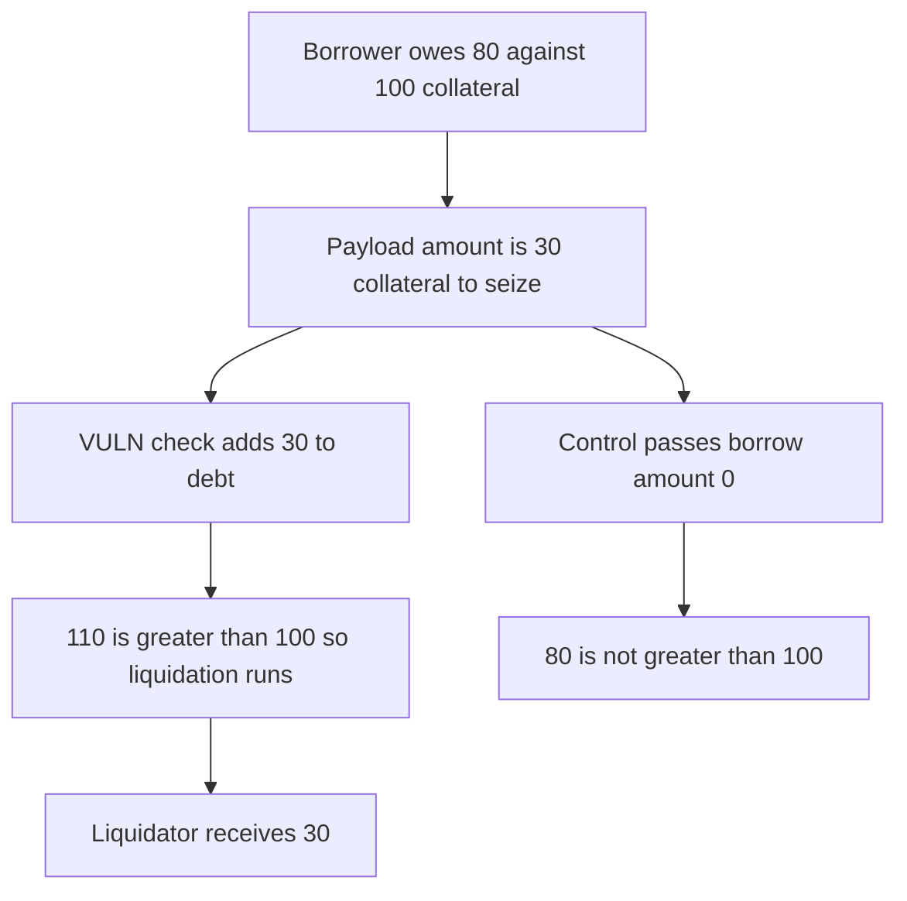

# LEND: a healthy 80/100 account is liquidated because the seize size is added to debt

> **Vulnerability classes:** `vuln/logic/liquidation-logic` · `vuln/logic/wrong-condition`

<!-- non-defihacklabs -->
<!-- source-auditvault: https://github.com/Auditware/AuditVault/blob/main/findings/58391-h-22-the-liquidation-validation-logic-is-wrong-sherlock-lend.md -->
<!-- date: 2025-05 -->

**AuditVault taxonomy:** `lang/solidity` · `sector/bridge` · `sector/lending` · `sector/uncollat-lending` · `platform/sherlock` · `has/github` · `has/poc` · `severity/high` · genome: `liquidation-underwater` · `liquidation-logic` · `direct-drain` · `variant` · `math-is-safe` · `redesign-logic`

## Key info

| Field | Value |
|---|---|
| **Loss** | 30 collateral taken from an account that owes 80 against 100 |
| **Vulnerable contract** | `CrossChainRouter._checkLiquidationValid` |
| **Attacker EOA** | `0x1111111111111111111111111111111111111111` |
| **Attack contract** | `Exploit` |
| **Attack tx** | `Exploit.run()` |
| **Chain / block / date** | Ethereum model · block 0 · 2025-05 |
| **Compiler** | solc 0.8.27, cancun, via IR |
| **Bug class** | Seize amount is passed as `borrowAmount` |

## TL;DR

On the collateral chain, `_checkLiquidationValid` asks whether the account would be short if it borrowed `payload.amount` more. `payload.amount` is the number of collateral tokens to seize, computed on the debt chain, not a new borrow. An account with 80 debt and 100 collateral is healthy: 80 is not greater than 100. Adding the 30 seize size makes the check see 110 against 100, so the liquidation runs and the liquidator receives 30. Passing 0 for the extra borrow leaves the account healthy.

## Background

Sherlock's May 2025 LEND contest, H-22, issue 930, reported by newspacexyz and others. Chain B's `_executeLiquidationCore` puts `seizeTokens` in the LayerZero payload. Chain A's `_checkLiquidationValid` forwards `payload.amount` as the fourth argument of `getHypotheticalAccountLiquidityCollateral`, whose parameter name is `borrowAmount`. The judging diff replaces that argument with 0.

## The vulnerable code

```solidity
(uint256 borrowed, uint256 collateral) = lendStorage.getHypotheticalAccountLiquidityCollateral(payload.sender, LToken(payable(payload.destlToken)), 0, payload.amount);
// @> VULN: payload.amount is the seize size, but it is passed as borrowAmount
return borrowed > collateral;
```

The recommended call, from the report:

```diff
- getHypotheticalAccountLiquidityCollateral(payload.sender, LToken(payable(payload.destlToken)), 0, payload.amount)
+ getHypotheticalAccountLiquidityCollateral(payload.sender, LToken(payable(payload.destlToken)), 0, 0)
```

## Root cause

The payload field is documented by its producer as collateral to seize. The consumer adds it to debt. The liquidity function then answers a different question from the one the liquidation needs.

## Preconditions

- The borrower owes 80 and has 100 of collateral on this chain. No extra borrow and no redeem is proposed.
- The liquidation payload's `amount` is 30, the seize size from the other chain.
- The router holds at least 30 of the collateral token.

## Attack walkthrough

1. A zero-borrow read returns borrowed 80 and collateral 100. `wasHealthy` is true.
2. The buggy read adds 30 to borrowed. 110 is greater than 100, so the check returns true.
3. The router transfers 30 collateral to the liquidator. The stored debt and collateral are still 80 and 100.
4. The control call with borrow amount 0 does not treat the account as liquidatable. The call with 30 does.

## Diagrams



## Impact

The liquidator receives 30 collateral tokens. The borrower was solvent: debt 80 is still covered by collateral 100, and the books are not changed by the transfer. Repeating the same mis-check can seize more of a healthy position whenever a cross-chain payload carries a non-zero seize size.

## Remediation

Pass 0 as `borrowAmount` in `_checkLiquidationValid`, which is the change in the Sherlock judging diff. Decide shortfall from the account's actual debt and collateral.

## How to reproduce

```bash
cd 58391-h-22-the-liquidation-validation-logic-is-wrong-sherlock-lend_exp
forge test -vv
```

`test_healthy_account_loses_30_collateral` asserts the 30 transfer and that 80 is still within 100. `test_control_zero_borrow_amount_is_not_liquidatable` asserts the zero-borrow read is healthy and the 30-borrow read is not. Captured output is `output.txt`.

## Sources

- AuditVault finding: https://github.com/Auditware/AuditVault/blob/main/findings/58391-h-22-the-liquidation-validation-logic-is-wrong-sherlock-lend.md
- Sherlock issue 930: https://github.com/sherlock-audit/2025-05-lend-audit-contest-judging/issues/930
- Blamed lines: https://github.com/sherlock-audit/2025-05-lend-audit-contest/blob/713372a1ccd8090ead836ca6b1acf92e97de4679/Lend-V2/src/LayerZero/CrossChainRouter.sol#L431-L436
