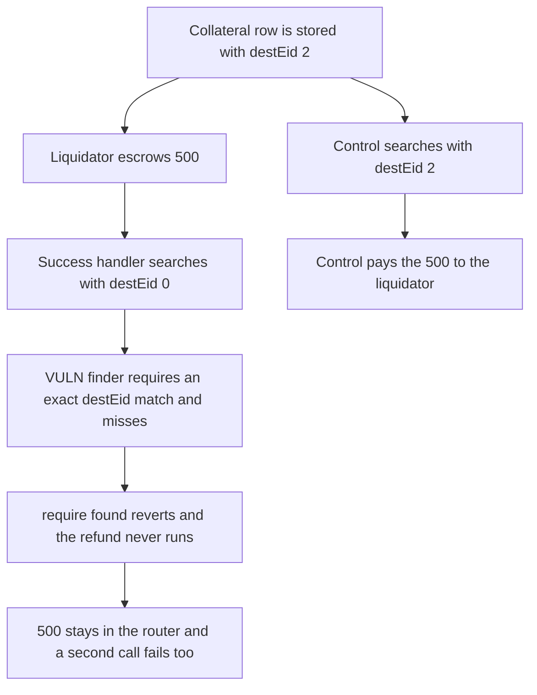

# LEND: liquidation success looks up destEid 0 and leaves 500 escrowed

> **Vulnerability classes:** vuln/logic/wrong-condition · vuln/dos/frozen-funds

<!-- non-defihacklabs -->
<!-- source-auditvault: https://github.com/Auditware/AuditVault/blob/main/findings/58394-h-25-incorrect-desteid-value-in-handleliquidationsuccess-pr.md -->
<!-- date: 2025-05 -->

## Key info

| Field | Value |
|---|---|
| **Loss** | 500 of the liquidator's escrow stays in the router. A second success call fails the same way. The control with destEid 2 pays 500 out |
| **Vulnerable contract** | `CrossChainRouter._handleLiquidationSuccess` |
| **Attacker EOA** | `0x1111111111111111111111111111111111111111` (the liquidator) |
| **Attack contract** | `Exploit` |
| **Attack tx** | `Exploit.run()` |
| **Chain / block / date** | Ethereum model · block 0 · 2025-05 |
| **Compiler** | solc 0.8.27, cancun, via IR |
| **Bug class** | Collateral lookup passes a hardcoded destination chain id |

## TL;DR

`_handleLiquidationSuccess` calls `findCrossChainCollateral` with `destEid` hardcoded to 0. The stored row has `destEid` 2, and the finder requires every field to match. The lookup misses, `require(found)` reverts, and the failure refund never runs. 500 of escrowed repayment stays in the router. A second call reverts the same way. The control passes destEid 2, finds the row, and pays the 500 to the liquidator.

## Background

Sherlock's May 2025 LEND contest, H-25. Several researchers reported that `_handleLiquidationSuccess` in `CrossChainRouter` passes `0` as `destEid`. `LendStorage.findCrossChainCollateral` compares `srcEid`, `destEid`, `borrowedlToken`, and `srcToken`. A stored destination chain id other than 0 can never match. Because the success handler reverts before any refund, the liquidator's escrowed tokens remain in the contract. Issue 328 describes the same stuck-funds result.

## The vulnerable code

```solidity
// @> VULN: destEid is hardcoded to 0, so the stored collateral row is never found
(bool found, uint256 index) = lendStorage.findCrossChainCollateral(
    payload.sender, underlying, currentEid, 0, payload.destlToken, payload.srcToken
);
require(found, "Borrow position not found");
```

The stored row uses `destEid` 2. The finder returns false unless `rows[i].destEid == destEid`.

## Root cause

The success handler does not know the destination chain id yet, and it passes 0 as a placeholder. The finder does not treat 0 as a wildcard. It requires an exact match, so a real row is invisible and the require reverts the message.

## Preconditions

- A cross-chain collateral row exists with `srcEid` 101, `destEid` 2, and the borrowed lToken and source token from the payload.
- 500 of the liquidator's repayment is already escrowed in the router.
- The success message is delivered on the chain that holds the row.

## Attack walkthrough

1. The row is stored with destEid 2.
2. The liquidator escrows 500 into the router.
3. The first success call searches with destEid 0. The finder skips the row. `Borrow position not found` reverts.
4. A second success call reverts the same way. The 500 is still in the router and the liquidator has received nothing from those calls.
5. The control searches with destEid 2, finds the row, and transfers 500 to the liquidator.

## Diagrams



## Impact

500 of the liquidator's repayment is stuck in the router. The liquidation cannot finish, and repeating the success message does not recover it, because destEid is still 0. The control pays that 500 to the liquidator when the stored destEid is passed through.

## Remediation

Pass the row's real `destEid`, or stop requiring `destEid` when the handler does not know it yet. Do not revert the success path in a way that skips the refund of escrowed tokens.

## How to reproduce

```bash
cd 58394-h-25-incorrect-desteid-value-in-handleliquidationsuccess-pr_exp
forge test -vv
```

`test_exploit_escrow_stuck` asserts 500 left in the router and 500 paid only by the control. `test_control_pays_the_escrow` asserts the fixed lookup pays 500 and leaves the router empty. Captured output is `output.txt`.

## Sources

- AuditVault finding: https://github.com/Auditware/AuditVault/blob/main/findings/58394-h-25-incorrect-desteid-value-in-handleliquidationsuccess-pr.md
- Sherlock issue 979: https://github.com/sherlock-audit/2025-05-lend-audit-contest-judging/issues/979
- Stuck-funds writeup: https://github.com/sherlock-audit/2025-05-lend-audit-contest-judging/issues/328
- Audited lines: https://github.com/sherlock-audit/2025-05-lend-audit-contest/blob/713372a1ccd8090ead836ca6b1acf92e97de4679/Lend-V2/src/LayerZero/CrossChainRouter.sol#L443
