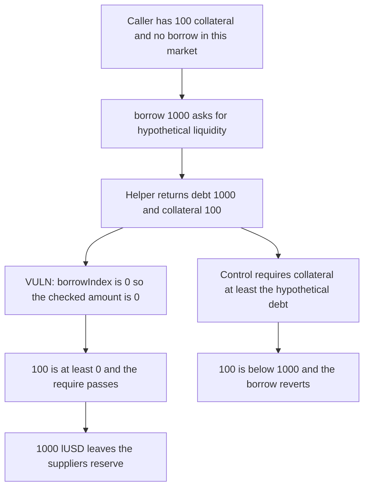

# LEND: the first borrow in a market compares collateral with zero

> **Vulnerability classes:** `vuln/logic/wrong-condition` · `vuln/logic/missing-check`

<!-- non-defihacklabs -->
<!-- source-auditvault: https://github.com/Auditware/AuditVault/blob/main/findings/58396-h-27-incorrect-collateral-check-logic-in-coreroutersolborrow.md -->
<!-- date: 2025-05 -->

## Key info

| Field | Value |
|---|---|
| **Loss** | 1000 lUSD borrowed against 100 of collateral value |
| **Vulnerable contract** | `CoreRouter.borrow` |
| **Attacker EOA** | `0x1111111111111111111111111111111111111111` |
| **Attack contract** | `Exploit` |
| **Attack tx** | `Exploit.run()` |
| **Chain / block / date** | Ethereum model · block 0 · 2025-05 |
| **Compiler** | solc 0.8.27, cancun, via IR |
| **Bug class** | Solvency check uses a borrow amount that is 0 on the first borrow |

## TL;DR

`borrow` asks `getHypotheticalAccountLiquidityCollateral` for the post-borrow debt and collateral, then ignores that debt. It builds `borrowAmount` from the caller's stored borrow index. On the first borrow in the market the index is 0, so `borrowAmount` is 0. `require(collateral >= borrowAmount)` is `require(100 >= 0)`. The router then transfers 1000 lUSD out of the suppliers' reserve.

## The vulnerable code

```solidity
uint256 borrowAmount = currentBorrow.borrowIndex != 0
    ? ((borrowed * LTokenInterface(_lToken).borrowIndex()) / currentBorrow.borrowIndex)
    : 0;

require(collateral >= borrowAmount, "Insufficient collateral"); // @> VULN: first borrow sets borrowAmount to 0, so collateral >= 0 always passes
```

`borrowed` in this run is 1000 and `collateral` is 100. The check that matches the liquidity helper is `require(collateral >= borrowed)`.

## Preconditions

- The caller has no borrow record in this market, so `borrowIndex` is 0.
- Collateral value is 100. The requested borrow prices to 1000.
- The lToken reserve holds at least 1000 of underlying, funded by other suppliers.

## Attack walkthrough

1. Record 100 of collateral value.
2. Call `borrow(1000)`. The hypothetical result is debt 1000 and collateral 100.
3. The stored borrow index is 0, so the amount compared with collateral is 0.
4. `100 >= 0` passes.
5. The lToken pays 1000 underlying to the router and the router forwards it to the caller. The reserve falls from 2000 to 1000.
6. The control compares collateral with the hypothetical debt and reverts. The reserve stays 2000.

## Diagrams



## Impact

A first-time borrower in a market receives 1000 lUSD while posting collateral the protocol itself values at 100. The extra 900 is bad debt against the suppliers who funded the reserve. The same call reverts if the check uses the hypothetical debt.

## How to reproduce

```bash
cd 58396-h-27-incorrect-collateral-check-logic-in-coreroutersolborrow_exp
forge test -vv
```

`test_exploit_first_borrow_bypasses_collateral_check` asserts 1000 received, a zeroed check, and 1000 left in a reserve that started at 2000. `test_control_compare_hypothetical_debt_reverts` asserts the fixed router reverts and the reserve is intact.

## Sources

- AuditVault finding: https://github.com/Auditware/AuditVault/blob/main/findings/58396-h-27-incorrect-collateral-check-logic-in-coreroutersolborrow.md
- Sherlock issue 1010: https://github.com/sherlock-audit/2025-05-lend-audit-contest-judging/issues/1010
- Borrow: https://github.com/sherlock-audit/2025-05-lend-audit-contest/blob/main/Lend-V2/src/LayerZero/CoreRouter.sol#L153
