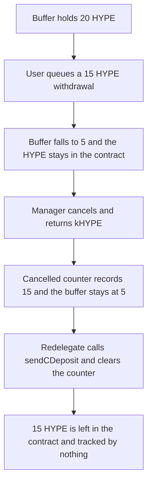

# Kinetiq: cancelling a buffer withdrawal then redelegating locks 15 HYPE

> **Vulnerability classes:** vuln/dos/frozen-funds · vuln/logic/state-update

<!-- non-defihacklabs -->
<!-- source-auditvault: https://github.com/Auditware/AuditVault/blob/main/findings/58553-h-01-buffer-silently-locks-staked-hype-in-contract-without-u.md -->
<!-- date: 2025-04 -->


A user queues a 15 HYPE withdrawal against a 20 HYPE buffer. `queueWithdrawal` reduces `hypeBuffer` to 5 but leaves the HYPE in the contract. `cancelWithdrawal` returns the kHYPE and adds 15 to `_cancelledWithdrawalAmount` without restoring the buffer. `redelegateWithdrawnHYPE` then zeroes that counter and `sendCDeposit`s the 8-decimal amount. No value is sent to L1, so 15 HYPE stays in the contract and is tracked by nothing.

```solidity
hypeBuffer = currentBuffer - amountFromBuffer; // 20 -> 5, HYPE still here
_cancelledWithdrawalAmount += hypeAmount;      // cancel does not restore the buffer
_cancelledWithdrawalAmount = 0;
l1Write.sendCDeposit(uint64(truncatedAmount)); // @> VULN: accounting moves, value does not
```

## Diagrams



## Impact

The contract balance is still 20 HYPE. `hypeBuffer` is 5, the queue is 0, and `_cancelledWithdrawalAmount` is 0. `untracked()` is 15 HYPE. The fixed cancel puts those 15 HYPE back into the buffer, so `untracked()` is 0.

## PoC

```bash
cd 58553-h-01-buffer-silently-locks-staked-hype-in-contract-without-u_exp
forge test -vv
```

