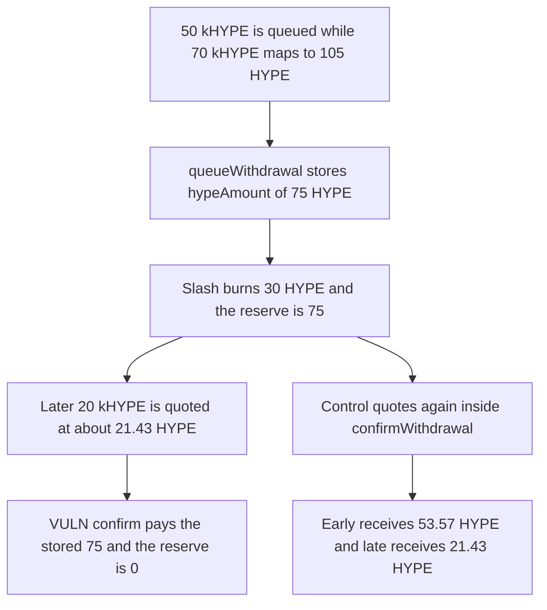

# Kinetiq pays a queued withdrawal the pre-slash HYPE amount and leaves the later stake at 0

> **Vulnerability classes:** vuln/logic/stale-state · vuln/defi/withdrawal

<!-- non-defihacklabs -->
<!-- source-auditvault: https://github.com/Auditware/AuditVault/blob/main/findings/58554-h-02-users-who-queue-withdrawal-before-a-slashing-event-disa.md -->
<!-- date: 2025-04 -->

## Key info

| Field | Value |
|---|---|
| **Loss** | 75 HYPE is paid to the withdrawal queued before the slash. The later 20 kHYPE is quoted at 21428571428571428571 wei and receives 0. The post-slash reserve was 75 HYPE for 70 kHYPE |
| **Vulnerable contract** | `StakingManager.confirmWithdrawal` |
| **Attacker EOA** | `0x1111111111111111111111111111111111111111` |
| **Attack contract** | `Exploit` at `0x15452ec016c4dc8c549e7fe6ff4b26324ea8b7a4` |
| **Attack tx** | `Exploit.run()` |
| **Chain / block / date** | Ethereum model · block 0 · 2025-04 |
| **Compiler** | solc 0.8.27, cancun, via IR |
| **Bug class** | `confirmWithdrawal` pays `hypeAmount` stored by `queueWithdrawal` |



## TL;DR

`queueWithdrawal` stores `hypeAmount = kHYPEToHYPE(postFeeKHYPE)` on the request. `confirmWithdrawal` loads that stored number and transfers it. The quote is not redone.

At 105 HYPE for 70 kHYPE, 50 kHYPE snapshots to 75 HYPE. A slash burns 30 HYPE, so 75 HYPE remains for 70 kHYPE. The early confirm still pays 75. The later 20 kHYPE was quoted, after the slash, at 21428571428571428571 wei. Its confirm reverts because the contract balance is 0.

HYPE is an 18-decimal token standing in for native HYPE. The stored amount, the balance check, and the transfer are the quoted confirm path.

The fixed confirm ignores the stored `hypeAmount` and calls `kHYPEToHYPE` again. The early user receives 53571428571428571428 wei and the later user receives 21428571428571428572 wei. Those sum to the 75 HYPE left after the slash.

## The vulnerable code

```solidity
uint256 hypeAmount = kHYPEToHYPE(postFeeKHYPE);
kHYPE.transferFrom(msg.sender, address(this), kHYPEAmount);
_withdrawalRequests[msg.sender][withdrawalId] = WithdrawalRequest({
    hypeAmount: hypeAmount,
    kHYPEAmount: postFeeKHYPE,
    kHYPEFee: kHYPEFee,
    timestamp: block.timestamp
});
```

```solidity
uint256 amount = _processConfirmation(msg.sender, withdrawalId);
require(hype.balanceOf(address(this)) >= amount, "Insufficient contract balance");
totalHYPE -= amount; // @> VULN: subtracts the pre-slash hypeAmount stored at queue time
hype.transfer(msg.sender, amount);
```

## Impact

The early withdrawer takes the entire post-slash reserve, 75 HYPE. The 20 kHYPE queued afterward cannot be paid. Under the recomputed rate that 20 kHYPE is worth 21428571428571428571 wei, and it receives none of it.
