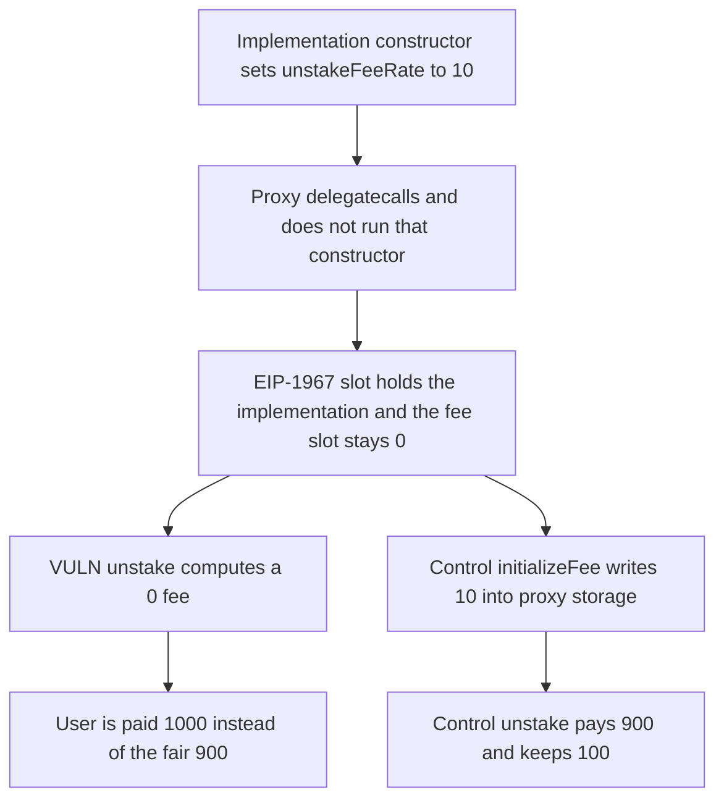

# Kinetiq: a declaration initializer never reaches the proxy, so the unstake fee is 0

> **Vulnerability classes:** vuln/access-control/uninitialized-proxy · vuln/defi/fee-manipulation

<!-- non-defihacklabs -->
<!-- source-auditvault: https://github.com/Auditware/AuditVault/blob/main/findings/58595-initialization-upon-declaration-will-not-work-for-proxied-co.md -->
<!-- date: 2025-03 -->

## Key info

| Field | Value |
|---|---|
| **Loss** | A proxy unstake pays 1,000. The fair payout at fee rate 10 is 900. The user is overpaid by 100 |
| **Vulnerable contract** | `StakingManager.unstake` |
| **Attacker EOA** | `0x1111111111111111111111111111111111111111` |
| **Attack contract** | `Exploit` |
| **Attack tx** | `Exploit.run()` |
| **Chain / block / date** | Ethereum model · block 0 · 2025-03 |
| **Compiler** | solc 0.8.27, cancun, via IR |
| **Bug class** | Declaration initializer writes the implementation, not the proxy |

## TL;DR

`StakingManager` sets `unstakeFeeRate = 10` on the declaration. That assignment runs in the implementation constructor and writes the implementation's storage. The proxy delegatecalls the implementation and never runs that constructor. The implementation address is stored in the EIP-1967 slot, so it does not occupy the fee slot. The proxy's fee slot stays 0. Unstaking 1,000 through the proxy charges no fee and pays 1,000. The fair fee is 100 and the fair payout is 900. The control calls `initializeFee` on a second proxy, which writes 10 into that proxy's storage, and the unstake pays 900.

## Background

Spearbit's March 2025 review of Kinetiq LST. `OracleManager` and `StakingManager` are meant to run behind a delegation proxy. Both initialize storage in the declaration, including `unstakeFeeRate = 10` on `StakingManager`. Those writes hit the implementation. Proxy storage for the same slots stays 0, so the unstake fee is not charged. The fix, commit `e2bac5c`, moves the assignments into `initialize`. This reduction deploys the implementation, two EIP-1967 proxies, and one unstake in the same transaction. It does not invent a second variable in the fee slot.

## The vulnerable code

```solidity
uint256 public unstakeFeeRate = 10;

function unstake(address to, uint256 amount) external returns (uint256 payout) {
    uint256 feeRate = unstakeFeeRate;
    uint256 fee = amount * feeRate / 100;
    payout = amount - fee;
    // @> VULN: the declaration initializer never wrote the proxy slot, so the fee is 0 and this transfer pays the full amount
    ethToken.transfer(to, payout);
}
```

The declaration is the initializer that never runs against proxy storage. The transfer is the line that pays `amount - 0`.

## Root cause

Solidity runs declaration initializers in the constructor. A proxy does not delegatecall the constructor. Unless `initialize` writes the same slots, every reader of `unstakeFeeRate` on the proxy sees 0.

## Preconditions

- The implementation is deployed, so its own `unstakeFeeRate` is 10.
- The proxy points at that implementation through the EIP-1967 slot.
- The token address is written with `setToken`, which does not touch the fee slot.
- The proxy holds 1,000 of the token.

## Attack walkthrough

1. The implementation's fee rate reads as 10. The proxy's fee rate reads as 0.
2. `setToken` stores the token in the proxy. The fee slot is still 0.
3. Unstake of 1,000 through the proxy computes a fee of 0 and transfers 1,000.
4. The fair payout is 900. The user is overpaid by 100.
5. The control proxy calls `initializeFee`, which sets the rate to 10 in proxy storage, then unstakes. It pays 900 and keeps 100.

## Diagrams



## Impact

The user who unstakes 1,000 through the proxy receives 1,000. The fee rate on the implementation is 10, so the fair fee is 100 and the fair payout is 900. The user is overpaid by 100, and the proxy keeps nothing. The control keeps that 100.

## Remediation

Set `unstakeFeeRate` inside `initialize`, which delegatecalls into the proxy's storage. Do not rely on a declaration initializer for a proxied contract. That is the change in commit `e2bac5c`.

## How to reproduce

```bash
cd 58595-initialization-upon-declaration-will-not-work-for-proxied-co_exp
forge test -vv
```

`test_exploit_proxy_skips_fee` asserts the implementation rate is 10, the user receives 1,000, the control user receives 900, and the control proxy keeps 100. `test_control_initialized_proxy_keeps_fee` asserts the declaration sets 10 on the implementation itself. Captured output is `output.txt`.

## Sources

- AuditVault finding: https://github.com/Auditware/AuditVault/blob/main/findings/58595-initialization-upon-declaration-will-not-work-for-proxied-co.md
- Spearbit report: https://github.com/spearbit/portfolio/blob/master/pdfs/Kinetiq-Spearbit-Security-Review-March-2025.pdf
- Fix commit named by the review: `e2bac5c`
