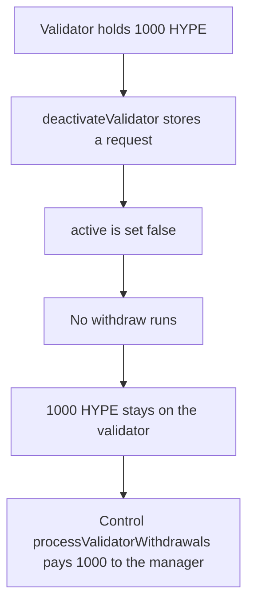

# Kinetiq deactivateValidator leaves 1,000 HYPE on the validator

> **Vulnerability classes:** vuln/dos/frozen-funds · vuln/logic/missing-check

<!-- non-defihacklabs -->
<!-- source-auditvault: https://github.com/Auditware/AuditVault/blob/main/findings/58610-h-02-validatormanager-missing-fund-withdrawal-from-validator.md -->
<!-- date: 2025-02 -->

## Key info

| Field | Value |
|---|---|
| **Loss** | 1,000 HYPE stays on the validator. The control pays 1,000 to the staking manager |
| **Vulnerable contract** | `StakingManager.deactivateValidator` |
| **Attacker EOA** | `0x1111111111111111111111111111111111111111` |
| **Attack contract** | `Exploit` |
| **Attack tx** | `Exploit.run()` |
| **Chain / block / date** | Ethereum model · block 0 · 2025-02 |
| **Compiler** | solc 0.8.27, cancun, via IR |
| **Bug class** | Deactivate records a request and never withdraws |

## TL;DR

`deactivateValidator` stores a rebalance request for the validator's balance and sets `active` to false. It never calls `processValidatorWithdrawals`. After deactivating a validator that holds 1,000 HYPE, the validator still holds 1,000 and the staking manager holds 0. The control calls the withdraw in the same function and the manager receives 1,000.

## The vulnerable code

```solidity
if (bal > 0) {
    // @> VULN: a rebalance request is stored and the validator balance is never withdrawn.
    requested = bal;
}
active = false;
```

The control then calls `processValidatorWithdrawals`, which pushes the balance to the manager.

## Root cause

The withdrawal request is only an accounting record. The HYPE sits on the validator account. Later closes of that request need the tokens to already be in the staking manager, and they revert because the manager balance is still zero.

## Attack walkthrough

1. The validator is funded with 1,000 HYPE.
2. `deactivateValidator` sets `requested` to 1,000 and clears `active`.
3. No transfer runs. The validator balance is still 1,000. The manager balance is 0.
4. The control manager deactivates and calls `processValidatorWithdrawals`.
5. The control validator pushes 1,000 HYPE to its manager and ends at 0.

## Diagrams



## Impact

1,000 HYPE is stuck on the deactivated validator. The staking manager cannot complete the rebalance it just recorded. The control path delivers that 1,000 to the manager.

## PoC

```bash
cd 58610-h-02-validatormanager-missing-fund-withdrawal-from-validator_exp
forge test -vv
```

`test_exploit_deactivate_leaves_1000` asserts the validator still holds 1,000e18, the manager received 0, and the control manager received 1,000e18.

## Sources

- AuditVault finding: https://github.com/Auditware/AuditVault/blob/main/findings/58610-h-02-validatormanager-missing-fund-withdrawal-from-validator.md
- Pashov report: https://github.com/pashov/audits/blob/master/team/md/Kinetiq-security-review_2025-02-26.md
