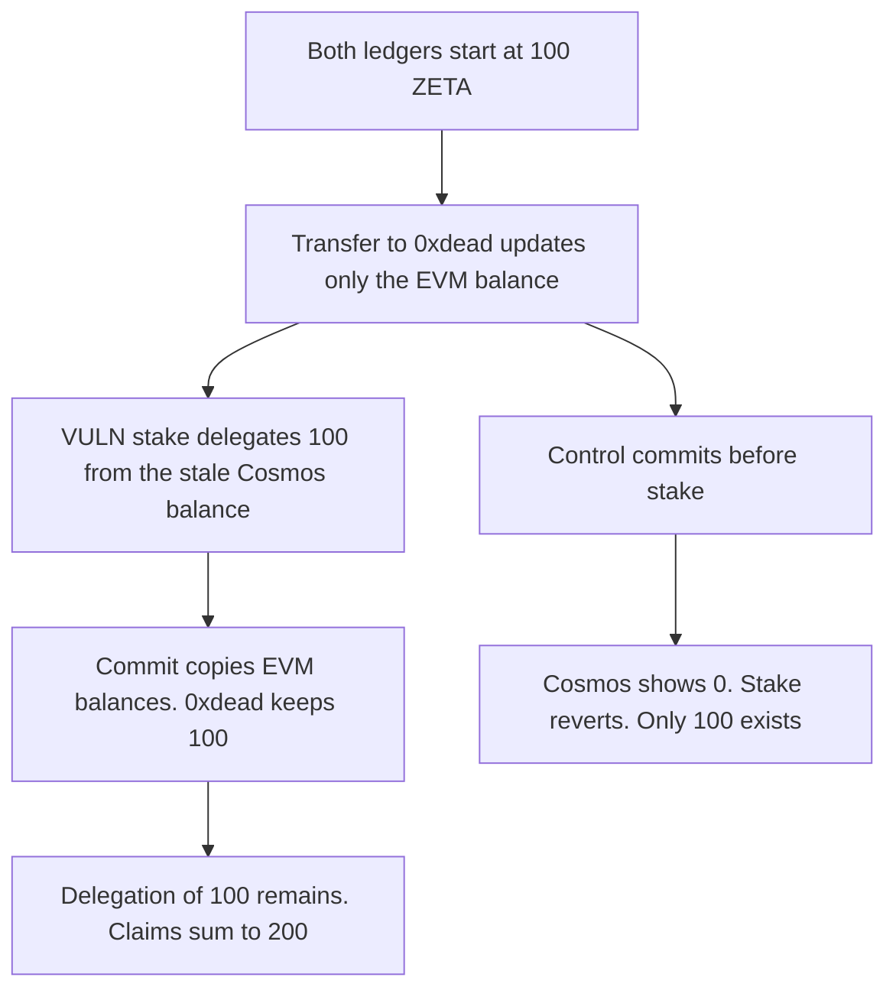

# ZetaChain: a dirty ZETA transfer is staked again because the precompile does not commit

> **Vulnerability classes:** vuln/logic/state-update

<!-- non-defihacklabs -->
<!-- source-auditvault: https://github.com/Auditware/AuditVault/blob/main/findings/58632-h-2-dirty-evm-state-changes-are-not-committed-before-precomp.md -->
<!-- date: 2025-04 -->

## Key info

| Field | Value |
|---|---|
| **Loss** | 100 ZETA is transferred to 0xdead and the same 100 ZETA is staked. The two balances sum to 200 |
| **Vulnerable contract** | `ZetaBank.stake` |
| **Attacker EOA** | `0x1111111111111111111111111111111111111111` |
| **Attack contract** | `Exploit` |
| **Attack tx** | `Exploit.run()` |
| **Chain / block / date** | Ethereum model · block 0 · 2025-04 |
| **Compiler** | solc 0.8.27, cancun, via IR |
| **Bug class** | Staking precompile reads Cosmos state before the dirty EVM transfer is committed |

## TL;DR

A Solidity transfer of 100 ZETA to `0xdead` updates only the EVM balance. The staking precompile then delegates 100 from the Cosmos balance, which still shows the old 100. The end-of-transaction commit copies the EVM balances over Cosmos, so `0xdead` keeps 100 and the delegation of 100 remains. One funding of 100 becomes 200 of claims. Committing before the stake makes Cosmos show 0, and the stake reverts.

## Background

Sherlock's April 2025 ZetaChain cross-chain contest, issue 329 (H-2), reported by berndartmueller and stonejiajia. ZetaChain precompile `Run` does not commit the EVM statedb before it executes Cosmos SDK code. `stateDB.SubBalance` in the staking method does not reject an underflow, so it does not repair the split. The team acknowledged the issue and did not fix it in that round. This reduction keeps the two ledgers, the uncommitted transfer, the stake, and the final overwrite.

## The vulnerable code

```solidity
function stake(uint256 amount) external {
    // @> VULN: stake spends the Cosmos balance without committing the dirty EVM transfer first
    cosmosBalance[msg.sender] -= amount;
    delegated[msg.sender] += amount;
    share.mint(msg.sender, amount);
}
```

`transfer` only edits `evmBalance`. `commit` runs after the stake and sets `cosmosBalance` from `evmBalance`, which does not remove `delegated`.

## Root cause

Cosmos and the EVM each keep a balance, and the precompile reads the Cosmos one while the EVM one is still dirty. The later commit makes the EVM view win for liquid balances and leaves the Cosmos delegation in place.

## Preconditions

- The contract is funded with 100 ZETA, recorded on both ledgers.
- It transfers the entire 100 to `0xdead` in the same transaction as the stake.
- No commit runs between the transfer and the stake.

## Attack walkthrough

1. Both ledgers show 100.
2. The transfer sets the EVM balance to 0 and `0xdead` to 100. Cosmos still shows 100.
3. `stake(100)` subtracts the Cosmos balance and mints 100 shares.
4. Commit copies the EVM balances. `0xdead` has 100 on Cosmos. The staker's Cosmos balance is 0. Delegation stays 100.
5. Dead balance plus delegation is 200.
6. The control commits first. Cosmos shows 0, `stake` reverts, and only the 100 at `0xdead` exists.

## Diagrams



## Impact

`0xdead` holds 100 ZETA and the staker holds 100 stake shares, from a single 100 ZETA funding. The extra 100 is the delegation that Cosmos allowed before it learned about the transfer. The control commits first, the stake reverts, no shares are minted, and `0xdead` holds the only 100.

## Remediation

Commit the dirty EVM state to the Cosmos bank before the staking precompile reads or spends a balance, which is the mitigation described on issue 329.

## How to reproduce

```bash
cd 58632-h-2-dirty-evm-state-changes-are-not-committed-before-precomp_exp
forge test -vv
```

`test_exploit_double_spends_100_zeta` asserts 100 at `0xdead`, 100 staked, and a sum of 200. `test_control_commit_before_stake_delegates_nothing` asserts the stake reverts, delegation stays 0, and `0xdead` holds the only 100. Captured output is `output.txt`.

## Sources

- AuditVault finding: https://github.com/Auditware/AuditVault/blob/main/findings/58632-h-2-dirty-evm-state-changes-are-not-committed-before-precomp.md
- Sherlock issue 329: https://github.com/sherlock-audit/2025-04-zetachain-cross-chain-judging/issues/329
- Staking precompile: https://github.com/sherlock-audit/2025-04-zetachain-cross-chain/blob/main/node/precompiles/staking/method_stake.go#L63-L70
