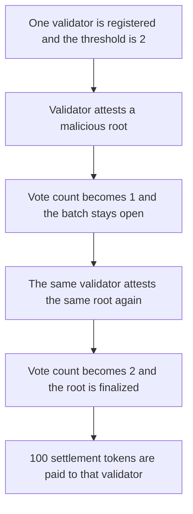

# Powerloom: one validator finalizes a batch by attesting twice

> **Vulnerability classes:** vuln/logic/missing-check · vuln/governance/proposal-manipulation

<!-- non-defihacklabs -->
<!-- source-auditvault: https://github.com/Auditware/AuditVault/blob/main/findings/58812-validators-can-submit-multiple-attestations-to-maliciously-f.md -->
<!-- date: 2024-03 -->


`submitBatchAttestation` counts a vote for the supplied root and never checks `attestationsReceived`. The finalization threshold is 2. One registered validator submits the same malicious root twice, the second vote crosses the threshold, and the 100 token batch settlement is paid to that validator.

```solidity
// Missing: require(!attestationsReceived[batch][tx.origin]);
votes[batch][root] += 1; // @> VULN
if (votes[batch][root] >= THRESHOLD && !finalized[batch]) {
    finalized[batch] = true;
    reward.transfer(msg.sender, SETTLEMENT);
}
```

## Diagrams



## Impact

The malicious root is finalized with `votes == 2` from a single validator. The validator receives 100 settlement tokens. With the missing check restored, the second attestation reverts, the batch stays open, and the 100 token escrow stays in the contract.

## PoC

```bash
cd 58812-validators-can-submit-multiple-attestations-to-maliciously-f_exp
forge test -vv
```

