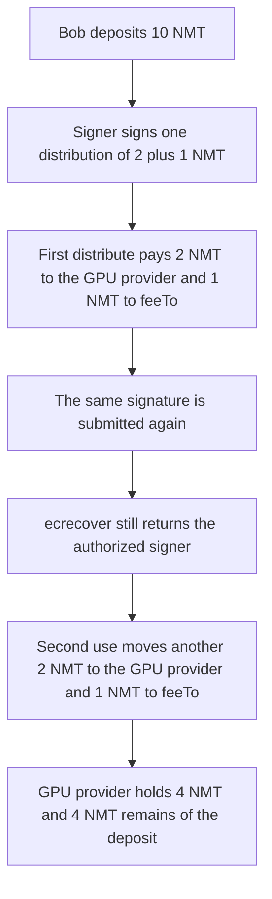

# NetMind: one distribution signature pays the GPU provider twice

> **Vulnerability classes:** vuln/auth/signature-replay

<!-- non-defihacklabs -->
<!-- source-auditvault: https://github.com/Auditware/AuditVault/blob/main/findings/59205-signature-replay-quantstamp-netmind-markdown.md -->
<!-- date: 2024-04 -->


Bob deposits 10 NMT. An authorized signer signs one distribution: payment id 1, the GPU provider, 2 NMT GPU fee, 1 NMT platform fee, expiry `2000000000`. The digest is `keccak256(abi.encode(...))` and is never marked used. The same 65-byte signature, precomputed offline, is submitted a second time. The GPU provider ends with 4 NMT and `feeTo` with 2 NMT. Only 2 NMT and 1 NMT were authorized. The second use moved another 3 NMT.

```solidity
require(signer == authorizedSigner, "sig");
p.distributed += gpuFee + platFee; // @> VULN: digest is not consumed
token.transfer(gpu, gpuFee);
token.transfer(feeTo, platFee);
```

## Diagrams



## Impact

GPU provider balance is 4 NMT. `feeTo` balance is 2 NMT. `distributed` is 6 NMT. The payment contract still holds 4 NMT. The fixed contract stores the digest and the second call reverts, leaving the GPU provider at 2 NMT and `feeTo` at 1 NMT.

## PoC

```bash
cd 59205-signature-replay-quantstamp-netmind-markdown_exp
forge test -vv
```

