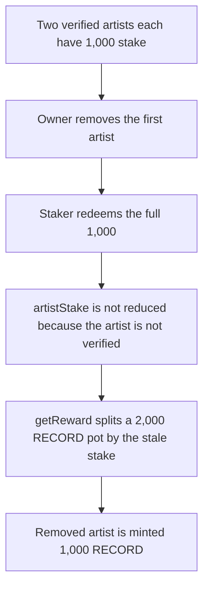

# Music Protocol: redeeming a removed artist still pays 1,000 RECORD

> **Vulnerability classes:** vuln/logic/reward-calculation

<!-- non-defihacklabs -->
<!-- source-auditvault: https://github.com/Auditware/AuditVault/blob/main/findings/59402-redeeming-does-not-discount-tokens-of-removed-artists-leadin.md -->
<!-- date: 2024-02 -->


`redeem` calls `_calcSinceLastPosition` only while the artist is still verified. After `removeArtist`, a full redeem zeroes the user's stake and leaves `artistStake` at 1,000. A 2,000 RECORD pot split by stake therefore mints 1,000 RECORD to the removed artist. The still-verified artist, who also has 1,000 stake, should have received the whole pot.

```solidity
if (live) {
    _calcSinceLastPosition(artist, _stake[artist][user].amount, false);
}
if (!live) skippedRedeem += _stake[artist][user].amount; // @> VULN
```

## Diagrams



## Impact

The removed artist receives 1,000 RECORD. Their `artistStake` is still 1,000. The fixed redeem subtracts the stake even after removal, so that artist is minted 0 and the active artist receives the full 2,000 RECORD.

## PoC

```bash
cd 59402-redeeming-does-not-discount-tokens-of-removed-artists-leadin_exp
forge test -vv
```

