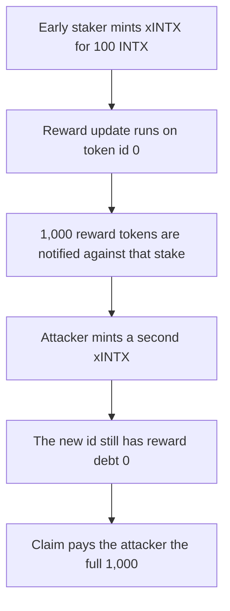

# IntentX: minting xINTX updates reward token id 0 and the new stake takes 1,000

> **Vulnerability classes:** vuln/logic/reward-calculation

<!-- non-defihacklabs -->
<!-- source-auditvault: https://github.com/Auditware/AuditVault/blob/main/findings/59428-incorrect-reward-updates-upon-xintx-minting-quantstamp-inten.md -->
<!-- date: 2024-05 -->


`_stake` declares `uint256 _tokenId` and calls `_updateReward(_tokenId)` before assigning it, so the update runs on token id 0. The new xINTX position keeps `rewardDebt` of 0. An early staker deposits 100 INTX. 1,000 reward tokens are then notified. A later mint of another 100 INTX claims that entire 1,000 because its debt was never set to the accumulator.

```solidity
function _updateReward(uint256 tokenId) internal {
    updates += 1; // @> VULN: tokenId is 0 on mint
    rewardDebt[tokenId] = (staked[tokenId] * accRewardPerToken) / 1e18;
}
```

## Diagrams



## Impact

The later minter receives 1,000 reward tokens. The staking contract's reward balance is 0, so the early staker cannot be paid. The fixed mint sets `rewardDebt` to the current accumulator after the stake is recorded. The later mint then claims 0 and the early staker claims the 1,000.

## PoC

```bash
cd 59428-incorrect-reward-updates-upon-xintx-minting-quantstamp-inten_exp
forge test -vv
```

